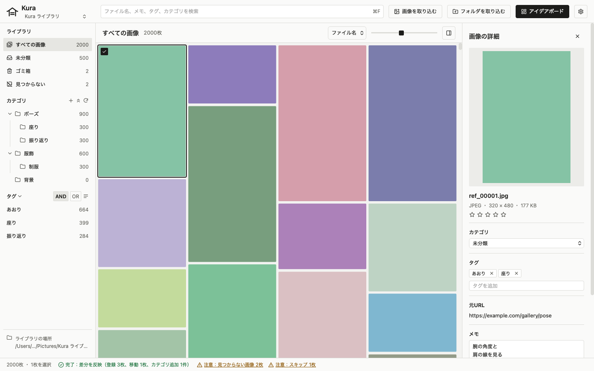

# Kura

Kura（蔵）は、イラスト制作用の参考画像をパソコンの中だけで取り込み、整理し、探すための個人用の macOS アプリです。外部のサービスを使わないので、サービスの規約や判断で資料を失うことがありません。



スクリーンショットは、モックの画面にダミーのデータを出したものです。サムネイルは色の塗りつぶしで写っています。

## できること（フェーズ1）

- ライブラリ（画像を置くフォルダ）を作る・開く。画像は普通のフォルダに普通のファイルとして置くので、Kura がなくても Finder で開ける
- 画像やフォルダを取り込む。フォルダの構成はカテゴリとして再現する。中身が同じ画像は重複として取り込まない
- カテゴリ（フォルダに対応）とタグで分類する。複数の画像にまとめて設定できる
- 縦横比を保った一覧で見る。並べ替え、サムネイルの大きさの変更、拡大表示ができる
- カテゴリ、タグ（AND・OR）、ファイル名、メモで絞り込む
- メモと評価（星5段階）を付ける
- アプリ内のゴミ箱。空にするまで元に戻せる
- Finder でした変更（画像の追加・移動・削除）を検出して反映する
- 管理情報（データベース）をバックアップ用に書き出す
- 主な操作のキーボードショートカット

使い方は [ユーザーガイド](docs/user-guide.md) を見てください。

## まだできないこと

フェーズ2以降で作る予定です。詳しくは [要件定義書](docs/requirements.md) の「開発フェーズと優先度」を見てください。

- フェーズ2：作画中に画像を自由に並べるボード（お絵描きモード）、最前面表示、ダウンロード元の URL の記録
- フェーズ3：ポーズ、構図、内容が似た画像の検索
- フェーズ4：検索条件の保存（スマートフォルダ）、縦横比や追加した日での絞り込み、クリップボードからの取り込みなどの改善
- フェーズ5：画像以外の資料（CLIP STUDIO PAINT の .clip、フォント、動画）

## 動く環境

- macOS（Apple シリコン）。Windows には対応しない
- ライブラリは、内蔵ディスクか外付けドライブ（APFS、HFS+、exFAT）に置く。iCloud Drive とネットワークドライブは動作を保証しない。選ぶと警告が出る

## インストール

1. [Releases](https://github.com/kk6/kura/releases) から、最新の版の `Kura-<版>-arm64.zip` をダウンロードする
2. zip をダブルクリックして展開し、できた `Kura.app` を「アプリケーション」フォルダに移す
3. `Kura.app` を開く

Kura は Apple の開発者の署名と公証を受けていません。そのため、初めて開くときに macOS が「開発元を確認できない」などと表示して止めます。次のどちらかの方法で開きます。一度開けば、次からは普通に開けます。

- Finder で `Kura.app` を右クリック（control キーを押しながらクリック）し、「開く」を選ぶ。確認が出たら「開く」を押す。macOS 15 以降ではこの方法で開けないので、次の方法を使う
- 一度開こうとして止められたあと、システム設定の「プライバシーとセキュリティ」を開く。下の方にある Kura の表示の横の「このまま開く」を押し、確認が出たら「開く」を押す

版ごとの変更は [CHANGELOG.md](CHANGELOG.md) にあります。ソースからビルドするときは、下の「開発の始め方」を見てください。

## 開発の始め方

### 必要なもの

- Node.js（CI は 24 を使う）
- Rust（stable）と、Tauri 2 の macOS の前提（Xcode の Command Line Tools）
- uv（Python の環境管理。ダミーライブラリの生成に使う）

### 準備と起動

```bash
npm install
```

```bash
npx playwright install webkit
```

`npm install` は、コミット前に整形と検査を流すフック（lefthook）も入れます。

| コマンド | すること |
| --- | --- |
| `npm run tauri dev` | アプリを開発用に起動する。Rust を最適化せずにビルドするので、取り込みが遅い（1枚1秒以上） |
| `npm run dev:mock` | Tauri のコマンドをモックに差し替えた画面だけを http://localhost:5173 で開く |
| `npm run dev-library -- <枚数>` | ダミー画像のライブラリを `dev-library/` に作る |
| `npm run tauri build` | リリース用にビルドする。`.app` は `src-tauri/target/release/bundle/macos/` にできる |

`npm run tauri dev` で起動すると、「Kura について」やウィンドウの切り替えのアイコンがファイルの絵になります。`.app` では正しく出ます。

開発やテストに、本物の資料フォルダを使わないでください。`npm run dev-library` で作ったダミーのライブラリを使います。

テスト、Lint、整形のコマンドと、開発の決まりは [CLAUDE.md](CLAUDE.md) にまとめています。

### ドキュメントのスクリーンショット

`docs/images/` のスクリーンショットは、次のコマンドで撮り直します。モックの開発サーバーを開いて撮るので、ポート 5173 を空けておいてください。

```bash
npm run docs:screenshots
```

## ドキュメント

| ファイル | 中身 |
| --- | --- |
| [docs/user-guide.md](docs/user-guide.md) | ユーザーガイド。アプリの使い方 |
| [CHANGELOG.md](CHANGELOG.md) | 版ごとの変更 |
| [docs/requirements.md](docs/requirements.md) | 要件定義書。機能要件（FR-xxx）と非機能要件（NFR-xx）、開発フェーズ |
| [docs/design.md](docs/design.md) | 画面のデザインの決まり |
| [CLAUDE.md](CLAUDE.md) | 開発の決まりとコマンドの一覧 |

## ライセンス

[MIT](LICENSE)
