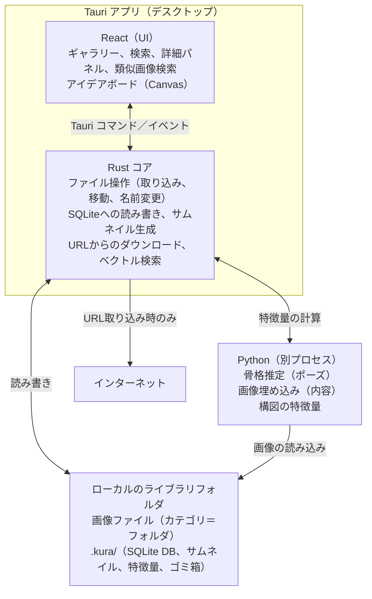

# Kura 要件定義書

最終更新：2026-11-19

本書には、アプリが何をするかを書きます。判断の理由と比べて却下した案は [ADR](adr/README.md) に、用語は [用語集](../GLOSSARY.md) にあります。決まったことは、何をするかを本書に、理由を ADR に書き戻します。

## 1. 背景と目的

Kura（蔵）は、イラスト制作用の参考画像を手元のPCだけで集め、整理し、作画中に参照するための個人用ツールです。

### 背景

- これまでポーズや構図の参考資料はPinterestで集めていた。
- Pinterestでは、ピンした画像が後日アダルトコンテンツとして削除されると、ピンしただけの利用者にもペナルティが課される。
- 削除対象の画像は、見た目では問題がわからないものも多い。Pinterest自身がおすすめしてきた画像でも対象になる。
- この仕組みにより、アカウントが過去に何度も停止された。集めた資料もアカウントと一緒に失われた。
- 現在は、資料をFinderのフォルダで整理している。

### 目的

1. 参考資料を外部サービスの規約や判断に左右されずに保持する。
2. 資料をカテゴリとタグで整理し、必要な画像をすぐに見つけられるようにする。
3. 作画中に複数の参考画像を一画面に並べ、自由に動かして参照できるようにする。

## 2. スコープ

本アプリは、参考資料の取り込み・整理・検索・作画中の参照の4つを扱います。新しい画像と出会うための発見機能は持ちません。

### 対象とする範囲

- ローカル画像の取り込み（ブラウザでダウンロードした画像の元URLの記録を含む）。画像URLからの取り込みはフェーズ5まで保留する（5.3）
- カテゴリ（フォルダに対応）とタグによる分類
- 一覧性の高いギャラリー表示と、条件による絞り込み
- ギャラリー内での類似画像検索
- アイデアボード：複数画像を自由に配置するボード
- 画像以外の資料（CLIP STUDIO PAINT の .clip、フォント、動画）の管理と表示。種類ごとに別のライブラリで管理する（フェーズ5。5.8）

### 対象外

- 他の利用者との共有、公開、SNS機能
- おすすめ画像の提示などの発見機能
- クラウド同期と複数端末での利用
- 画像の編集（トリミングや色調整を除く加工全般）
- ウェブページからの一括収集（スクレイピング）

### 参考にする既存ツール

| ツール | 参考にする点 |
| --- | --- |
| Eagle | ライブラリの整理方法、一覧画面、タグ付け、作業中の参照 |
| PureRef | アイデアボードの操作（自由配置、拡大縮小、最前面表示） |

## 3. 利用者と利用シーン

利用者は作者本人のみです。趣味で美少女イラストを描き、ポーズや構図の参考に主に写真を集めています。利用環境はmacOSを想定します。

| シーン | 利用者がすること | 使う機能 |
| --- | --- | --- |
| 資料を集める | ブラウザで見つけた画像を Chrome の拡張機能でダウンロードし、ドラッグ＆ドロップで取り込む | 取り込み |
| 資料を整理する | 未分類の画像にカテゴリとタグをまとめて付ける | 分類、複数選択 |
| 資料を探す | 「座り」「振り返り」などのタグで絞り込む。気になる画像に似たポーズの画像を探す | 一覧、検索、類似画像検索 |
| 作画中に参照する | 使う画像をボードに並べ、描画ソフトの横に置いて見る | アイデアボード |
| 元の画像を確認する | 取り込んだ画像の元URLを開く | 画像詳細 |

## 4. システム構成方針

本アプリは、Tauri（Rust）とReactで作るデスクトップアプリとして実装します。画面はウェブ技術で作り、ファイル操作などOSに関わる処理はRustが担当します。機械学習の処理はPythonの別プロセスが担当します。ブラウザで開くローカルウェブアプリにはしません（[ADR-0001](adr/0001-desktop-app-with-tauri.md)）。



Rustコアだけがライブラリに書き込みます。Pythonは画像を読んで特徴量を返すだけで、ファイルもDBも変更しません。

| 領域 | 採用する技術 |
| --- | --- |
| アプリ基盤 | Tauri 2 |
| 画面 | React + TypeScript |
| データ保存 | SQLite |
| 機械学習 | Python（uvで環境管理） |
| ベクトル検索 | 全件比較（Rust）。2秒（NFR-03）を超えたときだけ sqlite-vec を検討する（[ADR-0016](adr/0016-siglip2-for-content.md)） |

技術を選んだ理由は [ADR-0001](adr/0001-desktop-app-with-tauri.md) にあります。

### 実装方針

技術的に確かでない点は、使い捨てのプロトタイプ（`spikes/`）で確かめてから本体に入れました。試した方法と計測の結果は各スパイクの README に、選んだ理由は ADR にあります。

**Pythonの処理の同梱**（[ADR-0002](adr/0002-ml-worker-onedir-bundle.md)、[ADR-0003](adr/0003-start-worker-on-demand.md)）

- PythonのワーカーはPyInstallerのonedirの形でビルドし、Tauriの `bundle.resources` で `.app` に同梱する。Rustから標準の `std::process::Command` で起動する
- ワーカーは、計算する画像があるときだけ起動し、未計算がなくなったら終了させる。標準入力と標準出力で1行1件のJSONをやりとりする。ワーカーは標準入力が閉じると終わるので、アプリがどう終わっても残らない
- 利用者がuvやPythonをインストールする必要はない。uvは開発とビルドのときだけ使う

**一覧の仮想スクロール**（NFR-01、[ADR-0004](adr/0004-own-virtual-masonry.md)）

- 一覧はライブラリを使わずに自前で作る。DBに保存した幅と高さから全体の配置を先に計算し、列ごとの二分探索で表示範囲を求め、表示範囲と上下1画面分だけを描く
- サムネイルは `.kura/` の下のファイルを、Tauriのアセットプロトコルで直接読む。読み込み範囲（scope）は開いたライブラリの中に絞り、パスは正規化してから渡す。本体で読める範囲は5.5の「一覧の細部」にある
- 計測の結果は `spikes/masonry-scroll/README.md` にある

**移動の途中で止まった場合**（NFR-06、[ADR-0005](adr/0005-crash-safe-file-move.md)）

- ファイルを動かす操作（移動、名前変更、カテゴリのフォルダの移動・名前変更、ゴミ箱への移動と復元）は、次の3段階で行う
  1. 移動の予定を `pending_ops` に記録してコミットする
  2. 上書きしない名前変更（`renamex_np` の `RENAME_EXCL`）でファイルを移す
  3. 画像の情報の更新と予定の削除を、1つのトランザクションでコミットする
- 起動時に、残っている予定を実ファイルの位置に合わせて完了させるか取り消す。どちらとも決められない場合は予定を残して利用者に知らせる
- exFATでは `RENAME_EXCL` が使えないので、移動先がないことを確かめてから通常の rename をする。HFS+ と大文字・小文字を区別する APFS では `RENAME_EXCL` を使う
- exFATでは、存在の確認が大文字・小文字を区別しないので、大文字・小文字だけの名前変更は一時的な名前（移動先のフォルダの `.kura-tmp-<予定のid>`）を経由する。後始末では、一時的な名前が残っていれば移動元に戻す（コピーなら消す）
- `pending_ops` の移動元と移動先は、ライブラリのルートからの相対パスで記録する。外付けドライブのマウント先が変わっても後始末できるようにするため

**類似画像検索のモデルと特徴量**（FR-601、FR-605、NFR-03、NFR-11）

- 内容は、SigLIP 2（`google/siglip2-base-patch16-224`、Apache-2.0）の画像側の ONNX（768次元）を ONNX Runtime の CPU で動かす（[ADR-0016](adr/0016-siglip2-for-content.md)）
- 構図は、縮めたグレースケール画像（16×16）と、格子ごとのエッジの向きの分布（4×4の格子、8方向）で作る。類似度は2つの平均にする。学習済みモデルは使わない（[ADR-0017](adr/0017-composition-without-learned-model.md)）
- ポーズは、人物の枠を YOLOX-tiny で出し、枠ごとに RTMPose-m で関節を出す。前後処理は NumPy と Pillow で書く（[ADR-0019](adr/0019-rtmpose-m-for-pose.md)）
- どの観点も、サムネイルから1スレッドで計算する（[ADR-0018](adr/0018-features-from-thumbnails-single-thread.md)）
- 観点ごとの類似度のそろえ方は5.6の「重み」にある
- 元が同じ画像（FR-610、FR-611）のしきい値は、内容のそろえる前のコサイン類似度で 0.98 にする（5.6 の「元が同じ画像の整理」。2026-11-23 に写真の計測から 0.90 にし、2026-11-25 に利用者のライブラリでの計測から利用者が 0.98 に上げた）
  - 0.98 にした理由：利用者のライブラリ（イラストを主に 67,836枚）では、0.90 以上の2枚が約1,504万組（全部の組み合わせの約0.65%）あり、つないだ組の1つが 51,099枚になった。見た目が同じ2枚（類似度 0.991）もこの組に埋もれ、見つけられなかった。絵柄の近いイラストどうしは、写真どうしより類似度が高く出る（推測）。しきい値ごとの一番大きい組は、0.93 で33,492枚、0.95 で8,931枚、0.97 で1,608枚、0.98 で93枚、0.99 で37枚。2〜3枚の組は、0.98 で4,265個、0.99 で3,523個（2026-11-25）。測り方は `scripts/origin_group_sizes.py`。2枚の類似度は `scripts/pair_similarity.py` で測った
  - 0.98 では、トリミングや色味を変えた写しの多くを拾わない（下の写真の計測で、トリミング 90% の中央値が 0.979、彩度 0.6倍の下から5%が 0.980）。それらは「似た画像を探す」の結果から選んでまとめる（FR-610。しきい値を使わない）
  - 写真での測り方（0.90 を決めたとき）：見本の写真 231枚から `scripts/gen_same_origin.py` で写しを作り、隔離した実アプリ（リリース版）に取り込んで計算させた `features.db` の値を `scripts/measure_same_origin.py` で集めた。中身が同じ写真の3組は、別の写真どうしから外した。Pillow で真似たサムネイルでは、同じ画像でも 0.90〜0.96 まで下がるので使わない
  - 元の写真との類似度（各231組。最小 / 下から5% / 中央値）：縮小 1/2 は 0.964 / 0.996 / 0.999、縮小 1/4 は 0.913 / 0.991 / 0.998、トリミング 90% は 0.916 / 0.954 / 0.979、トリミング 75% は 0.882 / 0.911 / 0.960、彩度 0.6倍は 0.966 / 0.980 / 0.993、彩度 1.4倍は 0.975 / 0.988 / 0.995、明るさ 0.8倍は 0.950 / 0.985 / 0.994、明るさ 1.2倍は 0.920 / 0.968 / 0.992、JPEG の再圧縮（品質50）は 0.970 / 0.992 / 0.998。トリミングは中央でなく隅に寄せて切った
  - 別の写真どうし（26561組）：中央値 0.597、上から1%は 0.827、上から0.1%は 0.900、最大 0.967。上位は、ほとんどが同じ撮影者の続きのカットだった
  - 写真の計測では、0.90 で、変形2079件のうち3件（どれもトリミング 75%。0.882、0.895、0.895）を取りこぼし、別の写真の27組（0.10%）を組にする。同じ撮影者の続きのカットが組に入ることがあり、組を整理するときに利用者が確かめる
  - 第2のしきい値 0.85 は、変形の最小値（0.882）を下回り、変形をすべて拾う。別の写真の組は、0.88 で46組、0.85 で115組（0.43%）、0.80 で556組（2.09%）、0.75 で1438組（5.41%）に増える。第2のしきい値は名前が写しの形の2枚だけに使うので、組になる別の写真はこれよりずっと少ない
  - ライブラリ全体から組を探す（FR-611）時間：2万件・768次元のダミーの特徴量（features.db から読む時間を含む）で 1.06〜1.40 秒（2026-11-24、Apple M5 Max、18スレッドで並べて比べる。リリースビルド）。測り方は `src-tauri/src/origin.rs` の `元が同じ画像の組の2万件の計測`（`cargo test --release 元が同じ画像の組の2万件の計測 -- --ignored --nocapture`）
- 計測の結果は `spikes/similarity/README.md` と `spikes/pose/README.md` にある

## 5. 機能要件

機能は8つのグループに分けます。優先度は、Must（初回リリースに必須）、Should（できれば初回に入れる）、Could（後のフェーズでよい）の3段階です。

### 5.1 ライブラリ管理

| ID | 要件 | 優先度 |
| --- | --- | --- |
| FR-101 | 利用者はライブラリのルートフォルダを新規作成できる。また、作成済みのライブラリ（`.kura/` があるフォルダ）を開ける | Must |
| FR-102 | アプリはライブラリの管理情報（DB、サムネイル、特徴量）をルートフォルダ内の専用フォルダに保存する | Must |
| FR-103 | 利用者は、ライブラリでない既存フォルダをそのままライブラリのルートにできる。アプリは配下の画像とサブフォルダを走査し、サブフォルダをカテゴリとして登録する | Should |
| FR-104 | アプリは起動時と手動操作時に、DBと実際のファイルの差分（追加・削除・移動）を検出して反映する。ファイルの常時監視はしない | Must |
| FR-105 | 利用者は複数のライブラリを作成し、切り替えて使える | Could |
| FR-106 | 利用者は、ライブラリ選択画面の「最近使ったライブラリ」から、見つからないライブラリを一覧から外せる。ライブラリのフォルダは変えない | Could |
| FR-107 | 利用者は、書き出した管理情報（NFR-07）をアプリの中で選び、今のライブラリの管理情報をそれに戻せる。アプリは戻す前に、今の `kura.db` の写しを残す | Should |
| FR-108 | 差分検出で「登録しなかったファイル」のうち対応していない形式のファイル（動画など）を、利用者はルート直下の `_未対応ファイル/` フォルダへまとめて移せる。設定で ON にすると、アプリは差分検出のたびに自動で移す（フェーズ4b。2026-11-23、利用者の要望） | Could |
| FR-109 | 差分検出で重複として「登録しなかったファイル」について、利用者は、同じ画像のうちどのカテゴリにある1枚を残すかを選び、ほかをゴミ箱に移せる（フェーズ4b） | Should |

複数のライブラリの切り替え（FR-105）は、次の最小限だけを作ります（[ADR-0008](adr/0008-minimal-library-switching.md)）。

- メニューバーの「ファイル」の「ライブラリを切り替える…」（⇧⌘O）で、ライブラリ選択画面へ戻る。選択画面の作る・開く・最近使ったライブラリは、起動時と同じものを使う
- さっきまで開いていたライブラリは「最近使ったライブラリ」の先頭に出るので、そこから開き直す。選択画面に「キャンセル」は置かない
- 取り込みと差分検出の途中では戻らず、終わってから選び直すようダイアログで知らせる。アプリ内のダイアログ（設定など）を開いている間は、ほかのショートカットと同じく効かない
- 入力中のメモは、戻る前に保存する。選択と絞り込みは捨て、開き直すと初期の状態になる
- 開いていたライブラリは、次のライブラリを開くまで Rust 側に開いたまま残す
- 一度に開けるライブラリは1つ。フェーズ2では同じライブラリのアイデアボードだけを別ウィンドウで開ける（5.7）
- ヘッダーのライブラリ名を押すとメニューを出す。メニューには「最近使ったライブラリ」を出し（今開いているものに印を付ける）、選ぶと選択画面を通らずにそのライブラリへ切り替える。区切り線の下の「ほかのライブラリを開く…」は、メニューバーの「ライブラリを切り替える…」と同じく選択画面へ戻る。取り込み中の扱いとメモの保存は、選択画面へ戻るときと同じにする

フェーズ2でのライブラリ管理（[ADR-0008](adr/0008-minimal-library-switching.md)）：

- FR-105 は既存の切り替えと、ボード・入力中のメモの保存完了を待つ処理までとする。ヘッダーから直接切り替える場合も、選択画面に戻る場合も、保存失敗時は切り替えを中止する（5.7）。複数ライブラリの同時表示、ライブラリ間の画像・ボードの移動やコピーは含めない
- FR-106 をフェーズ2に入れる。ライブラリ選択画面で、見つからない項目に「一覧から外す」を出す。確認なしで履歴だけから外し、フォルダや中身は変更しない。必要なら「ライブラリを開く」で選び直せる。外付けドライブが一時的に外れている場合もあるため、自動では外さない

差分を見つけたとき（FR-104）、アプリは次のように動きます。

- 新しいファイル：取り込みと同じ扱いで登録する。重複していれば登録せず、一覧で知らせる（FR-204）
- 新しいフォルダ：カテゴリとして登録する
- 見つからないファイル：DBの行は消さず「見つからない」状態にする。タグやメモを失わないため。利用者は見つからない画像だけを一覧で表示し、DBから外せる
- 移動・名前変更：見つからない画像と同じハッシュのファイルが別の場所にあれば、同じ画像の移動とみなしてカテゴリとファイル名を更新する
- ファイルサイズと更新日時がDBと同じファイルは、ハッシュを計算し直さない

常時監視をしない理由は [ADR-0007](adr/0007-diff-detection-without-watching.md) にあります。

差分検出の細部は次のとおりです。A・B の理由は [ADR-0007](adr/0007-diff-detection-without-watching.md) にあります。

- ライブラリを開いた後と、サイドバーの「差分を確認」ボタンを押したときに行う。結果はステータスバーに出し、スキップしたものは取り込みと同じ一覧で知らせる
- ライブラリを開いたら、DB の一覧を先に出してから差分検出を始める。中身を読むファイル（新しいファイルと、サイズか更新日時が変わったファイル）を1枚処理するごとにロックを外し、ステータスバーに「Finder での変更を反映中 N / M枚」と進み具合のバーを出す。その間も一覧を見て操作できる。取り込みは差分検出が終わるまで受け付けない。その間と取り込み中は、ヘッダーの取り込みのボタンの代わりに処理中の表示（`docs/design.md`）を出す。新しい画像が多いと、終わるまで画面が固まって見えるため
- 名前は NFC にそろえて DB と比べる。exFAT と FAT32 では、フォルダの一覧の名前が NFD で返るため。フォルダは大文字・小文字だけが違えば同じカテゴリとみなし、カテゴリ名を Finder の名前に合わせる
- 隠しファイル（`.` で始まるもの）と `.kura/` は見ない。シンボリックリンクはたどらない
- ライブラリの直下の画像と、`_未分類/` の下のフォルダは登録せず、スキップの一覧で知らせる。カテゴリ名に使えない名前のフォルダ（`_未分類` など）も同じ
- A. カテゴリのフォルダがなくなった（Finder で削除・名前変更・移動した）ときは、カテゴリを子孫ごと消す。中の画像のうち、同じハッシュのファイルが別の場所にあるものは移動として扱う。残りの画像は未分類にして「見つからない」状態にする。ゴミ箱の画像は、カテゴリの削除（FR-404）と同じく元のカテゴリが消えた印を付ける
  - 「フォルダがない」と判断するのは、そのフォルダを調べて NotFound になったときだけにする。権限などで読めないだけのフォルダは、カテゴリを消さず、中の画像も「見つからない」にしない。読めなかったフォルダはエラーとして一覧で知らせる。外付けドライブの一時的な不調で、カテゴリや画像の状態をまとめて変えないため
- B. 同じ場所のファイルの中身が変わった（サイズか更新日時が違い、ハッシュも違う）ときは、同じ画像として行を更新する。ハッシュ、幅、高さ、ファイルサイズ、更新日時、代表色、サムネイルを新しくし、タグとメモは残す。新しい中身が別の画像（ゴミ箱を含む）と同じなら更新せず、古い行を「見つからない」にして、そのファイルは重複として一覧で知らせる
- 更新日時は DB の値と完全に一致するかで比べる。DB の値は同じボリュームで読んだ値なので、exFAT（10ミリ秒刻み）や FAT32（2秒刻み）でも、ファイルが変わらなければ一致する。別のボリュームへライブラリを写して一致しなくなっても、ハッシュを計算し直して同じなら、サイズと更新日時だけを更新する
- 新しいファイルの重複（FR-204）は、ゴミ箱の画像を含めて判定する。「見つからない」画像と同じハッシュなら、重複ではなく移動とみなす。取り込みの例外（未分類の画像を取り込み先へ移す）は使わない。ファイルはすでにライブラリの中にあり、利用者が置いた場所を変えないため
- 対応していない形式のファイルは、取り込みと同じくスキップの一覧で知らせる
- 未対応のファイルと重複の整理（FR-108、FR-109。フェーズ4b。2026-11-23、利用者と決めた）
  - 設定の「一般」に「差分検出で、対応していない形式のファイルを `_未対応ファイル/` へ移す」を置く。アプリ全体の設定で、初期値は OFF
  - ON の間は、差分検出のたびに対応していない形式のファイルを `_未対応ファイル/` へ移し、移したファイルと枚数をスキップの一覧で知らせる。OFF の間は、スキップの一覧から利用者がまとめて移せる
  - 移し方は `pending_ops` の3段階に乗せる。移す先で名前が衝突したら連番を付ける
  - `_未対応ファイル/` はカテゴリにせず、差分検出でも見ない。中のファイルは次の差分検出でスキップの一覧に出ない
  - 取り込み（ライブラリの外からのコピー）では写さない。今までどおりスキップの一覧で知らせるだけにする。移すのは、すでにライブラリの中にあるファイルだけ
  - 重複として登録しなかったファイル（FR-109）は、スキップの一覧の行に「整理…」を置く。ダイアログで、登録済みの画像と登録しなかったファイルのどちらの場所（カテゴリ）に残すかを選ぶ。中身が同じなので、タグを合わせる操作は要らない。「1枚にまとめる」（5.6）とは別のダイアログにする
  - 登録しなかった側を残すときは、登録済みの画像をそのカテゴリへ移す（FR-402 と同じ移し方）。どちらを残しても、残らない方のファイルはゴミ箱へ移す
  - 登録しなかったファイルは DB に行を作れない（中身が登録済みの画像と同じで、ハッシュが重なる）。そのため DB の行を作らず、`.kura/` のゴミ箱の下の別のフォルダへ移すだけにする。アプリのゴミ箱の一覧には出さず、元に戻す操作もない。「ゴミ箱を空にする」で一緒に消す。アプリのゴミ箱が0枚の間は「ゴミ箱を空にする」を押せないので、そのまま残す。中身は残した画像と同じなので、失うものはない（2026-11-23、利用者と決めた）
  - スキップの一覧は保存しないので、「整理…」を使えるのは差分検出の直後だけにする
- 見つからなかった画像のファイルが元の場所に戻れば、「見つからない」状態を外す
- 「見つからない」画像は通常の一覧とサイドバーの件数に出さない。サイドバーの「ゴミ箱」の下に「見つからない」と枚数を出す（1枚以上のときだけ）。押すと一覧が見つからない画像になり、詳細パネルの場所に「一覧から外す」を出す。外すのは取り消せないので、枚数を見せて確認する。外すと、DB の行（タグの付き方と元URLを含む）とサムネイルを消す
- 差分検出は画像のファイルを動かさず、DB とサムネイルだけを書き換える。そのため画像の登録と更新には `pending_ops` を使わない。例外は、設定で ON にしたときに対応していない形式のファイルを `_未対応ファイル/` へ移すこと（FR-108）で、この移動だけは `pending_ops` の3段階に乗せる

ライブラリの作成と開き方（FR-101、NFR-13）は次のとおりです。

- 新規作成では、空のフォルダ（`.DS_Store` だけがあるフォルダを含む）だけを受け付ける。中身のあるフォルダをライブラリにするのは FR-103 にあたるため。作成の途中で失敗したら、アプリが作った `.kura/` と `_未分類/` を消して元の状態に戻す
- 起動時は、最近使ったライブラリの先頭を開く。開けなければ、ライブラリ選択画面にエラーを出す
- 最近使ったライブラリの一覧は10件までにする。見つからないライブラリも一覧から自動では消さない（外付けドライブが一時的に外れているだけのことがあるため）。利用者が一覧から外す操作は FR-106 で作る
- iCloud Drive とネットワークドライブの警告は、利用者がダイアログでフォルダを選んだときに出し、続けるかやめるかを選んでもらう。最近使った一覧から開くときは出さない
- DBがアプリより新しい版（`user_version` がアプリの知っている版より大きい）なら、DBを変更せずにエラーにする

### 5.2 画像の取り込み

| ID | 要件 | 優先度 |
| --- | --- | --- |
| FR-201 | 利用者はファイル選択ダイアログ、またはドラッグ＆ドロップでローカル画像を取り込める（複数ファイル、フォルダごとの指定も可）。フォルダごと取り込む場合、アプリはサブフォルダをカテゴリとして再現する | Must |
| FR-202 | 対応形式はJPEG、PNG、WebP、GIF（静止画として扱う。アニメーションの再生はフェーズ5の FR-801 で見直す）とする。HEIC、AVIF、TIFFなどは対象外とし、利用者が取り込む前にJPEGなどへ変換する（今の資料にHEICがないことは確認済み） | Must |
| FR-203 | 取り込み時、アプリは画像をライブラリ内へコピーする。元ファイルはそのまま残す。コピーしたファイルには元ファイルの更新日時を引き継ぐ | Must |
| FR-204 | アプリはファイルの中身のSHA-256で重複を検出する。同じ画像がライブラリ（ゴミ箱を含む）にある場合は取り込まずにスキップし、取り込みの終了後にスキップした画像を一覧で知らせる。一覧から既存の画像へ移動できる。同じ取り込み操作の中に同じ画像が複数ある場合は、最初の1枚だけを取り込む | Must |
| FR-205 | 取り込み時、アプリはサムネイルを生成し、幅・高さ・ファイルサイズ・代表色を記録する | Must |
| FR-206 | 利用者はクリップボードの画像を貼り付けで取り込める | Should |
| FR-207 | 利用者は取り込み時に、カテゴリとタグをあらかじめ指定できる | Should |
| FR-208 | 取り込むファイルにダウンロード元の記録（macOS の `kMDItemWhereFroms`）があれば、アプリはそれを元URLとして保存する | Should |

ダウンロード元の記録（FR-208）は次のとおりです（[ADR-0009](adr/0009-download-source-instead-of-url-import.md)）。

- 利用者は、ブラウザの拡張機能で画像をダウンロードしてから取り込む。アプリで URL を入力する手順より楽なため
- Chrome でダウンロードしたファイルには、1つ目に画像URL、2つ目に参照元のページの URL が記録される。1つ目を画像URL、2つ目を掲載ページURLとして `image_sources` に入れる。2つ目は記事のページではなく、サイトのトップのこともある
- 記録がないファイルは、今までどおり元URLなしで取り込む

フェーズ2での取得・補完・閲覧の細部：

- 通常の取り込みではコピー元から、差分検出で新しく登録する画像ではライブラリ内のファイルから記録を読む。重複として取り込みをスキップした場合は既存画像の元URLを変更しない
- 記録の1番目を画像URL、2番目を掲載ページURLとして個別に検査する。有効な HTTP・HTTPS のURLだけを保存し、一方が不正でも他方が有効なら保存する。項目を詰めて役割を入れ替えず、3番目以降は使わない。欠けたURLを推測しない
- 記録がない場合は元URLなしで通常どおり取り込む。記録の読み取り・解析に失敗しても画像の取り込みは続ける。失敗や不正な項目があれば、結果の注意に件数と対象を表示する。一部だけ取得できた場合も、その旨が分かるようにする
- URLの有効性やリンク切れを調べるための通信は行わない
- 詳細パネルの元URLを、下線付きのリンクにする。有効な掲載ページURLを優先し、なければ画像URLを使う。クリック時だけ、確認ダイアログなしで既定のブラウザに渡す。開く処理の失敗は詳細パネルに表示する。HTTP・HTTPS 以外や不正なURLはリンクにしない
- 元URLがない画像は「なし」と表示する。手入力・編集・削除はフェーズ2に含めない。手入力値と自動取得値の区別は、その機能を検討するときに決める
- 設定に「元URLを補完」を置く。現在のライブラリの元URLが未登録の画像だけを調べ、既存の元URLは上書きしない。一方でも登録済みなら対象外とする。取り込み前の元フォルダを探さず、現在のライブラリ内のファイルだけから読む。起動時の自動補完は行わない
- 補完は中断・再実行できる。処理の進み具合と、補完・記録なし・読み取り失敗・対象外の件数を表示する。ゴミ箱と「見つからない」画像は対象外とする。中断までに保存した情報は残し、再実行時は未登録の画像を再び調べる
- 補完中も閲覧・検索・ボード編集は続けられる。取り込み、差分検出、画像の名前変更・移動・削除（カテゴリ操作によるものを含む）、ライブラリ切り替えは補完の終了か中断まで待つ。取り込み・差分検出中は補完を開始できない

記録の読み方と元URLのリンクの細部：

- 記録の項目が空文字列のときは、欠けている項目として扱い、注意を出さない。Chrome は参照元がないダウンロードで2番目を空文字列にするため。項目が1つだけの記録も、画像URLだけを保存して注意を出さない
- 注意を出すのは、属性を読めない、plist として解析できない、1番目か2番目に不正な値（HTTP・HTTPS 以外、URL でない文字列、文字列でない値）がある、のどれかのとき。注意は、取り込みと差分検出の結果に「元URLの注意 N件」として、スキップやエラーとは別に出す
- 保存する URL は、URL として解析して正規化した文字列にする（ホスト名を小文字にする、など）
- 画像URLが不正で掲載ページURLだけが有効な記録を保存できるよう、`image_sources` の画像URLは空にできる。どちらも空の行は作れない
- 差分検出で読むのは、新しい画像として登録するファイルだけ。移動や中身の更新とみなしたファイルの記録では、既存の元URLを変えない
- 元URLを保存できなかったとき（DB のエラー）は、その画像の登録も取り消し、取り込めなかったファイルとして知らせる
- 詳細パネルのリンクを押すと、画面は画像の ID だけを Rust に渡す。Rust は DB の値を確かめ直してから、macOS の `open` に渡す。DB にある値が開けない値なら、リンクにせず文字として出す
- リンクは `<a>` 要素にしない。WebKit の右クリックの「リンクを開く」で、アプリのウィンドウ自身が外のページを読み込まないようにするため
- 「元URLの注意」の一覧の見出しは、既存の一覧と同じ「（N枚）」のままにする。ステータスバーの「N件」とは単位をそろえない

補完の細部：

- 対象外の件数は、元URLが一方でも登録済みの画像と、ゴミ箱と「見つからない」画像の合計にする。内訳は分けない
- 読み取り失敗は、記録を読めない・解析できない・保存できるURLがない画像。一方だけ有効で保存した画像は補完に数える。補完の結果には件数だけを出し、対象の一覧は出さない
- 補完の途中に始めた取り込み、差分検出、`with_library` を通る操作（画像とカテゴリのファイル操作、ゴミ箱、一覧から外す、バックアップの書き出し）、ライブラリ切り替えは、断らずに Rust 側で補完の終了か中断まで待ってから行う。待っている間、ステータスバーには補完の進み具合を出す
- 終了（⌘Q など）は補完を待たない。補完は1枚ごとに保存しているので、終了までに保存した元URLは残る
- 補完の結果は、設定を閉じても同じライブラリを開いている間は残し、設定を開き直すと見られる
- 最近使ったライブラリの「見つからない」の判定は、開くときと同じく、フォルダがないことにする。フォルダはあるが `.kura/` がない項目には「一覧から外す」を出さない

フォルダごと取り込む場合（FR-201）、アプリは次のように動きます。

- 取り込んだフォルダ自体を1つのカテゴリにする。フォルダ直下の画像はそのカテゴリに入る。サイドバーのカテゴリにドロップした場合は、そのカテゴリの下に作る
- 取り込み先に同名のカテゴリがすでにある場合は、新しく作らず既存のカテゴリに合流させる
- 空のサブフォルダもカテゴリとして作る
- 隠しファイル（`.` で始まるもの）は無視し、シンボリックリンクはたどらない
- 対応していない形式のファイルは取り込まず、取り込みの終了後に、重複でスキップした画像（FR-204）と同じ一覧で知らせる

取り込みの細部は次のとおりです。

- フォルダではなくファイルを選んだりドロップしたりした場合は、未分類に入れる（サイドバーのカテゴリにドロップした場合は、そのカテゴリに入れる）
- 同名かどうかは、名前の衝突と同じく正規化（NFC）と大文字・小文字の違いを無視して判定する
- カテゴリ名に使えない名前のフォルダ（`_未分類` など）、同名のカテゴリがなく Finder で作った同名のフォルダやファイルがある場所のフォルダ、読めないフォルダは、エラーとしてスキップの一覧に出し、中身は取り込まない。残りの取り込みは続ける
- 壊れていて読めない画像も、エラーとしてスキップの一覧に出す

重複のうち未分類にある画像の扱い（FR-204 の例外）は次のとおりです（[ADR-0010](adr/0010-move-unsorted-duplicates.md)）。

- 取り込み先がカテゴリで、同じ中身の画像が未分類にあれば、スキップせずにその画像を取り込み先のカテゴリへ移す（ファイルも移す。4章「移動の途中で止まった場合」の手順）。タグとメモはそのまま残る
- 同じ画像が別のカテゴリにある場合と、ゴミ箱にある場合は、今までどおり重複としてスキップする。利用者が整理した場所を取り込みで変えないため
- 移した枚数は、取り込んだ枚数とは別にステータスバーに出す
- 取り込みは1枚ずつ順に行う。取り込み中にファイルを選んだりドロップしたりしても、受け付けない

1枚の取り込み（FR-202〜FR-205）の細部は次のとおりです。

- 形式は拡張子ではなく、ファイルの中身（先頭のバイト列）で判定する。形式は対応していても壊れていて読めない画像は、取り込まずにエラーとして知らせる
- 幅と高さは、Exif の向きを反映した表示上の値を記録する
- サムネイルは幅320pxの JPEG（幅が320px以下の画像は拡大しない）で、`.kura/thumbs/<SHA-256>.jpg` に置く。透明な部分は白に重ねる
- 代表色は、サムネイルの平均の色（`#rrggbb`）とする
- コピーした後、DB に登録する前に止まった取り込みは、起動時の後始末でファイルを残して予定だけを消す。そのファイルは差分検出（FR-104）が新しいファイルとして登録する

### 5.3 URLからの取り込み

この節の機能はフェーズ5まで保留する（[ADR-0009](adr/0009-download-source-instead-of-url-import.md)）。元URLは FR-208 で記録する。作るかどうかと、どの形で作るかは10章で決める。

| ID | 要件 | 優先度 |
| --- | --- | --- |
| FR-301 | 利用者が画像URLを入力すると、アプリは画像をダウンロードしてライブラリに取り込む | Must |
| FR-302 | アプリは画像URLを元URLとして画像情報に保存する | Must |
| FR-303 | 利用者は画像URLとは別に、掲載ページのURLを任意で入力して保存できる | Should |
| FR-304 | URLの先が画像でない場合や取得に失敗した場合、アプリは理由を表示し、画像を登録しない | Must |
| FR-305 | 利用者は複数のURLを改行区切りでまとめて入力できる | Could |
| FR-306 | ブラウザの画像をアプリへドラッグ＆ドロップした場合、アプリは取得できた元URLを保存する | Could |

### 5.4 分類（カテゴリとタグ）

カテゴリはフォルダに1対1で対応し、画像1枚は1つのカテゴリに属します。タグはファイルの置き場所とは関係なく、画像1枚に複数付けられます。

同じ画像を複数のカテゴリに入れることはできません。複数の分類に入れたい場合はタグを使います。理由は [ADR-0006](adr/0006-no-relative-path-in-db.md) にあります。

| ID | 要件 | 優先度 |
| --- | --- | --- |
| FR-401 | 利用者がカテゴリを作成すると、アプリはルートフォルダ配下に対応するフォルダを作る。カテゴリは入れ子にできる | Must |
| FR-402 | 利用者が画像にカテゴリを設定すると、アプリは画像ファイルをそのフォルダへ移動する | Must |
| FR-403 | 利用者がカテゴリ名を変更すると、アプリは対応するフォルダ名も変更する | Must |
| FR-404 | 利用者はカテゴリを削除できる。子カテゴリもまとめて削除し、配下の画像はすべて「未分類」に移動する（画像は削除しない）。削除前に、消えるカテゴリの数と未分類に移る画像の枚数を示して確認する。アプリが管理していないファイルが残ったフォルダは `.kura/trash/` に移す。`.DS_Store` だけが残ったフォルダは削除する | Must |
| FR-405 | カテゴリを設定していない画像は「未分類」（ルート直下の専用フォルダ）に置く | Must |
| FR-406 | 利用者は画像にタグを複数付け、外せる。入力中に既存タグを候補として表示する | Must |
| FR-407 | 利用者は複数の画像を選択し、カテゴリとタグをまとめて設定できる | Must |
| FR-408 | 利用者はタグ名の変更、統合、削除ができる | Should |
| FR-409 | 利用者はタグをグループ（例：ポーズ、アングル、部位）にまとめられる | Could |
| FR-410 | 利用者はアプリ上で画像のファイル名を変更できる。アプリは実ファイル名も変更する。拡張子は変えられず、利用者は拡張子より前の部分だけを編集する | Must |
| FR-411 | 利用者は画像にメモと評価（星5段階）を付けられる | Must |
| FR-412 | 利用者はサイドバーでカテゴリをドラッグし、別のカテゴリの下やルート直下へ移せる。アプリは対応するフォルダも移す。移動先に同名のカテゴリがある場合はエラーにする。カテゴリを自分の子孫の下へは移せない | Must |
| FR-413 | 利用者はカテゴリにアイコンと色を設定できる。サイドバーではカテゴリ名の前に出す | Could |
| FR-415 | 利用者は直前の分類の操作（カテゴリの作成・名前変更・移動、画像のカテゴリの設定、タグの付け外しなど）を元に戻し、やり直せる | Could |
| FR-416 | 利用者は、一覧と拡大表示の右クリックメニューから、選んだ画像（1枚でも複数でも）のカテゴリを変えられる。移す先は、既存のカテゴリ、その場で新しく作るカテゴリ、今のカテゴリの1つ上のカテゴリから選ぶ（FR-402、FR-407 の別の操作。フェーズ4a-2） | Should |
| FR-417 | 利用者はカテゴリを別のカテゴリに統合できる。アプリは元のカテゴリの画像と子カテゴリを統合先へ移し、元のカテゴリを削除する（フェーズ4c） | Could |
| FR-418 | 利用者はタグとカテゴリに読み仮名を付けられる。検索バーとタグ・カテゴリの候補は、名前と読み仮名を、ローマ字・ひらがな・カタカナの入力とも照らす（例：「suwari」で「座り」が出る）。方式は10章（フェーズ4c） | Could |
| FR-419 | 利用者は、詳細パネルの「最近使ったタグ」を出すかどうかと、出す件数（5、10、15）を設定で選べる（フェーズ4a-2） | Should |

カテゴリの設定とタグの付け外しの細部（FR-402、FR-406、FR-407）は次のとおりです。

- 詳細パネルで変える。1枚のときも複数のときも、同じカテゴリの選択欄とタグの入力欄を出す。複数のときは枚数を見出しにする
- カテゴリは、入力欄の候補から選ぶとすぐに移す。選んだ画像のカテゴリが揃っていなければ「複数のカテゴリ」と出す
- 画像は1枚ずつ移す（4章「移動の途中で止まった場合」の手順）。移せない画像（Finder で消された、フォルダに書き込めないなど）は、ファイルも DB も元のままにして残りを続ける。結果はステータスバーに出し、移せなかった画像は押すと一覧のダイアログで理由を出す
- タグ名は前後の空白を除く。正規化（NFC）と大文字・小文字の違いを無視して既存のタグと同じなら、既存のタグを付ける。名前は最初に作ったときの書き方のまま
- 選んだ画像の一部にだけ付いているタグは、付いている枚数（例：1/4）を出す。外すと、選んだ画像のすべてから外す。どの画像にも付いていないタグも消さずに残す（削除はタグ管理 FR-408）
- 入力中は、入力した文字を名前に含む既存のタグを8件まで候補に出す。選んだ画像のすべてに付いているタグは出さない。上下キーか Tab・Shift+Tab で候補を選び、Enter で付ける（Tab は検索バーの候補と同じく、端を越えると次の部品へ移る）。かな漢字変換を確定する Enter では付けない
- タグとカテゴリは、一覧から選ぶ操作と、名前で探す操作の両方でできる。タグの入力欄を何も入れずに押すと、選んだ画像のすべてに付いているタグを除いたすべてのタグを、名前の順に出す。カテゴリはタグと同じ入力欄にし、押すと「未分類」とツリーの順のすべてのカテゴリ（親からの道筋）を出し、文字を入れると道筋に含むものに絞る。上下キーと Enter の操作はタグと同じで、何も選ばずに文字だけ入れて Enter を押すと先頭の候補に移す。候補が多いときは一覧の中でスクロールする
- タグの入力欄の下に、この起動の間に付けたタグを、付けた新しい順に5個まで出す（出すかどうかと件数は設定の「タグ」で変えられる。初期値は出す・5件。FR-419。2026-11-23、利用者と決めた）。押すと選んだ画像に付ける。選んだ画像のすべてに付いているタグと、消したタグは出さない。続けてタグを付けるときに楽にするため。覚えるのは画面の中だけで、アプリを閉じるかライブラリを開き直すと忘れる。DB に付けた時刻を持たずに済ませるため
- 文字の入力欄では、macOS の自動修正と先頭の大文字化を切る。cat を Cat にする提案の吹き出しが出て、名前や検索語の入力と候補のキー操作を邪魔するため

タグ管理（FR-408）の細部は次のとおりです。

- サイドバーのタグの見出しのボタンで、設定の「タグ」を開く（フェーズ4a-2 まではタグ管理ダイアログ）。タグごとに、付いている枚数（ゴミ箱を除く）と、名前の変更・統合・削除のボタンを出す
  - フェーズ4a-2 で、タグ管理をダイアログから設定のページの「タグ」に移し、名前でタグを絞り込む検索欄を置く。タグが増えてダイアログでは狭く、名前を変えたいタグをスクロールして探すのが大変なため（2026-11-23、利用者の要望。8章）
- 名前の変更は、タグの行の下に出す入力欄で行う。名前の扱いはタグを付けるときと同じ。大文字・小文字だけの変更はできる。ほかのタグと同じ名前（正規化と大文字・小文字を無視して比べる）にはできず、入力欄の下にエラーを出す。まとめたいときは統合を使う
- 統合は、統合先のタグを選び、枚数を見せて確かめてから行う。元のタグが付いていた画像に統合先のタグを付け、元のタグを削除する。両方が付いていた画像は統合先のタグ1つになる
- 削除は、外れる枚数を見せて確かめてから行う。付いていたすべての画像から外す。画像は削除しない

カテゴリの統合（FR-417。フェーズ4c）の細部は次のとおりです（2026-11-28、利用者と決めた）。

- サイドバーのカテゴリを右クリックすると「名前と読み仮名を変更…」「統合…」「削除…」のメニューを出す（2026-11-28、利用者と決めた。ダブルクリックでの名前の変更と、行のゴミ箱のボタンは残す）。「統合…」では統合先のカテゴリを選び、移す枚数と子カテゴリの数を見せて確かめてから行う。統合先には、元のカテゴリ自身とその子孫は選べない
- 元のカテゴリの画像を統合先へ移し、子カテゴリを統合先の子にする。統合先に同じ名前の子カテゴリがあれば、その2つも統合する。下の階層も同じにする
- 移す先に同じ名前のファイルがあれば、カテゴリの設定と同じく番号を付けて入れる（7章の名前の衝突）
- 画像は1枚ずつ移す（4章の手順）。移せない画像があれば、その画像のあるカテゴリを削除せずに残し、結果をステータスバーに出す。画像を失わないため
- 空になった元のカテゴリは、カテゴリの削除（FR-404）と同じく、フォルダを `.kura/trash/` へ移して削除する。管理外のファイルもフォルダごと残る

読み仮名とローマ字での検索（FR-418。フェーズ4c）の細部は次のとおりです（2026-11-28、利用者と決めた。方式は案 A。理由は [ADR-0034](adr/0034-reading-column-for-tags-and-categories.md)）。

- タグとカテゴリに読み仮名を1つ付けられる。カテゴリはサイドバーの右クリックの「名前と読み仮名を変更…」で、名前と並べて入力する。タグは設定の「タグ」のタグの行と、サイドバーのタグの右クリックの「読み仮名を変更…」で入力する。読み仮名はひらがなで持ち、カタカナで入れてもひらがなに直す
- 検索バーの候補、詳細パネルのタグとカテゴリの候補、サイドバーのタグ一覧の絞り込み、設定の「タグ」の検索欄で、名前と読み仮名を照らす。入力がローマ字なら wanakana でひらがなに直してから照らす（「suwari」→「すわり」）。カタカナとひらがなは同じものとして照らす
- 読み仮名を付けていないタグとカテゴリでも、名前がひらがなかカタカナなら、ローマ字で探せる
- ファイル名とメモは、今のとおり入力した文字のままで照らす。ローマ字で探さない
- ゴミ箱の画像に付いたタグも、統合と削除の対象にする。元に戻したときに、なくなったタグが残らないようにするため
- 統合や削除をしたタグで絞り込んでいたら、絞り込みの条件も統合先に置き換えるか外す
- DB だけを変え、ファイルは動かさない

右クリックメニューからのカテゴリの変更（FR-416）の細部は次のとおりです（2026-11-23、利用者と決めた）。

- 一覧と拡大表示の右クリックメニューに「カテゴリを変える…」と「1つ上のカテゴリへ移す」を出す。ゴミ箱と見つからない画像のメニューには出さない
- 「カテゴリを変える…」はダイアログを開く。移す先は、詳細パネルと同じカテゴリの選択欄（名前で絞り込める）で選ぶ。新しいカテゴリを作って移すときは、ダイアログの「新しいカテゴリ」の欄に名前を入れ、作る場所（ルート直下か既存のカテゴリの下）を選択欄で選ぶ。作ったカテゴリへそのまま移す。名前の扱いと作れないときのエラーはカテゴリの作成（FR-401）と同じ
- 「1つ上のカテゴリへ移す」は、ダイアログを開かずに今のカテゴリの親へ移す。未分類の画像か一番上の階層のカテゴリの画像を1枚でも含むときは押せない。選んだ画像のカテゴリが揃っていなければ、それぞれの1つ上へ移す
- 移し方は詳細パネルと同じ（1枚ずつ移し、移せない画像は残して続ける。結果はステータスバーに出す）

カテゴリの作成（FR-401）の画面は次のとおりです。

- サイドバーの「カテゴリ」の見出しの＋でルート直下に、カテゴリの行にマウスを乗せると出る＋でそのカテゴリの下に作る。名前は入力欄で入れ、Enter で作り、Escape か入力欄の外を押すと取り消す。作れないときは入力欄の下にエラーを出し、入力欄を残す

カテゴリ名の変更と移動の細部（FR-403、FR-412）は次のとおりです。

- 名前の変更は、サイドバーのカテゴリをダブルクリックして入力欄で行う。Enter で変え、Escape か入力欄の外を押すと取り消す。かな漢字変換を確定する Enter では変えない。変えられないときは入力欄の下にエラーを出し、入力欄を残す
- 移動は、サイドバーのカテゴリを別のカテゴリにドラッグする。ルート直下へは「カテゴリ」の見出しにドラッグする。自分自身と子孫の上には落とせない。移せないとき（移動先に同名がある、フォルダが Finder で消されたなど）は、ステータスバーにエラーを出す
- ドラッグ中は、掴んだカテゴリの背景を変え、カーソルの横に何をどこへ移すかを出す（自分の中へは移せない、今の場所にある、も出す）。落とせる先には枠を付ける。Escape でドラッグをやめる
- 離すと確認のダイアログを出す。元に戻す操作がないため。「今後は確認しない」を選ぶと、次からは確認せずに移す。確認を戻す設定は設定ダイアログに置く（アプリ全体の設定に保存する）
- サイドバーのカテゴリは開閉できる。子のあるカテゴリの名前の前に開閉のボタンを置き、見出しに「すべて閉じる」のボタンを置く。閉じた状態はライブラリごとに覚える。子の並びの左に、親の開閉ボタンから縦の線を引き、階層の深さを見分けられるようにする

元に戻す・やり直す（FR-415）の決まりは次のとおりです。作る時期は決めていません。

- 「間違えた」と気づいてすぐ直す使い方を想定する。履歴はアプリを閉じたら消してよい
- 戻す先に同名のファイルやフォルダができているなど、元どおりに戻せない場合は、戻せないことを知らせて何もしない
- 変えるのはカテゴリの行の名前と親だけで、配下のカテゴリと画像の行は変えない（7章）。フォルダは4章「移動の途中で止まった場合」の手順で名前を変える・移す
- 同名の判定は、カテゴリの作成（FR-401）と同じく実際のフォルダの中身で行う。大文字・小文字だけの名前変更はできる（一時的な名前を経由する）

### 5.5 一覧と検索

| ID | 要件 | 優先度 |
| --- | --- | --- |
| FR-501 | 一覧画面はサムネイルを、縦横比を保つメイソンリー型で間隔を狭く表示する。画像は並び順のとおりに、一番短い列へ順に置く。利用者はサムネイルの大きさをスライダーで変えられる | Must |
| FR-502 | （対象外）利用者は表示形式を、メイソンリー型と、正方形に切り抜くグリッド型から選べる。作らない。一覧はメイソンリー型だけにする | — |
| FR-503 | 左サイドバーは、すべての画像、未分類、カテゴリツリー、タグ一覧を表示する | Must |
| FR-504 | 利用者はタグ（AND/OR）、カテゴリ、ファイル名、メモで絞り込める。カテゴリで絞り込むと、子カテゴリの画像も含めて表示する。サイドバーのカテゴリの件数も子カテゴリを含めた数にする | Must |
| FR-505 | 利用者は、縦横比（縦長・横長・正方形）、評価、追加した日、タグの有無で絞り込める | Should |
| FR-506 | 利用者は取り込み日、ファイル名、評価、ランダムで並べ替えられる | Must |
| FR-507 | 利用者が画像を選ぶと、右パネルに詳細（プレビュー、カテゴリ、タグ、元URL、サイズ、メモ）を表示する | Must |
| FR-508 | 利用者が画像をダブルクリックすると、拡大表示になる。左右キーで前後の画像に移れる | Must |
| FR-509 | 利用者は範囲選択（Shift）と個別選択（Command）で複数の画像を選べる | Must |
| FR-510 | 利用者はよく使う検索条件をスマートフォルダとして保存できる | Could |
| FR-511 | 利用者は画像を削除できる。削除した画像はアプリ内のゴミ箱に入り、利用者が空にするまで元に戻せる。アプリはゴミ箱の画像を自動では消さない。元に戻すとき、元のカテゴリが削除されていれば未分類に戻し、そのことを利用者に知らせる | Must |
| FR-512 | 利用者はメイソンリーの空いた所からドラッグして、囲んだ範囲の画像をまとめて選べる | Could |
| FR-513 | 利用者は、人に見られたくない画像に印を付け、印の付いた画像を一覧・詳細・拡大表示に出さないモードに切り替えられる。カフェなど人目のある場所での作業を想定する | Could |
| FR-514 | 利用者は、一覧で選んだ画像をサイドバーのカテゴリかタグへドラッグし、まとめてカテゴリを設定したりタグを付けたりできる（FR-402、FR-406、FR-407 の別の操作） | Could |
| FR-515 | 利用者が一覧または拡大表示で画像を右クリックすると、アプリは詳細パネルで行える操作（ゴミ箱に移動、Finder で表示、似た画像を探す、ボードに追加など）をメニューに出す。拡大表示でも一覧と同じメニューを出し、WebKit の標準のメニュー（画像をダウンロード、新規ウインドウで開く、被写体をコピー、共有など）は出さない | Should |
| FR-516 | 利用者は、カテゴリで絞り込むときに子カテゴリの画像を含めるかを切り替えられる。初期値は含める（FR-504） | Should |
| FR-517 | 利用者は、指定したタグが付いた画像や、指定したカテゴリの画像を除いて絞り込める。類似画像検索の結果の絞り込み（FR-603）にも使える。除いた結果から複数の画像を選び、まとめてタグを付けられる（FR-407） | Should |
| FR-518 | 利用者は、サイドバーのタグ一覧を名前で絞り込める。タグが多いと目で探すのが難しいため（フェーズ4a-2） | Should |

追加した日での絞り込み（FR-505）は次のとおりです（[ADR-0013](adr/0013-filter-by-registered-date.md)）。フェーズ4では作らなかった。作る時期は決めていない（10章。2026-11-28、利用者と決めた）。

- 使うのは登録日時（アプリに追加した時刻）とする
- 開始日と終了日で範囲を指定する。どちらか一方だけでもよい。日付は入力欄に打つほか、カレンダーからも選べる

人に見られたくない画像を隠すモード（FR-513）は次のとおりです（[ADR-0014](adr/0014-hide-mark-as-image-column.md)）。フェーズ4c で作った。

- 印はタグで代用せず、images に印の列を持つ
- 隠すモードでは、サイドバーの件数と「出ている枚数 / 全体の枚数」に、隠した画像を含めない。そのかわり、何枚を隠しているかを別に出す。ステータスバーの枚数の右に「・」で区切って「隠している画像 N枚」と出す。隠すモードの間で N が1以上のときだけ出す（2026-11-28、利用者と決めた）
- 隠すモードのオン・オフは、アプリを閉じても覚えておく。アプリ全体の設定に置き、ライブラリをまたいで効かせる（7章）
- 印は、右クリックメニューと詳細パネルの「NSFWとしてマークする」「隠す印を外す」で付け外しする（付ける側の文言は 2026-11-28、利用者が決めた）。モードは、メニューバーの「表示」の「隠すモード」（⇧⌘H）で切り替える（6章）
- 隠すモードの間、印の付いた画像は、一覧、詳細パネル（プレビューを含む）、拡大表示、類似画像検索の結果、元が同じ画像の組に出さない。一覧に出ないので選ばれず、詳細パネルにも出ない
- 開いているボードでは、印の付いた画像の配置を、同じ位置と大きさの無地の箱に置き換えて出す。配置は動かさず、保存する中身も変えない。モードを切ると元の画像に戻る（2026-11-28、利用者と決めた）

フェーズ2では FR-512、FR-513、FR-514 を作らず、フェーズ4c で扱う。

ギャラリーの範囲選択とドラッグ分類（FR-512、FR-514。フェーズ4c）の細部は次のとおりです。

- 画像のない所から押してドラッグすると、囲んだ範囲の画像を選ぶ。⌘ か Shift を押しながらだと、今の選択に足す。画像の上から押してドラッグすると、今までどおり画像を運ぶ（ボードへの追加 FR-713、サイドバーへの分類 FR-514）
- 選んだ画像をサイドバーのカテゴリへ落とすと、そのカテゴリへ移す（詳細パネルでカテゴリを選んだときと同じ。確認は出さずにすぐ移し、結果はステータスバーに出す。2026-11-28、利用者と決めた）。「未分類」へ落とすと未分類にする。タグへ落とすと、そのタグを付ける。落とせる所は、運んでいる間に枠で示す

スマートフォルダ（FR-510。フェーズ4c）の細部は次のとおりです（2026-11-28、利用者と決めた）。

- 保存するのは、今の絞り込みのすべて：検索語、タグ（AND/OR）、カテゴリ、除くタグとカテゴリ、子カテゴリを含めるか、縦横比・評価・追加した日・タグの有無、並べ替え。類似画像検索の結果と隠すモード（アプリ全体の設定）は保存しない。隠すモードは、開いたスマートフォルダの一覧にもいつもどおり効く
  - 縦横比・評価・追加した日・タグの有無（FR-505）の絞り込みは、フェーズ4では作らなかった（作る時期は10章）。今ある条件だけを保存し、FR-505 を作ったら、それも保存する。条件は絞り込みの状態の JSON で持ち、足りない項目は初期値で埋めて読むので、前に保存したものも開ける（2026-11-28、利用者と決めた）
  - 子カテゴリを含めるか（FR-516）はアプリ全体の設定なので、開くとアプリ全体の切り替えも保存した状態に変わる
- 絞り込みの帯の「スマートフォルダとして保存…」で名前を付けて保存する。帯の並べ替えの左に、その他のボタン（文字だけ）で置き、絞り込んでいるとき（絞り込みの条件が初期と違うとき）か並べ替えを変えたときだけ出す。ゴミ箱・見つからない画像・類似画像検索の結果・元が同じ画像の組の間は出さない。ダイアログは見出し「スマートフォルダとして保存」、名前の入力欄、「キャンセル」と主要ボタン「保存」で、名前のエラーは入力欄の下に出す（ボードの作成と同じ）。名前は前後の空白を除いて1〜100文字で、大文字・小文字と正規化だけが違う同じ名前は作れない（2026-11-28、利用者と決めた）
- サイドバーの「ライブラリ」と「カテゴリ」の間に「スマートフォルダ」の見出しを置き、その下に名前の順に並べる。1つもないときは見出しを出さない。押すと、保存した絞り込み・並べ替え・子カテゴリを含めるかにする。今の絞り込みと並べ替えが開いたときと同じ間は、その行を選んだ見た目にし（カテゴリの行は選んだ見た目にしない）、帯の見出しをスマートフォルダの名前にする。絞り込みか並べ替えを変えたら選んだ見た目を外し、見出しをいつもどおりに戻す。開いたスマートフォルダの条件は上書きしない（2026-11-28、利用者と決めた）
- 右クリックで「名前を変更…」と「削除…」を出す。名前の変更はカテゴリと同じく行が入力欄になり、Enter で変え、Escape か入力欄の外を押すと取り消す。削除は確認ダイアログ（「「<名前>」を削除します。画像は変わりません。」）を出す。削除しても画像は変わらない（2026-11-28、利用者と決めた）
- 保存先はライブラリの DB（7章）。ライブラリごとに持つ。保存した条件のタグやカテゴリが後で消えていたら、その条件を外して開き、ステータスバーにお知らせの色で「「<名前>」の条件から、なくなったタグとカテゴリ N件を外しました」と出す。保存した条件は書き換えず、開くたびに外して知らせる（2026-11-28、利用者と決めた）

一覧の細部（FR-501、FR-503、FR-506）は次のとおりです。

- 並べ替えの向きは、取り込み日が新しい順、ファイル名が名前順（数字は Finder と同じく数の大きさで比べる）、評価が高い順とする。同じ値の画像は、取り込み日の新しい順に並べる。ランダムは、ランダムを選ぶたびに並びを作り直す
- 並べ替えは画面側で行う。一覧を開いたときと取り込みの後に、ゴミ箱以外の全画像を1回だけ読む
- スライダーで変えるのは列の幅の目安で、100〜320px（初期値 200px）とする。上限はサムネイルの幅。最後に選んだ値をアプリ全体の設定に覚える（7章）
- スライダーの左に列の多いメイソンリー、右に列の少ないメイソンリーのアイコン（高さの違う縦長の四角を並べた絵）を置き、押すと 10px ずつ小さく・大きくする。拡大表示の間は、スライダーとアイコンの代わりに画像の倍率のスライダーを出す。後ろに隠れたサムネイルの大きさを変えても見えないため
- 一覧のスクロールを先頭に戻すのは、並べ替え・絞り込み・一覧（すべての画像、ゴミ箱、見つからない）を変えたときだけにする。タグ・メモ・評価の変更、ゴミ箱へ移す操作、差分の反映では戻さない
- サムネイルを読み込むまでは、その画像の代表色で埋める。画像の色そのものなので、UIの色の決まり（`docs/design.md`）の対象外とする
- アセットプロトコルで読めるのは、開いたライブラリの画像と `.kura/thumbs/` の下だけにする。DB（`kura.db` と WAL のファイル）とゴミ箱は読めない
- サイドバーで選んで絞り込む操作と、カテゴリ・タグの件数は、下の「絞り込みの細部」にある

絞り込みの細部（FR-504、NFR-02）は次のとおりです。

- 絞り込みも並べ替えと同じく画面側で行う。一覧を読むときに、画像ごとのタグの id とメモも一緒に読む（[ADR-0015](adr/0015-filter-and-sort-in-ui.md)。計測の結果もそこにある）
- サイドバーの「すべての画像」「未分類」「カテゴリ」は、どれか1つを押して選ぶ。カテゴリを選ぶと、子孫のカテゴリの画像も出す。子カテゴリを含めないように切り替えると、そのカテゴリの直下の画像だけを出す（FR-516）。検索バーで探すカテゴリ名（親からの道筋）は切り替えに従わない
- タグは押すたびに選ぶ・外すが切り替わる。マウスだけで複数のタグを選べるようにするため。別のタグ1つへ移るときは、Escape か余白で外してから押す
  - 修飾キーなしで押すか Command で押すと、選択に足し、選択中のタグなら外す。Shift で押すと、最後に修飾キーなしか Command で押したタグから、選んだタグを先頭へ寄せる前の並び順で範囲を選び直す（一覧の画像と同じ）
  - タグにフォーカスがあるとき（タグを押した後）は、Escape でタグの選択を外し、⌘A でタグをすべて選ぶ。フォーカスがタグにないときの Escape と ⌘A は、今までどおり一覧の画像に効く（NFR-12）
  - サイドバーの余白（項目のない所）を押すと、タグの選択を外す。カテゴリの選択は変えない
- タグの見出しの AND と OR で、選んだタグをすべて含む画像か、どれかを含む画像かを切り替える（初期は AND）
- カテゴリとタグの条件は組み合わせる（両方を満たす画像を出す）
- 検索バーは、ファイル名、メモ、タグ名、カテゴリ名（親からの道筋）のどれかに入力した文字を含む画像に絞る。空白で区切った語は、すべてを含む画像に絞る（語ごとに別の場所に含んでもよい）。正規化（NFC）と大文字・小文字の違いは無視する。タグ名とカテゴリ名も探すのは、候補を選ぶ前に一覧が空にならないようにするため
- 検索バーに入力すると、名前に入力した文字を含むカテゴリ（親からの道筋で探すので、親の名前で子も出る）とタグを、それぞれ5件まで候補に出す。タグやカテゴリが多いとサイドバーで探しにくいため。いま絞り込みに使っているものは出さない。選ぶとそのカテゴリかタグで絞り込み、入力した文字は消す。操作はタグの入力欄の候補と同じで、上下キーか Tab・Shift+Tab で選び Enter で決める。上下キーは端から反対の端へ巡る。Tab は最後の候補を越えると、Shift+Tab は入力した文字の位置を越えると、次（前）の部品へ移る。かな漢字変換を確定する Enter では選ばない。Escape で入力した文字を消す
- サイドバーの件数は絞り込みに関係なく、ゴミ箱以外の全画像で数える。カテゴリの件数は、子カテゴリを含めるかの切り替え（FR-516）に従う
- 子カテゴリを含めるかの切り替え（FR-516）：サイドバーの「カテゴリ」の見出しの「すべて閉じる」の隣にスイッチを置く。初期値は含める。状態はアプリ全体の設定に保存する（2026-11-20、利用者と決めた）
- タグとカテゴリを除く絞り込み（FR-517）：サイドバーのタグかカテゴリを ⌥ を押しながら押すと「除く」になり、名前に取り消し線を付けて示す。フェーズ4a-2 で、取り消し線に加えて、カテゴリは名前の文字をグレーにし、タグはタグの表示そのものをグレーにする。取り消し線だけでは見分けにくいため（2026-11-23、利用者の要望）。もう一度 ⌥ を押しながら押すと外れる。除く条件は、選んだ条件と組み合わせる（両方を満たす画像を出す）。類似画像検索の結果でも同じ操作で絞れる（2026-11-20、利用者と決めた）
  - 1つのタグやカテゴリを、選ぶ条件と除く条件の両方にはしない。選んでいるものを ⌥ で押すと選択から外して除き、除いているものを普通に押すと除くから外して選ぶ
  - 除くタグは、1つでも付いている画像を外す。AND と OR は選んだタグにだけ効く。除くカテゴリは、子カテゴリを含めるかの切り替え（FR-516）に従って子孫の画像も外す
  - タグの選択を外す操作（Escape、サイドバーの余白）は、除くタグも外す。「すべての画像」「未分類」を押しても、除くカテゴリは残す
  - 検索バーの候補には、除いているタグとカテゴリを出さない
- 絞り込みを変えたら、見えなくなった画像の選択を外す。見えない画像までまとめて変えないため。詳細パネルでタグを外して条件に合わなくなった画像は一覧から消えるが、選択は残す
- 絞り込んでいるときは、ステータスバーに「出ている枚数 / 全体の枚数」を出す
- 絞り込みの条件は保存しない。ライブラリを開き直すと、すべての画像に戻る。名前を付けて残すのはスマートフォルダ（FR-510）

選択と詳細パネルの細部（FR-507、FR-509）は次のとおりです。

- 修飾キーなしで選ぶとその画像だけを選ぶ。Command で選ぶと選択に足し、選択中の画像なら外す。Shift で選ぶと、最後に修飾キーなしか Command で選んだ画像から、今の並び順で範囲を選び直す。画像のない所を押すと選択を外す
- Escape でも選択を外す。拡大表示中は先に拡大表示を閉じる。入力欄の中とダイアログの中の Escape では外さない。サイドバーのタグにフォーカスがあるときの Escape は、画像ではなくタグの選択を外す（FR-504）。サイドバーや詳細パネルを押しても選択は外さない。詳細パネルの入力中や、まとめての設定（タスク9）の途中で選択が消えないようにするため
- 詳細は1枚だけ選んでいるときに出す。複数のときは枚数だけを出す（まとめての設定は FR-407）
- 詳細のカテゴリは親からの道筋（例：ポーズ / 座り）で出す。タグ・元URL・メモがなければ「なし」と出す。元URLは掲載ページURLを優先し、なければ画像URLを出す。元URLはブラウザで開くリンクにする（5.2）
- `image_sources` の画像URLと掲載ページURLは、どちらか一方を空にできる（5.2）

一覧の上の帯と詳細パネルの細部は次のとおりです。見た目の決まりは `docs/design.md` にあります。

- 一覧の上に帯を置き、見出し（サイドバーで選んだもの）、枚数、並べ替え、サムネイルの大きさのスライダー、詳細パネルを開閉するボタンを並べる。並べ替えとスライダーはヘッダーから移した
- 詳細パネルの見出しの × と、帯のボタンか ⌘I で、詳細パネルを閉じる・開く。閉じている間に画像を選び直しても開かない。開閉の状態は保存せず、起動すると開いた状態に戻る
- 詳細パネルに、形式（JPEG など）と取り込み日を出す
- 1枚だけ選んでいるときに「Finderで表示」を出す。Finder でそのファイルを選んだ状態で開く
- 選んだ画像には、黒い枠に加えて左上にチェックの印を重ねる。印は表示するだけで、押しても選択は変わらない
- サイドバーの下にライブラリの場所を出す。押すとそのフォルダを Finder で開く
- ステータスバーに、選んでいる枚数を出す
- サイドバーの「タグ」の見出しを押すと、タグ一覧を閉じる・開く。タグが多いとサイドバーのスクロールが長くなるため。閉じている間も、選んでいるタグの行は出す。何で絞り込んでいるかが見えなくならないようにするため。閉じた状態はアプリ全体の設定に残し、どのライブラリでも同じにする
- サイドバーのタグは、1行に1つ並べる一覧をやめ、詳細パネルのタグと同じ四角い部品を折り返して並べる。部品には × の代わりに件数を出す。選んでいるタグは一覧の先頭へ寄せる。画面の外で選ばれたままのタグに気づかずに、絞り込みの結果を不具合と誤解しないようにするため。Shift の範囲選択は、先頭へ寄せる前の並び順で決める。表示を切り替える FR-414 は取り下げた
- タグの AND と OR は、2つの文字の下を黒いつまみが選んだ側へ滑るスイッチにする
- 案にあった「すべて／画像」のタブ、正方形の表示への切り替え（FR-502）、ステータスバーの寸法表示と2つ目のスライダーは作らない

拡大表示の細部（FR-508）は次のとおりです。

- 詳細パネルのサムネイルをダブルクリックしても、拡大表示を開く（Finder と同じ）
- 拡大表示は一覧の場所に重ねて出し、サイドバーと詳細パネルは残す。閉じると一覧のスクロールの位置に戻る
- 元の画像を、縦横比を保ったまま枠いっぱいに広げて出す（小さい画像も広げる）。読み込むまではサムネイルを出す
- 左右キーで今の並び順の前後の画像に移り、移った画像を選ぶ。先頭と末尾では止まる（端から反対の端へは回らない）
- 拡大表示の左右の端（幅の15%）にマウスを乗せると < と > のボタンを出し、押すと前後の画像に移る。先頭では < を、末尾では > を出さない
- Escape か「閉じる」で閉じる
- 拡大表示の中で、拡大・縮小、移動、原寸表示、枠に合わせた表示ができる。画面だけの変更で、DB には残さない
  - 一覧の上の帯に、サムネイルの大きさのスライダーの代わりに、画像の倍率のスライダーと、左右に虫眼鏡の「−」「＋」を出す。スライダーの右に、原寸を 100% とした倍率を出す。原寸は、画像の1ピクセルを画面の1ポイントにした大きさ（プレビューの「実際のサイズ」と同じ）
  - ピンチで、指の位置を中心に拡大・縮小する。⌘＋と⌘−、虫眼鏡のボタンは、枠の中央を中心に 1.25 倍ずつ変える。⌘0 で原寸、⌘9 で枠に合わせた大きさにする（プレビューと同じキー）
  - 倍率の範囲は、大きい画像は枠に合わせた大きさから、小さい画像は原寸から、原寸の 800% まで
  - 枠からはみ出した画像は、ドラッグか2本指のスクロールで動かす。画像の端が枠の内側に入らないところで止め、枠より小さい向きは中央に置く。< > のボタンの上から始めたドラッグでは、前後の画像へ移らない
  - 拡大していても、左右キーは前後の画像への移動のままにする。前後の画像へ移ると、枠に合わせた大きさに戻す

メモと評価の細部（FR-411）は次のとおりです。

- 詳細パネルで、1枚だけ選んでいるときに入力する。複数の画像へのまとめての入力はしない
- 評価は星を押したときに保存する。今の評価と同じ星を押すと評価なし（0）に戻す
- メモは入力欄から離れたとき（別の画像を選んだときを含む）に保存する。保存できなければ入力欄の下にエラーを出す
- ゴミ箱の画像のメモと評価は変えられない

削除とゴミ箱の細部（FR-511）は次のとおりです。

- 詳細パネルの「ゴミ箱へ移す」で、選んだ画像（1枚でも複数でも）をゴミ箱へ移す。元に戻せるので確認は出さない。移せない画像はファイルも DB も元のままにして残りを続け、結果はステータスバーに出す（カテゴリの設定と同じ）
- サイドバーの「未分類」の下に「ゴミ箱」と枚数を出す。押すと一覧がゴミ箱の画像になり、詳細パネルの場所に「元に戻す」と「ゴミ箱を空にする」を出す。ほかのサイドバーの項目を押すとゴミ箱を閉じる
- ゴミ箱の一覧は削除した新しい順に出し、並べ替えと絞り込みはしない。拡大表示はしない（アセットプロトコルでゴミ箱を読めないため。5.5）
- 元に戻すと、元のカテゴリのフォルダへ戻す。同名があれば連番を付ける（5章「名前の衝突」）。元のカテゴリが削除されていれば未分類へ戻し、ステータスバーに「お知らせ：」で枚数を出す。タグとメモは消さずに残っているので、そのまま戻る
- ゴミ箱を空にするのは取り消せないので、枚数を見せて確認する。消すのは、ゴミ箱の画像の実ファイル、DB の行（タグの付き方と元URLを含む）、サムネイル
- 空にするときは、1枚ずつ実ファイルを先に消し、次に行を消す。途中で止まっても、もう一度空にすると続きから消せる。消せないファイルの画像は行を残し、元に戻せるままにする
- カテゴリの削除（FR-404）で `.kura/trash/` に残した管理外のファイルのフォルダは、空にしても消さない。画面に出していないものを利用者の知らないうちに消さないため
- ゴミ箱の画面で選んだ画像だけを完全に削除することもできる。取り消せないので、枚数を見せて確認する。消し方はゴミ箱を空にするときと同じ。ゴミ箱を通さずにすぐ削除する操作は作らない（[ADR-0011](adr/0011-delete-only-through-trash.md)）

### 5.6 類似画像検索

類似画像検索は、ギャラリー内の画像だけを対象にします。ポーズ・構図・内容の3つの観点で類似度を計算し、利用者が観点ごとの重みを決めます。

| 観点 | 似ていると判定する例 | 想定する手法 |
| --- | --- | --- |
| ポーズ | 腕を上げて振り返る、片膝を立てて座る | 写真向けの骨格推定で関節座標を取り、正規化して比較する |
| 構図 | 人物が画面の右寄りにいる、あおりのアングル | 画像の大まかな形と配置の特徴量（縮小画像やエッジ分布）を比較する |
| 内容 | 制服、椅子に座る、屋外 | 画像埋め込みモデル（CLIP系など）のベクトルを比較する |

| ID | 要件 | 優先度 |
| --- | --- | --- |
| FR-601 | 利用者が画像を選んで「似た画像を探す」を実行すると、アプリは類似度の高い順に画像を一覧表示する | Must |
| FR-602 | 利用者はポーズ・構図・内容の重みをスライダーで調整できる。結果は調整に合わせて並び替わる | Must |
| FR-603 | 利用者は類似検索の結果を、カテゴリやタグでさらに絞り込める | Should |
| FR-604 | アプリは取り込み後に、特徴量をバックグラウンドで計算する。計算中も利用者は他の操作を続けられる | Must |
| FR-605 | 人物が検出できない画像では、アプリはポーズの類似度を計算せず、構図と内容だけで比較する | Must |
| FR-606 | 利用者が骨格の推定結果を画像に重ねて確認できる | Could |
| FR-607 | 利用者が「座って振り返る女性」のような文章で画像を検索できる | Could |
| FR-608 | 利用者がギャラリー外の画像をドロップして、それに似た画像をギャラリーから探せる | Could |
| FR-609 | アプリは画像の中身から、服装（セーラー服、ブレザー、バニースーツなど）、写っている部位（胸、尻など）、アングル（俯瞰、アオリなど）、画角（全身、バストアップなど）のタグを推定し、候補として出す。利用者が承認したものだけを画像のタグにする | Could |
| FR-610 | 利用者は、類似画像検索の結果から、元が同じと思われる画像（大きさ違い、トリミング位置の違い、彩度などの色味の違いなど）を選び、1枚を残してほかをゴミ箱に移せる。移す前に、残す画像のカテゴリとタグを確かめて変えられる | Should |
| FR-611 | アプリはライブラリ全体から、元が同じと思われる画像の組を探して一覧にする。利用者は組ごとに FR-610 と同じ操作で整理できる | Could |
| FR-612 | 利用者は、一覧と拡大表示の右クリックメニューから、その画像を Google 画像検索で探せる（出典を特定するため）。Google 画像検索に画像を渡すことは NFR-08 の例外とする（2026-11-23、利用者と決めた）。渡し方は10章（フェーズ4c） | Could |
| FR-613 | 特徴量の計算が止まったとき、アプリは止まった理由（ワーカーを起動できない、ワーカーが落ちた、返事がない など）を、画面のエラーの文にも出す。今は理由がログにだけ出て、画面には「特徴量の計算が止まりました」としか出ない。開発版でワーカーの Python（`ml/.venv`）がないときに、画面から原因が分からなかった（2026-11-21、フェーズ4のタスク8で見つけた） | Could |
| FR-614 | 元URLが X の画像なら、アプリは投稿者の名前をタグの候補に出す。候補に出すだけで、自動では付けない（フェーズ6。もとは FR-612 の一部） | Could |

自動のタグ付け（FR-609）の考え方は次のとおりです（[ADR-0029](adr/0029-auto-tagging-as-suggestions.md)）。手法は作るときに実際の画像で試して決める（10章）。

- 推定したタグは候補として出し、利用者が承認するまで画像のタグにしない
- 推定はグループ（FR-409 のポーズ、アングル、部位など）ごとに分けて扱えるようにする
- Python は推定結果を返すだけにし、DB への書き込みは Rust が行う（4章）
- 手法の候補は次のとおり。物体検出の YOLO 単体は主役にしない
  - 画像埋め込み（5.6 の「内容」で計算するもの）と、タグを表す文のベクトルを比べる（ゼロショット）。追加の計算がほとんど要らず、タグの候補を利用者が文で足せる。俯瞰とアオリのように見た目の差が小さい区別は苦手
  - イラストのタグで学習した分類器（WD14 タガーなど）。服装、アングル、画角の語彙が多い。学習データがイラストなので写真では精度が落ちる。出力は英語のタグなので、日本語のタグへの対応表が要る
  - 写真の部位を検出するモデル（NudeNet など）。部位のタグはこれが最も確実
  - ローカルの画像言語モデル（Qwen2.5-VL などを MLX で動かす）。選択肢を渡して答えさせると細かい区別に強い。1枚に数秒かかり、モデルが数 GB あるので、ほかの手法で決まらない画像だけに使う。モデルは `.app` に同梱せず、初回にダウンロードする（NFR-08）

フェーズ3では FR-601〜FR-605 を実装する。FR-606、FR-608 はフェーズ4b、FR-607 と FR-609 はフェーズ6に回す（FR-607 は2026-11-23、利用者と決めた）。タスクは [phase3.md](tasks/phase3.md)、通しの確認は [phase3-check.md](tasks/phase3-check.md)。

#### 進め方とモデル

- 前半（3a）で内容と構図、後半（3b）でポーズを作る。3a が終わったら一度リリースする
- 内容の埋め込みモデルは SigLIP 2（`google/siglip2-base-patch16-224`）にする（[ADR-0016](adr/0016-siglip2-for-content.md)）。文章での検索そのものは作らない
- スパイクと開発側の確認には、見本の写真（商用利用できる写真。`docs/images/` のスクリーンショットに使っているもの）を読み取り専用で使う。本物の資料は使わない。並びが期待どおりかの最終判断は、利用者が自分のライブラリで行う
- 構図は、学習済みモデルを使わない特徴量（縮めたグレースケール画像と、格子ごとのエッジの向きの分布）で作る。計算は Python 側で行う。左右反転した画像を同じ構図とみなす扱いは入れない（[ADR-0017](adr/0017-composition-without-learned-model.md)）
- 内容・構図・ポーズは、元の画像ではなくサムネイル（幅320px）から計算する（[ADR-0018](adr/0018-features-from-thumbnails-single-thread.md)）
- 推論は1スレッドで始める。スレッド数はワーカー側の設定（`ml/model.json`）に置く（[ADR-0018](adr/0018-features-from-thumbnails-single-thread.md)）
- ワーカーは ONNX Runtime で動かす。ワーカー本体は `.app` に同梱し、モデルのファイルだけをダウンロードする。ONNX で動かない、遅すぎるなどの場合は、PyTorch に勝手に切り替えず、実測を添えて利用者に相談する

#### ポーズ（3b）

理由と比べた案は [ADR-0019](adr/0019-rtmpose-m-for-pose.md)、計測の結果は `spikes/pose/README.md` にある。

- 骨格推定は RTMPose-m にする。人物の枠を YOLOX-tiny で出し、枠ごとに RTMPose-m で関節（COCO 17点）を出すトップダウンの構成
- サムネイル（幅320px）から計算する
- 複数人の画像は、関節が足りる全員の骨格を持ち、基準画像と比べる側の人物の組のうち一番近い組の類似度を使う。集合写真の中の1人のポーズでも見つかるようにするため
- 左右反転したポーズを同じとみなす。反転した骨格（左右の関節を入れ替える）とも比べ、近い方を使う。作画では参考画像を反転して使えるため。構図は同じとみなさない（上の「進め方とモデル」）
- 画像ごとの結果は「人物なし」「人物はいるが、比べられる関節が足りない」「ポーズあり」の3つに分けて記録する。前の2つはポーズを比べない（FR-605）。手だけの写真や胸元のアップは2番目になる。画面で理由を出せるように分けておく。どちらも計算をやり直さない
- 類似度の計算は、スパイクの方法から始める。関節のスコアが0.3未満の点は比べない。見えている関節が6点未満の人物は比べない。2人に共通に見えている関節だけで、重心を引いてからコサイン類似度を取る。回転はそろえない（寝ている人と立っている人は似ていないとする）。基準の人物で見えている関節のうち比べられた割合を掛ける
- ポーズのスライダーの名前は「体の姿勢」、説明は「手足や胴の向き」にする
- 3a で ON にしていた利用者が更新したときは、足したモデル（約75MB）を設定から押して取得してもらう（NFR-08、[ADR-0020](adr/0020-download-models-on-demand.md)）。設定の類似画像検索に、ポーズのモデルが要ることと大きさ、「ダウンロード」を出す。押すまで通信しない。それまで内容と構図の計算と検索は続け、結果の帯には「体の姿勢」のスライダーを出さず、名前と理由を出す（下の「重み」）。今はモデルが1つでも欠けると計算全体が止まるので、観点ごとに止まるように直す。ポーズのモデルの取得元は下の「有効化とモデルの取得」の例外のとおり

#### 有効化とモデルの取得（NFR-08、[ADR-0020](adr/0020-download-models-on-demand.md)）

- 設定の「類似画像検索を使う」で ON/OFF を切り替える。アプリ全体の設定に置き、初期値は OFF。OFF の間は入口を隠し、ワーカーを起動しない
- ON にすると、モデルの大きさを見せて確認してからダウンロードする。利用者が押すまで通信しない。失敗したらエラーと「再試行」を出し、ON にしない。途中からの再開は作らない
- モデルは `.app` に同梱しない。取得元は Kura の GitHub Release に置いた写しにし、SHA-256 で確かめる。写しを置くのは、モデルのライセンスが再配布を認めているときだけにする。ライセンスの写しと著作権表示（`ml/models-1/`）をモデルと同じ Release（models-1）に置き、README の「ライセンス」の節と、設定の「類似画像検索」の説明の下にも1行で表記する。ON の確認ダイアログには書かない
- 例外として、ポーズのモデル（YOLOX-tiny と RTMPose-m）は写しを置かず、OpenMMLab の公式の配布先（`download.openmmlab.com`）から zip のまま取得し、zip と取り出したファイルの両方を SHA-256 で確かめる。再配布してよいと判断できなかった根拠は [ADR-0020](adr/0020-download-models-on-demand.md) と [phase3-design.md](tasks/phase3-design.md) の5章にある
- モデルはアプリのデータフォルダに置き、ライブラリの中には置かない
- ダウンロードは、macOS に入っている `/usr/bin/curl` を Rust から起動して行う。進み具合は、書きかけのファイルの大きさから出す
- 通信が止まったら失敗にする。30秒つながらないか、毎秒1KB未満が60秒続いたら、エラーと「再試行」を出す（curl の `--connect-timeout 30 --speed-limit 1024 --speed-time 60`）。全体の時間では打ち切らない。遅い回線でも、進んでいる間は止めない
- ON にするときの大きさの確認は、モデルがそろっていても毎回出す。そろっているときは通信せずに ON にし、確認の文にもそう書く
- OFF に戻しても、モデルと計算済みの特徴量は消さない

#### 特徴量の計算と保存（FR-604）

- ON の間、ライブラリを開いた後と、取り込み・差分検出の後に、未計算の画像を自動でバックグラウンド計算する。取り込み日の新しい順に計算し、1枚ごとに保存する
- 計算はサムネイルを読んで `features.db` に書くだけで、画像のファイルも `kura.db` も変えない。そのため、取り込み・差分検出・ファイル操作・ボード・ライブラリ切り替えを待たせない。切り替えたら止め、次のライブラリの分を始める。終了は計算を待たず、次に開くと続きから計算する
- ステータスバーに「特徴量を計算中 N / M枚」を出す。設定に計算状況と「再計算」を置く。手動の一時停止は作らない
- 計算できなかった画像と再計算（[ADR-0003](adr/0003-start-worker-on-demand.md)。作り方は [phase3-design.md](tasks/phase3-design.md) にある）
  - 計算できなかった画像は、枚数を設定に出し、同じ起動の間は自動では計算し直さない。記録はメモリの中だけに持ち、アプリを起動し直すともう一度試す
  - ワーカーが落ちたとき、30秒返事がないときは、そのとき計算していた1枚を「計算できなかった画像」に数え、計算を止めてステータスバーと設定にエラーを出す。自動では起動し直さない。同じ画像で落ち続けないようにするため。再開のきっかけは、ライブラリを開いた後、取り込みと差分検出の後、ON にしたとき、設定の「再計算」
  - 設定の「再計算」は、計算できなかった画像と未計算の画像をもう一度計算する。計算済みの特徴量は消さない。止まった計算を再開する操作を兼ねるため。全部を計算し直すときは、アプリを終了して `.kura/features.db` を消す
- アプリの更新でモデルが変わったら、古いモデルの特徴量を自動で計算し直す
- 特徴量は `.kura/features.db` に置き、`kura.db` には入れない（7章、[ADR-0021](adr/0021-separate-features-db.md)）。キーは画像の SHA-256、観点、モデル名にする。古い `kura.db` をバックアップから戻しても、同じ場所で中身が変わっても（5.1 の B）、別の画像の特徴量に結び付かないようにするため
- `features.db` が無いとき、開いた時点で SQLite のファイルでない・壊れているとき、版がアプリの知っている版と違うとき（新しい版も含む）は、消して空で作り直す。特徴量は計算し直せるため。ディスクの I/O エラー、ロック、権限のエラーでは消さず、計算を止めてエラーを出し、次のきっかけで開き直す。外付けドライブが一瞬外れただけで、計算済みの特徴量を失わないため
- `kura.db` に無い画像の特徴量と、古いモデルの特徴量は、計算を始める前にまとめて消す。完全削除と「一覧から外す」のときに特徴量を消せなくても、画像の操作は失敗にしない
- ゴミ箱と「見つからない」画像は計算せず、結果にも出さない。ゴミ箱へ移しても特徴量は残す。完全削除と「一覧から外す」のときに消す

#### 入口と結果（FR-601、FR-603）

- 「似た画像を探す」は、1枚だけ選んでいるときの詳細パネルのボタンと、画像の右クリックメニューに置く。フェーズ4b で、メニューバーの「ファイル」に「似た画像を探す」（⇧⌘F）を足す（6章）。ゴミ箱、「見つからない」画像、未計算の画像では押せない。未計算のときは理由を出す。ボードの配置からは探せない
- 結果は別の画面にせず、いつもの一覧を類似度の高い順に並べたモードにする。帯に基準画像のサムネイル、重みのスライダー、「閉じる」を出し、並べ替えの選択欄は隠す
- 件数で打ち切らず、特徴量のある全画像を並べる。基準画像は先頭に置く。類似度の数値は出さない。未計算の画像は出さず、「未計算 N枚」と知らせる
- サイドバーのカテゴリ・タグと検索バーは、そのまま結果の絞り込みに使う（FR-603）
- 結果の画像の選択・詳細・拡大表示・タグ付けは通常どおり。結果の画像から「似た画像を探す」を押すと、基準が入れ替わる。戻る履歴は作らない
- 「閉じる」か Escape（選択も拡大表示もないとき）で、元の一覧に戻る
- 押す前に未計算かを知るため、詳細を読むとき（`image_detail`）に、その画像を基準にできるかも返す。`features.db` のないライブラリでは、作らずに「できない」とする
- 結果のモードの間だけ帯を2段にする。上の段に基準画像、見出し「似た画像」と枚数、「閉じる」、下の段に重みのスライダーを置く。見た目は `docs/design.md`
- 「未計算 N枚」は帯の枚数の右に出す。0枚のときは出さない
- 結果のモードの間、ステータスバーの「全体の枚数」は結果の枚数（特徴量のある画像の枚数）にする
- 基準画像が絞り込みの条件に合わないときは、ほかの画像と同じく一覧から外す。帯のサムネイルには出る
- 右クリックメニューの「似た画像を探す」は、アイデアボードが OFF でも、類似画像検索が ON なら出す

#### 骨格の重ね表示とギャラリー外の画像で探す（FR-606、FR-608。フェーズ4b）

2026-11-23 に利用者と決めた。

- 骨格の重ね表示（FR-606）
  - 拡大表示の上の帯に「骨格を重ねる」の切り替えを置く。初期値は OFF で、状態は保存しない
  - ポーズのない画像（人物がいない、手足が足りない、未計算、モデルがない）では切り替えを出さない。類似画像検索が OFF の間も出さない
  - 重ねるのは計算したポーズのすべての人物の骨格。拡大表示の倍率と位置に合わせて重ねる（拡大表示には反転・回転・グレースケールの状態がない。2026-11-24 に直した）
  - 骨格は白い線と点に黒の縁取りを付け、左右は区別しない。切り替えは帯の画像の倍率のスライダーの左に置く（2026-11-24 に利用者と決めた。見た目は `docs/design.md`）
- ギャラリー外の画像で探す（FR-608）
  - 検索バーの隣に「画像で探す」を置く。ファイルをドラッグしている間だけ落とし先として目立たせ、そこに落とすと探す。押すとファイル選択を開く。ほかの場所に落とすと今までどおり取り込む
  - 落とせるのは対応している形式の画像1枚。それ以外は探さずに理由を出す
  - ブラウザから落としたものがファイルにならない（URL だけ）ときは、通信せずに「画像のファイルではないので探せません」と出す。ブラウザの画像は一度保存してから落としてもらう（NFR-08。2026-11-24 に利用者と決めた）
  - 特徴量は、ライブラリの計算のワーカーとは別のワーカーをその場で起動して1枚だけ計算し、すぐ止める。ライブラリの計算の回が終わるのを待たせないため。ライブラリの計算中は、モデル2つ分のメモリを使う
  - 落とした画像は取り込まず、ライブラリのファイルにも DB にも書かない。特徴量はその場で計算し、結果を閉じたら捨てる
  - 結果は「似た画像を探す」と同じモードにし、帯の基準画像には落とした画像を出す。基準画像は一覧には並ばない
  - 類似画像検索が OFF の間は「画像で探す」を出さない

#### 重み（FR-602、FR-605）

- 観点ごとに 0〜100 のスライダーにする。初期値は全部同じ値。最後の値をアプリ全体の設定に保存する。3a は内容と構図の2本で、3b でポーズを足す。スライダーには、何を比べるかが分かる名前と短い説明を2行で出す。名前は「写っているもの」（内容）、「明暗と線の配置」（構図）、説明は「人や物、場面」「明るい所と暗い所、線の向き」（[ADR-0022](adr/0022-normalize-similarity-per-aspect.md)）
- Rust は、基準画像に対する観点ごとの類似度を全画像分まとめて1回返す。重みを掛けて並べ替えるのは画面側で、スライダーを動かしている間も並びが追従する
- 全部を0にはできない。最後の1つは1で止まる
- 初期値は50。設定の `similarity_weights` に観点の名前ごとに持ち、無い観点は初期値で埋め、知らない観点の値は消さずに残す（3b で観点が増えても保存した値を壊さない）。並びはスライダーを動かしている間ずっと変え、保存は手を離したときだけにする
- 観点ごとに類似度の幅が違うので、重みを掛ける前にそろえる。基準画像に対する全画像の類似度を、観点ごとに平均0・標準偏差1にする（[ADR-0022](adr/0022-normalize-similarity-per-aspect.md)）。絞り込みで並びが変わらないよう、絞り込む前の、特徴量のある全画像で計算する
- 人物を検出できない画像と、関節が足りない画像（FR-605）の扱いは次のとおり（[ADR-0022](adr/0022-normalize-similarity-per-aspect.md)）
  - 基準画像にポーズがないときは、ポーズを使わず、内容と構図だけで比べる
  - そのとき帯には「体の姿勢」のスライダーを出さず、名前と理由（人物がいない、手足が足りない、未計算、モデルがない）を出す
  - ポーズの行がない画像（未計算、モデルがない）も、比べる側では平均（0）とみなす。ポーズはあるが基準の人物と共通に見えている関節が6点未満の画像も同じく0とし、平均と標準偏差には入れない
  - 基準画像にポーズがあり、比べる側の画像にポーズがないときは、その画像のポーズの類似度を平均（そろえた後の0）とみなして重みを掛ける。ポーズの重みを上げると似たポーズの画像がその上に来て、人物のいない画像は真ん中あたりに寄る。結果から消したり、末尾に固定したりはしない
  - ポーズの平均と標準偏差は、ポーズのある画像だけで計算する

#### 元が同じ画像の整理（FR-610、FR-611。フェーズ4b）

2026-11-23 に利用者と決めた。用語は GLOSSARY.md の「元が同じ画像」「組」「1枚にまとめる」を使う。中身（SHA-256）が同じ「重複」とは別に扱う。ボードとゴミ箱の扱いの理由は [ADR-0033](adr/0033-merge-same-origin-images.md) にある。

- 基準
  - 内容（SigLIP 2）の、そろえる前のコサイン類似度がしきい値以上の2枚を「元が同じ」とみなす。構図とポーズは使わない。構図はトリミングで値が大きく崩れ、ポーズは人物のいない画像では計算しないため
  - 5.6 の「重み」でそろえた値は基準画像ごとに変わるので、しきい値には使わない
  - 左右反転した写しは「元が同じ」に含めない（構図の扱いと同じ。[ADR-0017](adr/0017-composition-without-learned-model.md)）
  - ファイル名は使わない。2026-11-28 に利用者と決めた。それまでは、名前が写しの形（「abcde 2」「abcde(1)」など）の2枚に低い第2のしきい値（0.85）を使っていた。連番の名前（「18」と「18 (1)」）や、ブラウザが付ける「(1)」は写しでない画像にも付くので、利用者のライブラリで人物写真の別の撮影どうしがつながり、見た目の違う数十枚が1つの組になった。名前の形を足して直しても、別の名前のパターンで同じことが起きた。トリミングや色味を変えた写しは、「似た画像を探す」の結果から選んでまとめる（FR-610）
  - しきい値の値と測り方は4章にある。見本の写真から作った写しだけで決めると、イラストの多いライブラリでは別の画像どうしが組になりすぎる。しきい値を変えるときは、本物のライブラリで、しきい値ごとの一番大きい組の枚数を確かめる
- 類似画像検索の結果から（FR-610）
  - アプリは候補に印を付けない。利用者が結果のモードで画像を2枚以上選び、右クリックメニューか詳細パネルの「1枚にまとめる…」を押す。しきい値は使わない
  - ダイアログで残す1枚を選ぶ。初期値は画素数（幅×高さ）が一番大きい画像。同じならファイルサイズの大きい方、それも同じなら取り込み日時の古い方
  - 残す画像のカテゴリとタグを確かめて変えられる。カテゴリの初期値は残す画像のもの。タグの初期値は、選んだ全部の画像のタグを合わせたもの（和集合）で、外せる
  - 元URLは、残す画像になければ、ほかの画像のものを引き継ぐ。メモは引き継がず、ゴミ箱の画像に残す
  - 残さない画像はゴミ箱へ移す（FR-511 と同じ操作）
  - 残さない画像がボードに置かれていたら、その配置を残す画像に置き換える。位置、表示の幅、回転、反転、グレースケールを保ち、縦横比が違えば高さを合わせ、トリミングは外す。置き換えはボードの取り消しの履歴に入れない（ボードを開いていないときにも起きるため）
  - ゴミ箱から戻したとき、戻るのは画像とそのカテゴリ、その画像のタグだけ。残した画像に足したタグと元URL、置き換えたボードの配置は戻さない。まとめた操作の記録は持たない
- ライブラリ全体から（FR-611）
  - 利用者が押したときだけ探す。入口はメニューバーの「ファイル」の「元が同じ画像の組を探す…」と、設定の「類似画像検索」。バックグラウンドでの自動実行はしない
  - 内容の特徴量のある画像どうしを全部比べ、元が同じとみなした2枚をつないで組にする。A と B、B と C が元が同じなら、A、B、C を1つの組にする。ゴミ箱と「見つからない」画像は比べない
  - 2万枚で60秒以内を目標にする。探している間はステータスバーに進み具合を出し、中止できる。その間もほかの操作を続けられる
  - 結果は別の画面にせず、いつもの一覧を組ごとに区切って並べるモードにする。帯に「元が同じ画像 N組」と「閉じる」を出し、組ごとに「1枚にまとめる…」（FR-610 と同じダイアログ）と、組を一覧から外す操作を置く
  - 結果も外した組も保存しない。次に探すと、外した組もまた出る
  - 見た目は `docs/design.md`。組ごとに、一覧の幅いっぱいの見出しの行（組の枚数、「1枚にまとめる…」「一覧から外す」）を置き、その下に組の画像を並べる。帯は「元が同じ画像」と組の数、「閉じる」で、並べ替えの選択欄は隠す（2026-11-24、利用者が案 A を選んだ）
  - サイドバーのカテゴリ・タグと検索バーは、条件に合う画像を1枚でも含む組を、組の全部の画像ごと出す。まとめるときに組の全部を見るため。組が1つもなければ「元が同じ画像の組は見つかりませんでした」と出す
  - 組は、組の中で一番早く取り込んだ画像（id）の順に並べる。組の中も同じ順
  - 中止はステータスバーの進み具合の右の「中止」で行う。「閉じる」と Escape の扱いは「似た画像を探す」の結果と同じ。「似た画像を探す」を押すと、組の結果は閉じる

#### Google 画像検索で出典を探す（FR-612。フェーズ4c）

2026-11-28 に利用者と決めた。アプリ自身は通信しない。

- 一覧と拡大表示の右クリックメニューと、メニューバーの「ファイル」に「Google 画像検索で探す」を置く。1枚だけ選んでいるときに押せる。ゴミ箱と見つからない画像では押せない。右クリックメニューでは「Finderで表示」の次に置き、「Finderで表示」と同じく2枚以上を選んでいるときは出さない
- 元URL（画像URL）があれば、Google レンズの URL での検索（`https://lens.google.com/uploadbyurl?url=<画像URL>`）を既定のブラウザで開く
- 元URLがなければ、元の画像をクリップボードに写し、既定のブラウザで Google レンズ（`https://lens.google.com/`）を開く。ステータスバーに「画像をコピーしました。開いたページで ⌘V を押してください」と出す
- 押さない限り、画像も URL も Google に渡さない

### 5.7 アイデアボード

アイデアボードは、複数の画像を無限キャンバス上に自由に配置する画面です。作画中の参照だけでなく、参考画像を並べて構図を考えたり、雰囲気を比較したりする用途にも使います。配置した状態は「ボード」として保存します。

名称は「アイデアボード」とし、本体に同梱する任意の機能として、設定で ON/OFF を切り替えます。プラグインのインストールや更新の仕組みは作りません（[ADR-0023](adr/0023-idea-board-as-optional-feature.md)）。

作品管理・バーチャル見本誌との関係は [将来の検討メモ](future-ideas.md) に記録しています。これらはどのフェーズにも入っていません。将来案のための共通基盤や拡張ポイントも作りません。

| ID | 要件 | 優先度 |
| --- | --- | --- |
| FR-701 | 利用者は一覧で選んだ画像をボードに追加できる。ボードは新規作成できる | Must |
| FR-702 | 利用者はボード上の画像をドラッグで移動し、個別に拡大・縮小できる | Must |
| FR-703 | 利用者はボード全体をホイールやトラックパッドのピンチで拡大・縮小し、ドラッグでスクロールできる | Must |
| FR-704 | アプリはボードの配置（画像、位置、倍率、重なり順）を保存し、次に開いたときに同じ状態で表示する | Must |
| FR-705 | 利用者はウィンドウを常に最前面に表示する設定にできる | Must |
| FR-706 | 利用者は画像の左右反転、回転、グレースケール表示を切り替えられる。元ファイルは変更しない | Should |
| FR-707 | 利用者はウィンドウの不透明度を下げられる | Should |
| FR-708 | 利用者はボード上の画像を表示上だけトリミングできる | Could |
| FR-709 | 利用者はボード上の画像を自動で整列できる | Could |
| FR-710 | 利用者はファイルやクリップボードの画像をボードに直接貼り付けられる。その画像をライブラリに取り込むかどうかは利用者が選ぶ | Could |
| FR-711 | 利用者は設定でアイデアボードの ON/OFF を切り替えられる。OFF にしても保存済みのボードは残る | Must |
| FR-712 | 一覧の右クリックメニューに、最後に画像を追加したボードへダイアログを出さずに追加する「「<ボード名>」に追加」を出す。追加先を選ぶ「ボードに追加…」も残す | Should |
| FR-713 | 利用者は一覧の画像を、開いているボードのウィンドウへドラッグして追加できる | Should |

フェーズ2では FR-701〜FR-708、FR-711 を実装する。自動整列（FR-709）はフェーズ4c で作る。直接追加（FR-710）はフェーズ4c に入れず、時期を決めずに候補に残す（2026-11-28、利用者と決めた。ライブラリ外の画像をボードに持たせる置き場所と、取り込むかの選び方を新しく決める必要があり、今は一度取り込めば追加できるため）。

#### 有効化と入口（FR-701、FR-711）

- 初期値は ON。新規インストールと既存版からの更新の両方に適用し、利用者が OFF にした選択は以後も保持する。ON でも起動時にボードを自動では開かない
- OFF のときは関連ボタン・メニューを非表示にし、ショートカットも無効にする。設定の ON/OFF 操作は残す。画面は開くときに読み込み、使わない起動時には読み込まない
- 開いている間に OFF にする場合は、保存完了を待ってボードウィンドウを閉じる。保存失敗時は OFF への変更を中止し、ボードを開いたままエラーを表示する。保存済みボードは削除しない。再び ON にしても入口を戻すだけで、自動では開かない
- ギャラリーの主要ボタンはヘッダーの「アイデアボード」。画像の選択に関係なくボードを開く入口であり、押しただけでは画像を追加しない
- 同時に開く専用ウィンドウは1つ。開く操作を繰り返したら既存ウィンドウを手前に出す。保存できるボード数に製品上の上限は設けない
- 開くと、そのライブラリで最後に使ったボードを表示する。未作成なら「ボードを作成」、最後のボードが削除済みなら残るボードの選択画面を表示する。開いただけで空のボードを自動作成しない

#### ボードの管理（FR-701、FR-704）

- 専用ウィンドウ上部に、現在のボード名を示す選択欄と「新しいボード」を置く。選択欄から切り替え、隣のメニューから現在のボードの「名前を変更」「削除」を行う
- 名前は前後の空白を除いて1〜100文字。同じライブラリ内では NFC と大文字・小文字をそろえて重複を判定する。別ライブラリの同名は許可する。ファイル名には使わないため `/` などの記号も許可する
- 新規作成の名前は「新しいボード」、使用済みなら「新しいボード 2」などの重複しない名前を入力済みにする。そのまま作成してもよい
- 削除前にボード名と配置件数を示して確認する。削除するのはボードと配置情報だけで、元画像はライブラリに残す。ボード専用のゴミ箱や削除の取り消しは設けない
- 削除後はボード選択画面、残りがなければ「ボードを作成」を表示する。失敗時は現在のボードを残してエラーを表示する

#### 画像の追加（FR-701）

- 操作名は「ボードに追加」。詳細パネル（1枚・複数選択）、画像の右クリックメニュー、ショートカットから同じ操作を行える。未選択なら実行不可。ゴミ箱と「見つからない」画像は新規追加できない
- 毎回、追加先を選ぶダイアログを表示する（フェーズ4aで足す FR-712 と FR-713 は除く）。開いているボード、閉じていれば最後に使ったボードを選択済みにする。同じダイアログから名前付きの新規ボードへ追加することもできる。最後に使ったボードが削除済みなら、最近更新したボードを選択済みにする
- 「追加」で確定する。キャンセルした場合はボード作成も画像追加も行わない。成功後は追加先を専用ウィンドウで開いて手前に出す
- 同じ画像を同じボードに複数配置できる。追加するたびに独立した配置となり、元画像のファイルは複製しない
- 追加分は既存画像全体の右側に余白を空け、縦横比を保ち、共通の枠に収まる初期サイズで格子状に並べる。空のボードでは中央付近に並べる。既存配置は動かさない
- 追加分をまとめて選択し、その全体が見える位置・倍率へ表示を移す。既存配置の自動整列（FR-709）とは別の操作とする
- フェーズ2ではライブラリに取り込んだ画像だけを使う。ファイル・クリップボードからの直接追加や、ライブラリ外の画像の別保存は作らない（FR-710）

#### 選択・配置・表示の加工（FR-702、FR-703、FR-706、FR-708）

- クリックで1つ選択し、⌘＋クリックか Shift＋クリックで追加・解除する（どちらでも同じ。ギャラリーの ⌘ と、描画ソフトで多い Shift のどちらの手でも使えるようにする。ボードには並び順がないので、Shift を範囲選択には使わない）。空白からのドラッグで範囲選択する。ギャラリー側の範囲選択（FR-512）は対象外
- 選択画像をドラッグすると、複数の場合も相互の位置関係を保って移動する。選択枠の四隅のハンドルで、画像の縦横比と相互の位置関係を保って拡大・縮小する。1枚でも同じ操作にする
- Delete で選択した配置を外す。元画像や同じ画像の別の配置には影響しない
- 右クリックメニューの「最前面へ」「1つ前へ」「1つ後ろへ」「最背面へ」で重なり順を変える。複数選択では選択画像同士の順序を保つ。選択・移動だけでは順序を変えない。レイヤー一覧パネルは作らない
- キャンバスは Space＋ドラッグまたは中ボタンドラッグで移動する。ホイールとトラックパッドのピンチはポインター位置を中心に拡大・縮小する。上部に「全体を表示」「選択画像を表示」を置く
- 左右反転とグレースケールは独立した ON/OFF。回転はドラッグで自由角度、Shift を押している間は15度刻み。「右へ90度回転」「回転をリセット」も用意する
- トリミングは四角形の範囲で行い、「トリミングを解除」で元画像全体を表示する。自由形状の切り抜きや背景除去は含めない
- 反転・回転・グレースケール・トリミングは1枚ずつ操作し、ボード上の配置ごとに保存する。元ファイル、ギャラリー、別の配置には影響しない。複数画像への一括加工や、保存されるグループ化は含めない
- 右クリックメニューと上部の「整列」で、選んだ配置（選んでいなければすべての配置）を自動で整列する（FR-709。フェーズ4c。2026-11-28、利用者と決めた）。配置の高さをそろえ、左から右へ行に詰める。高さは、並べる配置の外枠（回転の後。選択枠と同じ求め方）の高さの中央値にする。配置どうしと行どうしの間には、ボード上の 16 の隙間を空ける。並べる順は元の位置の上から下、同じ高さなら左から右。起点は元の範囲の左上、行の幅は元の範囲の幅に合わせる。行の幅より広い配置は、1行に1枚で置く。回転・反転・トリミングは変えない。整列は取り消しの1操作にし、自動保存に乗る
- ⌘Z／⇧⌘Z で、追加・配置の削除・移動・拡大縮小・重なり順・反転・回転・グレースケール・トリミング・整列を取り消す／やり直す。ドラッグ1回を1操作にする。履歴は現在のボードを開いている間だけ保持し、ボード切り替えやウィンドウを閉じると消す。ボード自体の削除は対象外

#### 保存とウィンドウの終了（FR-704、FR-105、FR-711）

- 自動保存する。移動・拡大縮小・回転はドラッグ終了時、追加・削除・加工は操作確定時に保存する。キャンバスの表示位置と倍率は操作が止まったところで保存し、再表示で復元する
- ウィンドウ内に「保存中」「保存済み」「保存できませんでした」を示す。失敗時は編集内容を画面に保持して「再試行」を出す
- ボード切り替え、ウィンドウを閉じる、OFF、ライブラリ切り替え、通常終了の前に保存完了を待つ。失敗したらその操作を中止して現在の状態を残す。未保存の変更を保存済みと表示しない
- ボードは画像が属するライブラリ内に保存する。ライブラリ切り替え時は旧ボードを保存して閉じ、次のライブラリのボードだけを開ける。画像や配置を別ライブラリに混在させない
- ボードだけを閉じた場合はギャラリーを残す。ギャラリーを閉じた場合と ⌘Q は、ボードと入力中のメモの保存完了を待ってアプリを終了する。失敗時は終了を中止し、該当ウィンドウにエラーを表示する。作画中にギャラリーを隠したい場合は最小化して使う

#### ウィンドウの表示設定（FR-705、FR-707）

- 上部の「最前面に固定」で切り替える。初期値は OFF。対象は専用ウィンドウだけで、ギャラリーには適用しない
- ギャラリーで設定や確認のダイアログ（HTML の dialog）を開いている間は、固定を一時的に外し、閉じたら戻す。固定したボードの後ろにダイアログが隠れて押せなくなるため。設定の値は変えない
- 不透明度は初期値100%、範囲30〜100%。上部のスライダーで調整し、「100%に戻す」を置く。対象はウィンドウ全体。背後の描画ソフトへクリックを通す機能は作らない
- 最前面表示・不透明度・ウィンドウの位置と大きさはアプリ全体で保存し、ボード・ライブラリの切り替えや再起動後も維持する。画面外になる位置は現在の画面内に補正する。初回はメイン画面と同じディスプレイの中央に開く
- ウィンドウの位置と大きさは、動かすたびではなく、ボードを閉じたときと Kura を終了したときに保存する。保存できなくても、閉じる・終了は止めない（失うのは次に開く位置だけのため）。保存した枠が一部でも画面の外に出ていたら、次に開くときに全部を画面の中へ寄せ、画面より大きければ縮める

#### 元画像の状態とギャラリーへの移動（FR-701、FR-704、FR-104、FR-511）

- 元画像がゴミ箱へ移ったら、画像の代わりに「ゴミ箱にあります」の枠を表示する。「見つからない」画像も状態を示す枠にする。配置と加工は保持し、復元・再検出されたら同じ配置で再表示する
- 元画像の完全削除、または「見つからない」画像の登録削除後も、「削除された画像」の枠と削除前のファイル名を残す。画像・サムネイルは保持しない。取り込み直しても自動では結び直さない。枠は利用者がボードから外せる
- 開いたボードにもギャラリー側の変更を反映する。画像の名前変更・カテゴリ移動で参照を失わない。削除や復元と保存・取り消しが重なっても、削除済み画像を復活させたり、別画像へ結び付けたりしない
- 右クリックメニューの「ギャラリーで表示」でメインウィンドウを手前に出し、絞り込みを解除して画像を選択・スクロール表示する。ボードは開いたままにする。ゴミ箱・見つからない画像は対応する一覧で選択する。完全削除済みでは無効にする
- 状態の枠と「ギャラリーで表示」の細部
  - 状態の枠（ゴミ箱・見つからない・削除された画像）では、反転・回転・グレースケール・トリミングと回転のハンドルを使えなくする。結果を見て確かめられないため。選択・移動・拡大縮小・重なり順・ボードから外す操作は枠でもできる。枠になる前の加工は保持する
  - 「ギャラリーで表示」は1枚を選んだときだけ使える。ギャラリーでダイアログを開いている間は、ウィンドウを手前に出すだけで選択を変えない。確認ダイアログの対象が、開いた後に変わらないようにするため
  - 開いたボードへの反映は、ギャラリーでファイルを動かす操作（ゴミ箱・復元・完全削除・一覧から外す・名前変更・カテゴリの変更）と差分検出が終わるたびに行う。元画像の状態の変化は取り消しの履歴に載せない

### 5.8 その他の形式

フェーズ5では、画像のライブラリに2つの機能（FR-801、FR-802）を足し、画像以外の資料（.clip、フォント、動画）を扱えるようにします。画像以外の資料は、種類ごとに別のライブラリで管理します。1つのライブラリには、1つの種類の資料だけを入れます。

種類ごとにライブラリを分ける理由は [ADR-0025](adr/0025-one-kind-per-library.md) にあります。

| ID | 要件 | 優先度 |
| --- | --- | --- |
| FR-801 | アプリは GIF とアニメーション WebP を、詳細パネルのプレビューと拡大表示で元のファイルのまま再生する。サムネイルは今のとおり静止画の JPEG にする | Could |
| FR-802 | アプリは取り込み時に、画像の主要な8色をサムネイルから計算して記録する。利用者は詳細パネルで8色の見本を見られる | Could |
| FR-803 | 利用者はライブラリを作るときに、種類（画像、.clip、フォント、動画）を選ぶ。アプリは、ライブラリの種類に合う形式のファイルだけを取り込む。また、種類に合わせて画面と使える機能を切り替える。アイデアボードと類似画像検索は、画像のライブラリだけで使える | Could |
| FR-804 | 利用者は .clip のライブラリに、CLIP STUDIO PAINT のファイル（.clip）を入れられる。アプリはファイルに埋め込まれた SQLite の CanvasPreview からサムネイルを作る。利用者は .clip を既定のアプリ（CLIP STUDIO PAINT）で開ける | Could |
| FR-805 | 利用者はフォントのライブラリに、フォントファイル（.ttf、.otf、.ttc）を取り込める。アプリは見本の文字を描いたサムネイルを作る | Could |
| FR-806 | 利用者はフォントビューアーで、入力した文字を大きさを変えて表示できる。また、フォントに収録されている文字の一覧を表示できる | Could |
| FR-807 | 利用者は動画のライブラリに、動画（mp4、mov）を取り込める。アプリは動画のサムネイルを作る。利用者は詳細パネルと拡大表示で動画を再生できる | Could |

ライブラリの種類（FR-803）について、今の決まりから自然に決まることは次のとおりです。

- フェーズ1〜4で作ったライブラリは、画像のライブラリとして扱う
- ライブラリの種類に合わない形式のファイルは取り込まない。取り込みの終了後に、対応していない形式のファイル（FR-201）と同じ一覧で知らせる

確かめたことと、まだ確かめていないことは次のとおりです（2026-11-04 時点）。

- アニメーション（FR-801）：今の取り込み処理は、GIF とアニメーション WebP を最初のフレームの静止画として読む。本体と同じ image クレート（0.25、`jpeg`・`png`・`webp`・`gif` の機能）で、2フレームのファイルを読んで確かめた。サムネイルの作り方は変えなくてよい。足すのは、アニメーションかどうかの判定と、元ファイルを表示する部分になる。WKWebView が両方を `img` 要素で再生できるかは、まだ確かめていない
- 元ファイルの表示（FR-801、FR-806、FR-807）：画面はアセットプロトコルで元ファイルを読む。読める範囲（5.5）に、画像以外の形式の元ファイルも含める必要がある
- .clip（FR-804）：中身の構造は、公開されている解析情報をもとにしている。先頭が `CSFCHUNK` で、SQLite のデータベースが `CHNKSQLi` のチャンクに入り、その中の CanvasPreview テーブルに PNG の画像がある、という構造である。実際のファイルではまだ確かめていない。フェーズ5の開始時にスパイクで確かめる
- .clip の編集：.clip は作画中に書き換わるファイルなので、FR-203 のとおりコピーすると、元のファイルと中身がずれる。どこに置くかは10章で決める
- フォント（FR-805、FR-806）：サムネイルを描くには、Rust でフォントを描く手段（描画用のクレート、または macOS の Core Text）が要る。フォントビューアーは、画面が元ファイルをフォントとして読み込んで描く。収録されている文字の一覧は、フォントの cmap テーブルから読む
- 動画（FR-807）：image クレートは動画を読めない。サムネイルにするフレームは、macOS の AVFoundation か、同梱した ffmpeg で取り出す。今の取り込み処理はファイル全体をメモリに読んでからハッシュを計算するので、大きな動画では読みながら計算する形に変える必要がある。WKWebView で再生できるコーデック（H.264、HEVC など）は、まだ確かめていない
- 形式の判定：今の取り込み処理（5.2の細部）と同じく、拡張子ではなく先頭のバイト列で判定する。判定した形式がライブラリの種類に合うかを確かめてから取り込む。フォントは `00 01 00 00`・`true`（TrueType）、`OTTO`（OpenType）、`ttcf`（.ttc）で見分ける。mp4 と mov は4バイト目からの `ftyp` で見分け、続くブランド（mov は `qt  `）で区別する。HEIC と AVIF も `ftyp` で始まるので、ブランドで動画と分け、FR-202 のとおり対象外のままにする

### 5.9 ローカルの言語モデル

ローカルで動く言語モデル（画像を読めるもの）を使い、文章で頼んだ作業をアプリにさせます。モデルは類似画像検索と同じく、設定で ON にしたときにダウンロードします（NFR-08）。画像も頼んだ文章も外部へ送りません。

| ID | 要件 | 優先度 |
| --- | --- | --- |
| FR-901 | 利用者は、チャットの画面で「雨の夜、駅で振り返る女の子を描きたい。ポーズ・衣装・背景の資料を探して、ボードにまとめておいて」のように頼める。アプリはライブラリの画像を探し、見つけた画像を新しいボードにまとめる | Could |

自動のタグ付け（FR-609）も、このモデルを使う候補にする（10章）。

### 名前の衝突（各グループ共通）

移動先や変更後の名前と同じ名前のファイル・フォルダがすでにある場合、アプリは操作の種類によって次のように動きます。どの操作でも上書きはしません。

| 操作 | アプリの動き |
| --- | --- |
| 取り込み、カテゴリの設定、カテゴリの削除に伴う移動、ゴミ箱からの復元 | 自動で連番を付ける（`a.jpg` → `a (2).jpg`。Finderと同じ形式） |
| ファイル名の変更（FR-410）、カテゴリの作成・名前変更・移動（FR-401、FR-403、FR-412） | エラーを表示し、利用者に別の名前を入力してもらう |

- 大文字と小文字だけが違う名前は衝突として扱う（APFSの初期設定に合わせる）。大文字・小文字だけの名前変更は、一時的な名前を経由して行う
- 名前はUnicodeの正規化（NFC）をそろえてから比較する
- 衝突の判定は、DBではなく実際のフォルダの中身で行う
- `/` と `:` を含む名前、`.` で始まる名前、`_未分類`、`.kura` はカテゴリ名に使えない
- ファイル名の変更（FR-410）でも、空の名前、`/` と `:` を含む名前、`.` で始まる名前は使えない。`.` で始まるファイルは Finder でも差分検出（FR-104）でも見えなくなるため

## 6. 非機能要件

数値の目標は仮のものです。実際の画像枚数と使い方を見て見直します。

| ID | 分類 | 要件 |
| --- | --- | --- |
| NFR-01 | 性能 | 画像2万枚のライブラリで、一覧画面のスクロールが引っかからずに動く（仮想スクロールを使う） |
| NFR-02 | 性能 | タグやカテゴリでの絞り込み結果が0.5秒以内に表示される |
| NFR-03 | 性能 | 類似画像検索の結果が2秒以内に表示される（特徴量の計算が済んだ画像が対象） |
| NFR-04 | 性能 | アイデアボードで画像30枚を並べても、移動と拡大が滑らかに動く |
| NFR-05 | データ保全 | 画像ファイルは通常のフォルダに通常のファイルとして置く。アプリがなくてもFinderで画像を開ける |
| NFR-06 | データ保全 | ファイルの移動や名前変更が途中で失敗しても、画像が失われず、DBとファイルの不整合を検出できる |
| NFR-07 | データ保全 | 利用者はライブラリの管理情報（DB）をエクスポートしてバックアップできる |
| NFR-08 | プライバシー | アプリは画像も特徴量も外部サーバーへ送らない。アプリ自身が通信するのは、URL取り込みと、初回のモデルダウンロードだけとする。元URLは利用者のクリックで既定のブラウザに渡す（FR-208）。例外として、利用者が「Google 画像検索で探す」を押した画像だけを、既定のブラウザを通して Google 画像検索に渡す。アプリ自身は通信しない（FR-612） |
| NFR-09 | オフライン | URL取り込みとブラウザでの元URL閲覧を除き、ネットワークにつながっていなくても使える。元URLの取得・保存・補完は通信しない |
| NFR-10 | 動作環境 | macOS（Appleシリコン）で動く。Windows対応は対象外とする |
| NFR-11 | 保守性 | 機械学習の処理は本体と切り離し、モデルを入れ替えても本体のコードを変えなくてよい構成にする |
| NFR-12 | 操作性 | 主な操作（検索、タグ付け、拡大表示、ボードへの追加）にキーボードショートカットを用意する |
| NFR-13 | 動作環境 | ライブラリは内蔵ディスクか外付けドライブ（APFS、HFS+、exFAT）に置く。iCloud Drive とネットワークドライブは保証しない。利用者がそこを指定したら、アプリは警告を出す。起動時にライブラリが見つからない場合（外付けドライブが外れているなど）、アプリはその旨を表示してライブラリ選択画面に戻る |
| NFR-14 | 操作性 | 利用者はアプリの中から使い方の説明（ヘルプ）を開ける。中身は `docs/user-guide.md` と同じにする。`docs/user-guide.md` と載せている画像をビルドのたびにアプリに入れ、メニューバーの「ヘルプ」の「Kura ヘルプ」でアプリの別ウインドウに出す。ネットワークにつながっていなくても読める（フェーズ4c。2026-11-28、利用者と決めた） |

ヘルプ（NFR-14）の中のリンクの扱いは次のとおりです（2026-11-28、利用者と決めた）。

- ガイドの中の見出しへのリンク（`#…`）は、ヘルプのウインドウの中で移る
- ガイドの外へのリンクは、押すと既定のブラウザで開く。`../README.md` のような相対リンクは、GitHub の URL（`https://github.com/kk6/kura/blob/main/…`）に置き換える。アプリ自身は通信しない

フェーズ1のキーボードショートカット（NFR-12）は次のとおりです。ボードへの追加は下のフェーズ2の表にあります。

| キー | 操作 |
| --- | --- |
| ⌘F | 検索欄へ移る |
| 矢印キー | 一覧で選択を動かす。左右は並び順の前後、上下は同じ列の上下の画像。何も選んでいなければ先頭の画像を選ぶ。端では止まる。移った画像が見えるようにスクロールする。拡大表示中の左右は、前後の画像へ移る（FR-508） |
| Space | 拡大表示を開く・閉じる（Finder のクイックルックと同じ）。1枚だけ選んでいるときに開く。ゴミ箱と見つからない画像では開かない（ダブルクリックと同じ） |
| ⌘＋ ⌘− ⌘0 ⌘9 | 拡大表示の中で、拡大・縮小・原寸・枠に合わせた大きさ（FR-508。プレビューと同じキー） |
| T | 詳細パネルのタグの入力欄へ移る |
| ⌘A | 今の一覧の画像をすべて選ぶ。サイドバーのタグにフォーカスがあるときは、タグをすべて選ぶ（FR-504） |
| ⌘Delete | 選んだ画像をゴミ箱へ移す（Finder と同じ。詳細パネルの「ゴミ箱へ移す」と同じく確認は出さない） |
| ⌘, | 設定のページを開く。Escape で一覧に戻る |
| ⌘I | 詳細パネルを閉じる・開く |
| Escape | 拡大表示を閉じる。拡大表示でなければ選択を外す（FR-509）。サイドバーのタグにフォーカスがあるときは、タグの選択を外す（FR-504） |
| ⇧⌘H | 隠すモードの切り替え（FR-513。フェーズ4c）。メニューバーの「表示」の項目と同じ |
| ⇧⌘F | 選んだ1枚の「似た画像を探す」（FR-601。フェーズ4b）。メニューバーの「ファイル」の項目と同じ。押せる条件は詳細パネルのボタンと同じ |

- 入力欄の中では、文字の入力を優先してショートカットを効かせない。例外は ⌘F と ⌘, で、入力欄の中でも効く
- ダイアログを開いている間は、どのショートカットも効かせない
- ⌘A と ⌘Delete は NFR-12 の「主な操作」には入らないが、Finder と同じ操作なので足した

フェーズ2のメニューとショートカット：

| メニュー | 操作 | キー |
| --- | --- | --- |
| ウインドウ | アイデアボードを開く／手前に出す | ⌘B |
| ファイル | ボードに追加… | ⇧⌘B |
| 編集 | 取り消す／やり直す | ⌘Z／⇧⌘Z |
| 編集 | ボード上の配置をすべて選択 | ⌘A |

- メニュー名は、アプリのメニューバーの表記（macOS の慣例の「ウインドウ」）に合わせる。本文では「ウィンドウ」と書く
- 既存のメニュー構成を保ち、ボードに必要な項目だけを足す。全体の構成の見直しはフェーズ4へ回す
- 操作対象は手前のウィンドウとする。「ボードに追加」はギャラリーが手前で追加可能な画像を選択している場合だけ有効。OFF のときは開く・追加の項目を隠し、キーも無効にする
- 入力欄では文字編集を優先し、⌘Z／⇧⌘Z／⌘A はボードの配置に作用させない。ダイアログ中は背後のボードやギャラリーを操作しない
- 「編集」のメニューと「ボードに追加…」の細部
  - 「編集」の「取り消す」「やり直す」「すべてを選択」は、メニューから選んでも ⌘Z／⇧⌘Z／⌘A を押したときと同じ操作にする。手前のウィンドウに同じキーとして渡し、入力欄で文字を入れている間は文字に効かせる。ギャラリーには取り消しがないので、ギャラリーが手前のときの「取り消す」「やり直す」は入力欄の外では何もしない（項目は押せる）。macOS の標準の項目はウェブの画面の配置や一覧に届かないため
  - 「ボードに追加…」は、ギャラリーが手前で、追加できる画像を選び、ダイアログを開いていないときだけ押せる

フェーズ4b で足すメニューの項目（2026-11-23、利用者と決めた。メニュー全体の見直しは4c）：

| メニュー | 操作 | キー |
| --- | --- | --- |
| ファイル | 似た画像を探す | ⇧⌘F |
| ファイル | 元が同じ画像の組を探す… | なし |

- 「ボードに追加…」の近くに置く。類似画像検索が OFF の間は隠し、キーも無効にする
- 結果を閉じる操作は今までどおり Escape と帯の「閉じる」

フェーズ4c のメニューバー全体の構成（2026-11-28、利用者と決めた）。画面で使えるキー操作をすべてメニューにも載せ、「表示」と「ヘルプ」を埋める。キーは今までのものを変えない。上のフェーズ2とフェーズ4b の表は、この構成に含める：

| メニュー | 項目（キー） |
| --- | --- |
| Kura | Kura について、設定…（⌘,）、サービス、Kura を隠す（⌘H）、ほかを隠す、Kura を終了（⌘Q） |
| ファイル | ライブラリを切り替える…（⇧⌘O）／ボードに追加…（⇧⌘B）、似た画像を探す（⇧⌘F）、元が同じ画像の組を探す…、Google 画像検索で探す／ゴミ箱へ移す（⌘Delete）、ウインドウを閉じる（⌘W） |
| 編集 | 取り消す（⌘Z）、やり直す（⇧⌘Z）／カット、コピー、ペースト、すべてを選択（⌘A）／検索（⌘F） |
| 表示 | 詳細パネルを隠す・出す（⌘I）、隠すモード（⇧⌘H）／フルスクリーンにする |
| ウインドウ | しまう、拡大／縮小／アイデアボードを開く（⌘B）／ウインドウを閉じる |
| ヘルプ | Kura ヘルプ |

- 「／」は区切りの線の位置
- 「ゴミ箱へ移す」「Google 画像検索で探す」は、詳細パネルや右クリックメニューの同じ操作を押せるときだけ押せる。「設定…」「検索」「詳細パネルを隠す・出す」「隠すモード」は、ギャラリーが手前のときだけ押せる
- 隠すモードの間は「隠すモード」に印を付ける
- アイデアボードと類似画像検索が OFF の間、その項目を隠す決まりは変えない

DB のバックアップ（NFR-07）の細部は次のとおりです（[ADR-0031](adr/0031-backup-export-only.md)）。

- 設定の「管理情報をエクスポート…」で、保存先を選んで DB を1つのファイルに書き出す。保存先の初期の名前は `<ライブラリのフォルダ名>-<日付>.db`。画像ファイルとサムネイルは含まない
- SQLite のバックアップ機能で書き出す。ライブラリを開いたまま（WAL に残った変更も含めて）、整った写しになるため。別名に書いてから置き換え、途中で失敗しても保存先にあった前のファイルを壊さない
- フェーズ1では書き出しだけを作り、戻す操作は作らない。アプリの中で戻す操作（FR-107）はフェーズ4aで作る。それまでは、利用者が次の手順で行う
  1. アプリを終了する
  2. ライブラリの `.kura/` の `kura.db` を書き出したファイルに置き換え、`kura.db-wal` と `kura.db-shm` があれば消す（残すと、古い変更が新しい DB に重なって壊れるおそれがあるため）
  3. アプリでライブラリを開く。書き出した後に移した・足した・消した画像は、開いた後の差分検出（FR-104）が反映するか「見つからない」画像として知らせる

管理情報を戻す操作（FR-107）の細部は次のとおりです（2026-11-20、利用者と決めた。[ADR-0032](adr/0032-restore-backup-in-app.md)）。

- 設定の「管理情報をエクスポート…」の隣に「管理情報をインポート…」を置く。ボタンの名前は、2026-11-21 に利用者と決めた（前は「管理情報を書き出す…」「管理情報を戻す…」）。確認ダイアログの実行のボタンは「インポート」。ファイルを選ぶと確認ダイアログを出し、書き出した日時（ファイルの更新日時）と、選んだ管理情報と今の管理情報の画像の枚数を見せる
- 戻す前に、今の `kura.db` の写しを `.kura/backups/kura-before-restore-<日時>.db` に書く。写しを書けなければ戻さない。写しは自動で消さない（[ADR-0027](adr/0027-backup-before-migration.md) の移行前の写しと同じ）
- 選んだ管理情報に記録された画像のうち、ライブラリの中に見つかるものが半分に満たなければ、「別のライブラリの管理情報かもしれません」と警告する。利用者が続けると選べば戻す
- アプリより新しい版の管理情報は、エラーにして戻さない。古い版の管理情報は、戻した後にいつもの移行を流す（移行前の写しがもう1つ残る）
- 取り込みと差分検出の途中では戻さない（ライブラリの切り替えと同じ）。ボードの保存を待ってボードのウィンドウを閉じ、特徴量の計算を止めてから管理情報を置き換え、同じライブラリを開き直す。保存に失敗したら戻すのをやめる。開き直した後の差分検出が、書き出した後のファイルの変化を反映する
- 特徴量（`features.db`）は消さない。画像の中身から計算した値で、戻した管理情報の画像にもそのまま使えるため
- 置き換える中身は、先にライブラリの `.kura/` の一時ファイルへ写してそろえ、今の DB の写しを書いた後に、WAL を本体へ書き戻して閉じ、rename で一度に置き換える。途中で止まっても `kura.db` は戻す前か戻した後のどちらかになる
- 書き出した時点で途中だった操作の予定（`pending_ops`）は、戻した管理情報から消す。書き出した後にファイルが動いているので、後始末させると画像を動かしてしまうため。食い違いは開き直した後の差分検出が反映する
- 戻した管理情報を開けなければ（移行の失敗など）、戻す前の写しで置き換え直して開き直し、エラーを出す
- 特徴量の計算は、戻す間は止めたままにし、開き直した後の差分検出が終わってから再開する。先に再開すると、戻した管理情報にまだない画像（書き出した後に取り込んだ画像）の特徴量を、`kura.db` にない画像の行として消してしまい、差分検出が登録し直した後に計算し直すことになるため

## 7. データモデル概要

管理情報はライブラリ内のSQLiteに保存します。画像の実体はカテゴリのフォルダに置きます。

DBには相対パスを保存しません。画像のパスは、カテゴリの親子関係とファイル名から組み立てます（[ADR-0006](adr/0006-no-relative-path-in-db.md)）。

- DBは `.kura/kura.db` に置き、SQLiteのWALモードと `synchronous=FULL` で使う。WALは取り込み中も一覧を表示できるようにするため。FULLは電源断でも直前のコミットを失わないため
- DBは排他モード（`locking_mode=EXCLUSIVE`）で開く。Kura が開いている間は、ほかのプロセス（別の Kura、`sqlite3` など）がライブラリの DB を開けない。同じライブラリを2つの Kura で開こうとすると、後から開いた方に「ほかの Kura が開いています」と出す。共有メモリのファイル（`-shm`）を使わないため、外付けドライブが外れても保存がエラーになるだけで、アプリは落ちない（[ADR-0026](adr/0026-exclusive-db-and-reconnect.md)）
- DB の操作が SQLite のディスクの I/O エラー（「disk I/O error」「database disk image is malformed」など）で失敗したら、その接続は使えなくなったものとし、次の操作の前に古い接続を閉じてから同じライブラリの DB を開き直す。つなぎ直した外付けドライブで、ボードの「再試行」やギャラリーの操作を続けられるようにするため。ボードの編集（セッション、編集トークン、保存済みの revision）は残し、外れていた間の編集を保存できる。DB の revision が進んでいれば、上書きせずに断る。readonly、busy、revision の不一致などほかのエラーでは開き直さない。保存に失敗している間は、切り替えと通常の終了を中止する決まりは変えない。このときの画面のエラーは「ライブラリのドライブを読めません。ドライブをつなぎ直してから、もう一度試してください」とし、SQLite の文言（「database disk image is malformed」など）は出さずにログにだけ残す。DB が壊れたと読めてしまうため（[ADR-0026](adr/0026-exclusive-db-and-reconnect.md)）
- DBにスキーマのバージョン番号（SQLiteの `user_version`）を持たせ、最初の版からマイグレーションの仕組みで作る。後のフェーズでテーブルを足すときに、既存のライブラリを壊さずに更新するため
- DBを移行する（`user_version` がアプリの知っている版より小さい）ときは、最初の移行の前に、移行前の `kura.db` の写しを `.kura/backups/kura-v<移行前の版>-<日時>.db` に書く。写しはSQLiteのバックアップ機能で作る。写しを書けなければ移行せず、ライブラリを開かずにエラーにする。移行した後は古い版のアプリで開けなくなるので、戻す先を必ず残すため。写しは消さずにすべて残す（移行は版を上げるときだけなので数は増えにくい。要らなければ利用者が手で消す）。作ったばかりのライブラリ（版0）と、移行の要らないライブラリでは写しを作らない（[ADR-0027](adr/0027-backup-before-migration.md)）
- 各テーブルのidは整数の連番にする
- 日時は UNIX 時間のミリ秒で保存する
- 「最近使ったライブラリ」の一覧はライブラリの中に置かず、アプリのデータフォルダ（`~/Library/Application Support/` の下）に置く。外付けドライブが外れていても一覧を出せるようにするため
- 開発版（`npm run tauri dev` とデバッグビルド）は、アプリのデータフォルダの下の `debug/` に一覧と設定を置く。リリース版と ID が同じなので、分けないと開発版がリリース版の一覧から本物のライブラリを自動で開き、DB を新しい版に移行してしまう（[ADR-0028](adr/0028-two-settings-locations.md)）
- 設定は2か所に分けて置く（[ADR-0028](adr/0028-two-settings-locations.md)）
  - アプリ全体の設定は、アプリのデータフォルダの `settings.json` に置く。どのライブラリを開いても同じ値を使う。今あるのは、カテゴリの移動の確認（5.4）、サムネイルの大きさ（5.5）、サイドバーのタグ一覧を閉じているか（5.5）。人に見られたくない画像を隠すモード（FR-513）のオン・オフもここに置き、ライブラリをまたいで効かせる。フェーズ2で足すアイデアボードの ON/OFF（FR-711）、最前面表示、不透明度、専用ウィンドウの位置と大きさもここに置く。書くのは Rust で、別名に書いてから置き換える。ファイルがないか壊れていれば初期値を使う
  - ライブラリの中身に結び付く状態は、ライブラリの DB に置く。今あるのは、サイドバーで閉じたカテゴリ（`categories` の `collapsed`）。フェーズ2ではボード、配置、各ボードの表示位置・倍率、そのライブラリで最後に使ったボードを追加する。ライブラリを移しても、DB のバックアップ（NFR-07）から戻しても残る
  - 画面側の `localStorage` には置かない
- 類似画像検索の特徴量は `kura.db` に入れず、`.kura/features.db` に置く（[ADR-0021](adr/0021-separate-features-db.md)）。特徴量は画像から計算し直せるので、バックアップに含めない。書くのは Rust だけ。「類似画像検索を使う」の ON/OFF と重みは、アプリ全体の設定に置く
- 未分類の画像は `category_id` を空にし、実ファイルは `_未分類/` に置く
- ゴミ箱の画像は `category_id` とファイル名を削除前の値のまま残し、実ファイルは `.kura/trash/<画像のid>.<拡張子>` に置く。ゴミ箱の中で名前が衝突しないようにするため
- カテゴリを削除する（FR-404）と、そのカテゴリにあったゴミ箱の画像の `category_id` を空にし、`category_deleted` に印を付ける。`category_id` は外部キーなので、消したカテゴリを指したままにできないため。復元（FR-511）では、印のある画像を未分類に戻して利用者に知らせる
- カテゴリを削除するとき、フォルダは空のものも含めて `.kura/trash/` へまとめて移し、カテゴリの行の削除と同じ1つの操作（`pending_ops` の `trash_category`）にする。移した後で、`.DS_Store` だけか空のフォルダを消す。ライブラリの中でフォルダを先に消していくと、途中で失敗したときにフォルダのないカテゴリが残るため。ゴミ箱の中で同名のフォルダがあれば連番を付ける

### ライブラリのフォルダ構成（例）

```
ReferenceLibrary/          ← ルートフォルダ
├── .kura/            ← アプリ専用（DB、移行前の写し、サムネイル、特徴量、ゴミ箱）
├── _未分類/
├── ポーズ/
│   ├── 座り/
│   └── 立ち/
└── 服飾/
```

### 主なテーブル

フェーズ1で作ったのは pending_ops、categories、images、tags、image_tags、image_sources です。フェーズ2のタスク1で boards、board_items、board_sources、board_state を追加しました。embeddings はフェーズ3で `.kura/features.db` に作ります。tags のグループの列は、使うフェーズで足します。列の名前と型は `src-tauri/src/library.rs` の `MIGRATIONS` にあります。

| テーブル | 主な項目 | 備考 |
| --- | --- | --- |
| images | id、ファイル名、ハッシュ、幅、高さ、ファイルサイズ、ファイルの更新日時、代表色、category_id、評価、メモ、取り込み日時、登録日時、削除日時、見つからなくなった日時、元のカテゴリが消えた印、隠す印 | 隠す印は FR-513（フェーズ4c。[ADR-0014](adr/0014-hide-mark-as-image-column.md)）。削除日時が入っている画像はゴミ箱にある。元のカテゴリが消えた印は、ゴミ箱の画像の元のカテゴリを削除したときに付ける（上の箇条書き）。見つからなくなった日時が入っている画像は、差分検出（FR-104）で実ファイルが見つからなかった。ファイルサイズとファイルの更新日時は、差分検出でハッシュの再計算を省くために使う。取り込み日時は、ローカルから取り込んだ画像では元ファイルの更新日時、URLやクリップボードから取り込んだ画像では取り込んだ時刻とする。並べ替え（FR-506）はこれを使う。登録日時は実際にライブラリへ入れた時刻で、追加した日での絞り込み（FR-505）はこれを使う |
| image_sources | image_id、画像URL、掲載ページURL、取得日時 | ダウンロード元の記録があるファイルから取り込んだ画像（FR-208）と、URL取り込みした画像（フェーズ5まで保留）だけが持つ |
| categories | id、名前、parent_id、表示順、閉じているか、読み仮名 | parent_idで入れ子を表す。名前がフォルダ名になる。閉じているかは、サイドバーでカテゴリを閉じた状態（5.4）。読み仮名は tags と同じ（FR-418） |
| tags | id、名前、読み仮名、グループ | グループはCouldの機能（FR-409）で、列はまだない。名前はUnicodeの正規化（NFC）と大文字・小文字をそろえたうえで重複を許さない。読み仮名（FR-418。フェーズ4c）はひらがなで持ち、付けていなければ空 |
| smart_folders | id、名前、条件 | スマートフォルダ（FR-510。フェーズ4c）。条件は絞り込みの状態を JSON で持つ |
| image_tags | image_id、tag_id | 画像とタグの多対多 |
| embeddings | 画像のハッシュ（SHA-256）、観点（pose / composition / content）、モデル名、ベクトル、計算日時 | `kura.db` ではなく `.kura/features.db` に置く。モデルを変えたときに再計算が必要な画像を判別できる。ベクトルは float32 を並べたもの。構図は、グレースケール画像とエッジの分布の2つを、それぞれ 1/√2 倍してつなげた1つのベクトルにする（コサイン類似度が、2つの類似度の平均と同じ値になる） |
| boards | id、名前、表示位置、倍率、更新日時 | 保存済みのアイデアボード |
| board_items | id、board_id、source_id、表示対象か、枠の寸法、x、y、倍率、回転、反転、グレースケール、トリミング範囲、重なり順 | 配置ごとの独立したIDを持つ。同じ画像を複数置ける。配置を外してもIDと画像参照の組を残し、Undoで別画像へ結び付くのを防ぐ。ボード削除時にその配置情報も消す |
| board_sources | id、image_id（完全削除後は参照なし）、ファイル名、画像の幅と高さ | 画像の登録ごとに再利用しない参照IDを持つ。完全削除後も最後の名前と寸法を残す。画像IDの再利用や同じ画像の再取り込みで、古い配置を結び直さない |
| board_state | 最後に使ったボードのID、最後に画像を追加したボードのID | ライブラリごとに1行。どちらも、そのボードを削除したら空にする。最後に画像を追加したボードは、右クリックの「「<ボード名>」に追加」の追加先（FR-712）。ボード、配置、画像参照とともにDBバックアップに含まれる |
| pending_ops | id、操作の種類、対象のid、コピーかどうか、移動元、移動先 | ファイルを動かす操作の予定。操作が終わると消える。起動時に残っていれば、途中で止まった操作として後始末する（4章「移動の途中で止まった場合」） |

## 8. 画面一覧

アプリは、メインウィンドウを持ち、アイデアボードを開くときに別ウィンドウを表示します。アイデアボードを別ウィンドウにするのは、描画ソフトの横に小さく置いて最前面表示するためです。

| 画面 | 種類 | 主な要素 |
| --- | --- | --- |
| ライブラリ選択 | メインウィンドウ | ルートフォルダの新規作成、作成済みライブラリを開く、最近使ったライブラリ |
| ギャラリー | メインウィンドウ | 左：カテゴリツリーとタグ一覧。中央：サムネイル一覧と検索バー。右：選んだ画像の詳細 |
| 拡大表示 | メインウィンドウ内 | 1枚を大きく表示。前後の画像への移動 |
| 類似画像検索 | メインウィンドウ内 | ギャラリーの一覧を類似度の順に並べたモード。帯に基準画像、観点ごとの重みスライダー、閉じる |
| URL取り込み（フェーズ5まで保留） | ダイアログ | 画像URL、掲載ページURL、カテゴリ、タグの入力と、取得結果の表示 |
| タグ管理 | 設定のページの「タグ」（フェーズ4a-2 まではダイアログ） | タグ一覧、名前での絞り込み、名前変更、統合、削除 |
| ゴミ箱 | メインウィンドウ内 | 削除した画像の一覧、元に戻す、空にする |
| 設定 | メインウィンドウ内（フェーズ4aでダイアログからページにした。一覧の場所を設定のページに置き換え、サイドバーは残す。⌘, と歯車のアイコンで開き、歯車をもう一度押すか Escape で一覧に戻る（「閉じる」のボタンは置かない。2026-11-21 に利用者と決めた）。サイドバーの項目を押しても閉じる。項目は意味のまとまりごとに枠で囲む。項目の ON/OFF は字のないトグル（ON は黒、OFF はグレー、つまみは白）にする。2026-11-21 に利用者と決めた） | カテゴリの移動の確認、アイデアボードの ON/OFF と元URLの補完（フェーズ2）、類似画像検索の ON/OFF・特徴量の計算状況と再計算（フェーズ3）、バックアップ（サムネイルの大きさは一覧のスライダーの値を覚えるので、ここには置かない） |
| 設定（フェーズ4a-2 からの形） | メインウィンドウ内 | 設定を種類ごとのページに分ける。設定を開いている間はギャラリーとは別の画面にし、左のサイドバーにはカテゴリツリーとタグ一覧の代わりに設定の種類を出す。「ギャラリーに戻る」でギャラリーに戻る（2026-11-23、利用者の要望）。種類は4a の枠をそのまま使い、「一般」（カテゴリを移すときの確認、対応していない形式のファイルを `_未対応ファイル/` へ移すか（FR-108。フェーズ4b））、「タグ」（タグ管理と最近使ったタグ FR-419）、「アイデアボード」、「類似画像検索」、「元URL」、「バックアップ」の順に並べる（2026-11-23、利用者と決めた）。設定の間はサイドバー全体を「ギャラリーに戻る」と種類に置き換え、「ライブラリ」の項目とライブラリの場所も出さない。開いたときは「一般」を出し、ページの見出しは種類の名前にする（2026-11-23、利用者が決めた） |
| アイデアボード | 別ウィンドウ | ボードの切り替え、無限キャンバス、最前面表示と不透明度の切り替え |

### デザイン方針

画面は白を基調にし、白・黒・グレーの3色だけで作ります。差し色は使いません。参考画像の色を正しく見るためと、UIが画像より目立たないようにするためです。例外として、エラー・警告・完了・お知らせの状態を示すときだけ、わかりやすさを優先して色を使います。その色は文字・アイコン・入力欄の枠だけに使い、背景の塗りつぶしや画像を並べる部分には使いません。色や文字サイズなどの具体的な値は `docs/design.md` にまとめます。

| 色 | 使う場所 |
| --- | --- |
| 白 | サイドバー、詳細パネル、ヘッダーなど、操作する部分の地 |
| 薄いグレー | 画像を並べる部分の地、境界線、選択中のカテゴリやオンになっているボタンの背景 |
| 濃いグレー | 件数やラベルなどの補足の文字 |
| 黒 | 本文の文字、選択中の画像の枠、主要なボタン |

画面の元になるプロトタイプは [Kura UIプロトタイプ](https://claude.ai/artifact/TQHrYLpADNMWU6VaNTgKXL) のv2です。黒を基調にしたダークモードは、初回リリースの対象外です。

## 9. 開発フェーズと優先度

開発は6つのフェーズで進めます。フェーズ1が終わると、Finderでの整理をこのアプリに置き換えられます。

終わったフェーズの見出しには「（完了：<版>）」を付けます。`scripts/check-docs.mjs` はこの印を見て、終わったフェーズの作業文書に「確認待ち」などが残っていないか、README の「まだできないこと」が残りのフェーズと合うかを確かめます。

1. **フェーズ1：整理と閲覧**（完了：0.1.0）
   - ライブラリ管理、ローカル取り込み、カテゴリとタグ、一覧と絞り込み、拡大表示、ゴミ箱
   - 5.1、5.2、5.4、5.5のMustに加え、Shouldのうち FR-408 を入れる。その他のShouldはフェーズ4に回す。そのうちクリップボードからの取り込み（FR-206）、取り込み時のカテゴリとタグの指定（FR-207）、縦横比などでの絞り込み（FR-505）はフェーズ4で作らず、作る時期を決めていない（10章。2026-11-28、利用者と決めた）
   - 非機能要件のうち、NFR-07（バックアップ）と、フェーズ1の操作に対するNFR-12（キーボードショートカット）を入れる
   - 完了条件：現在Finderで整理している資料をすべて取り込み、タグで探せる
   - 資料の移し方：新しいライブラリを作り、今のフォルダをフォルダごと取り込む（FR-201）。元のフォルダには手を入れない。既存フォルダをそのままライブラリにする方法（FR-103）は使わない
   - フェーズ1の後、フェーズ2の前に、UIとアプリのアイコンを新しくした（5.5 と `docs/design.md`）
2. **フェーズ2：アイデアボード**（完了：0.3.0）
   - FR-701〜FR-708、FR-711：ボードの作成・管理・配置・自動保存、最前面表示、不透明度、配置ごとの反転・回転・グレースケール・トリミング。5.7 の複数選択と取り消しも含む
   - 本体に同梱し、設定で ON/OFF を切り替える（FR-711）。OFF でも保存済みのボードは残し、画面は開くときに読み込む
   - FR-208：元URLの取得・保存・手動補完とブラウザで開く操作。FR-106：見つからないライブラリを履歴から外す操作
   - FR-105 は既存の切り替えに保存待ちを加える。メニューバーはボード関連だけを追加する。NFR-04、NFR-07、NFR-08、NFR-09、NFR-10、NFR-12、NFR-13 と既存データ保全要件を確認する
   - 自動整列、直接追加、FR-512〜FR-514、メニュー全体の再構成、作品管理・見本誌は含めない。タスクは [phase2.md](tasks/phase2.md)、通しの確認は [phase2-check.md](tasks/phase2-check.md)
   - URL取り込み（5.3）はフェーズ5まで保留した（[ADR-0009](adr/0009-download-source-instead-of-url-import.md)）
   - 完了条件：作画中にこのアプリだけで参考画像を並べられる
3. **フェーズ3：類似画像検索**（完了：0.6.0）
   - 内容と構図の類似検索を先に作り（3a）、次に骨格推定によるポーズの類似検索を足す（3b）。3a が終わったら一度リリースする
   - FR-601〜FR-605。FR-606〜FR-608 はフェーズ4b、FR-609 はフェーズ6に回す。NFR-03、NFR-08、NFR-09、NFR-11 を確認する
   - 設定で ON/OFF を切り替える（初期値は OFF）。モデルは ON にしたときにダウンロードする（5.6）
   - タスクは [phase3.md](tasks/phase3.md)、通しの確認は [phase3-check.md](tasks/phase3-check.md)
   - 完了条件：重みを変えると、結果の並びが期待どおりに変わる
4. **フェーズ4：改善**（完了：0.8.0）
   - 小さく早く済む手直しを先に行い（4a、4a-2）、類似画像検索の拡張（4b）、残りの Should と Could（4c）の順に進める。4a、4a-2、4b は、それぞれ終わったら一度リリースする
   - **4a：作った機能の手直し**
     - 右クリックメニュー：一覧と拡大表示で同じメニューにし、詳細パネルの操作を出す（FR-515）。最後に追加したボードへ1回で追加する（FR-712）
     - 一覧から開いているボードへのドラッグでの追加（FR-713）
     - 絞り込み：子カテゴリを含めるかの切り替え（FR-516）、タグとカテゴリを除く絞り込み（FR-517）
     - 管理情報をアプリの中で戻す操作（FR-107）
     - 設定をダイアログから別ページにし、ON/OFF をスイッチにする（8章）。拡大表示の「閉じる」を、見える範囲で画像の邪魔にならない見た目にする（`docs/design.md`）
     - 完了条件：一覧と拡大表示の右クリックから主な操作ができ、管理情報を Finder を使わずに戻せる
   - **4a-2：0.6.1 を使って見つかった手直し**（2026-11-23 に足した）
     - 右クリックメニューからのカテゴリの変更（既存・新規・1つ上。FR-416）
     - 除いたタグとカテゴリをグレーで示す（FR-517 の表示）
     - サイドバーのタグ一覧の絞り込み（FR-518）、最近使ったタグの ON/OFF と件数（FR-419）
     - 設定を種類ごとのページにし、タグ管理を設定の「タグ」に移して検索欄を置く（8章、FR-408）
     - 完了条件：右クリックから画像のカテゴリを変えられ、多くのタグの中から名前で目的のタグを見つけられる
   - **4b：類似画像検索の拡張**
     - 元が同じ画像の整理：類似画像検索の結果から（FR-610）、ライブラリ全体から（FR-611）。差分検出で登録しなかった重複の整理（FR-109）
     - 対応していない形式のファイルを `_未対応ファイル/` へ移す（FR-108。2026-11-23 に4c から移した）
     - 骨格の重ね表示（FR-606）、ギャラリー外の画像で探す（FR-608）。文章での検索（FR-607）はフェーズ6に移した
     - 類似画像検索のショートカットとメニューバーの項目（6章）
     - 完了条件：元が同じ画像の組を、1枚を残してゴミ箱に移せる
   - **4c：残りの Should と Could**
     - スマートフォルダ（FR-510）、ギャラリーの範囲選択（FR-512）とドラッグ分類（FR-514）、画像を隠すモード（FR-513）、ボードの自動整列（FR-709）、メニューバー全体の再構成（6章）。直接追加（FR-710）は入れない（2026-11-28、利用者と決めた。5.7）
     - 2026-11-23 に足したもの：カテゴリの統合（FR-417）、読み仮名とローマ字での検索（FR-418）、Google 画像検索（FR-612。フェーズ6から移した）、ヘルプ（NFR-14。メニューバーの再構成で「ヘルプ」メニューと一緒に作る）
     - 完了条件：隠すモードで印の付いた画像がどこにも見えず、よく使う絞り込みをスマートフォルダから1回で開け、アプリの中からヘルプを読める（2026-11-28、利用者と決めた）
   - 縦横比・評価・追加した日・タグの有無での絞り込み（FR-505）、クリップボードからの取り込み（FR-206）、取り込み時のカテゴリとタグの指定（FR-207）は、フェーズ4では作らなかった。作る時期は決めていない（10章。2026-11-28、利用者と決めた）
   - タスクは [phase4.md](tasks/phase4.md)、通しの確認は [phase4-check.md](tasks/phase4-check.md)
5. **フェーズ5：その他の形式**
   - 5.8 の FR-801〜FR-807（アニメーションの再生、主要な8色、ライブラリの種類、.clip、フォントとフォントビューアー、動画）
   - 5.8 の Could は、フェーズ4の「Couldの残り」に含めず、このフェーズで扱う
   - ライブラリの種類（FR-803）を使うと、利用者は複数のライブラリを行き来する。複数のライブラリの切り替え（FR-105）は、選択画面へ戻る最小限だけをフェーズ1のあとで足した（5.1）。足りない所がフェーズ4で済んでいなければ、このフェーズで一緒に作る
   - 中での順番は、フェーズ5の開始時に決める（10章）
   - 完了条件：.clip、フォント、動画をそれぞれの種類のライブラリに取り込み、詳細パネルで中身を確かめられる
6. **フェーズ6：ローカルの言語モデル**
   - 5.9 の FR-901（チャットでの依頼）と、自動のタグ付け（FR-609）、文章での検索（FR-607。2026-11-23 にフェーズ4b から移した）
   - X の画像の投稿者の名前をタグの候補に出す（FR-614）。画像検索で出典を探す操作（FR-612）はフェーズ4c に移した
   - モデルと動かし方は、フェーズ6の開始時に、そのときに出ているモデル（Gemma の新しい版など）を試して決める（10章）。作る量が多く、モデルの進み方にも左右されるので、最後のフェーズにする
   - 完了条件：文章で頼むと、ライブラリの画像を集めたボードができる

## 10. 未決事項

フェーズ2の開始前に決めた事項は各節へ反映済みです。以下は後のフェーズに残す事項で、括弧内の時期に、実際に試しながら決めます。

- [x] フェーズ3で決めた事項（内容のモデル、骨格推定のモデル、複数人のポーズ、類似度のそろえ方と構図の特徴量）は ADR に移した：[ADR-0016](adr/0016-siglip2-for-content.md)、[ADR-0017](adr/0017-composition-without-learned-model.md)、[ADR-0019](adr/0019-rtmpose-m-for-pose.md)、[ADR-0022](adr/0022-normalize-similarity-per-aspect.md)
- [x] 類似画像検索のショートカットとメニューバーの項目は、6章の「フェーズ4b で足すメニューの項目」とショートカットの表に移した（2026-11-23）
- [x] 管理情報を戻す操作（FR-107）の細部は、6章の「管理情報を戻す操作（FR-107）の細部」に移した（2026-11-20）。ADR-0031 は [ADR-0032](adr/0032-restore-backup-in-app.md) で上書きした
- [x] 子カテゴリを含めるかの切り替え（FR-516）の場所と件数の数え方は、5.5 の「絞り込みの細部」に移した（2026-11-20）
- [x] 出典探し（FR-612）と NFR-08 の関係は、B（画像そのものを Google 画像検索に渡す。NFR-08 の例外）に決めた（2026-11-23、利用者と決めた）。投稿者の名前（FR-614）はフェーズ6に残した
- [x] Google 画像検索（FR-612）への画像の渡し方は、5.6 の「Google 画像検索で出典を探す」に移した（2026-11-28。元URLがあれば URL で、なければクリップボードに写して貼ってもらう。アプリ自身は通信しない）
- [ ] 投稿者の名前（FR-614）の取り方（フェーズ6の開始時）
  - X の投稿者の名前をタグの候補に出すには、X の画像の URL から投稿を見つけ、名前を読む必要がある。アプリが X のページを取りに行くと NFR-08 の例外になり、X はログインしていない取得を制限している。利用者がブラウザで見た名前を貼る形で足りるかも確かめる
  - 写真の人物と投稿者が別人のことがあるので、名前は候補に出すだけにし、自動で付けない
- [x] 元が同じ画像の整理（FR-610、FR-611）の細部は5.6 の「元が同じ画像の整理」に、差分検出で登録しなかった重複（FR-109）と未対応のファイル（FR-108）は5.1 の差分検出の細部に移した（2026-11-23）。しきい値の値は、フェーズ4b のタスク13で実測して4章に書く
- [ ] ローカルの言語モデル（FR-901）の選び方と動かし方（フェーズ6の開始時）
  - モデル（Gemma の新しい版など）、大きさ、ライセンス。日本語の依頼を読めるか
  - 動かす手段（今の Python のワーカーに載せるか、別のプロセスにするか）と、メモリと速さ
  - モデルがアプリに頼める操作（検索、絞り込み、類似画像検索、ボードの作成）の範囲。ボードは新しく作るだけにし、既存のボードや分類を書き換えるかは利用者に確かめるか
  - 文章での検索（FR-607）と自動のタグ付け（FR-609）を、このモデルでまとめて作るか
- [ ] 自動のタグ付け（FR-609）の手法と、候補の持ち方（フェーズ6の開始時。FR-901 のモデルと一緒に決める）
  - 5.6 の候補（埋め込みのゼロショット、WD14 タガー、NudeNet、ローカルの画像言語モデル）を、グラビアなどの写真で試して精度を比べる。試すときは本物の資料に触れないので、利用者が選んだ少数の画像で利用者が確かめる
  - 画像言語モデルを入れるか。入れるなら、どの画像にかけるか（ほかの手法の確信度が低い画像だけ、利用者が選んだ画像だけ、など）
  - 推定した候補を DB のどこに持つか。候補と承認済みのタグを分け、却下した候補を次の推定で出し直さないようにする
  - 推定したタグを、タグを付けるときの候補として出すか
  - 推定するタグの一覧（語彙）を決めるのはアプリか利用者か。英語のタグと日本語のタグの対応表をどこに持つか
- [ ] .clip をどこに置くか（FR-804）（フェーズ5の開始時）
  - A. ライブラリの中に置き、そこで編集する。FR-203 のとおりコピーし、以後は利用者がライブラリの中の .clip を CLIP STUDIO PAINT で開いて編集する
    - パスをカテゴリとファイル名から組み立てる設計（7章）、差分検出（FR-104）、ファイル操作の共通処理（4章「移動の途中で止まった場合」）をそのまま使える
    - 「ライブラリに書き込むのは Rust だけ」（4章）と「元ファイルの中身は変更しない」（CLAUDE.md の設計上の決まり）の例外になる
    - 編集で中身が変わると、ハッシュ、サムネイル、ファイルサイズが古くなる。今の FR-104 には、同じ場所で中身が変わったファイルの扱いがない。「同じ資料として情報を更新する」という決まりを足す必要がある（画像については、5.1 の差分検出の細部の B に「同じ画像として行を更新する」決まりがある。.clip に同じ決まりを使えるかは、ここで決める）
    - CLIP STUDIO PAINT で開いている間にアプリがファイルを移すと、保存先が食い違うおそれがある（未確認）
    - 利用者は、今の作業フォルダではなくライブラリの中で編集する運用に変える
  - B. コピーせず、場所だけを登録する
    - 7章：DB にパスを持たない設計の例外になる。この資料だけ、絶対パス（または macOS のブックマーク）を持つ列が要る。外付けドライブのマウント先が変わると絶対パスはたどれない。`pending_ops` を相対パスにしたのと同じ問題が起きる
    - カテゴリ：カテゴリとフォルダが1対1という決まり（5.4）が、この資料には成り立たない。カテゴリの設定（FR-402）、名前変更（FR-410）、削除（FR-511）で実ファイルを動かすかを決め直す。利用者の作業ファイルを動かさないなら、DB だけを変える操作になる
    - 差分検出（FR-104）：ライブラリのフォルダを走査しても見つからない。登録した場所を1件ずつ確かめる処理が別に要る。編集で中身が変わるので、同じハッシュで移動を見つける方法も使えない
    - ファイル操作の共通処理：`pending_ops` とゴミ箱は、ライブラリの中のファイルを相対パスで扱う前提で作っている。登録しただけの資料には、ファイルを動かさない分岐が各操作に要る
    - 重複の検出（FR-204）とバックアップ（NFR-07）：中身が変わるので、ハッシュで重複を判定できない。バックアップには資料の実体が入らない
  - C. 今の CLIP STUDIO PAINT の作業フォルダを、そのまま .clip のライブラリにする（FR-103 と同じ形）
    - コピーしないので、元のファイルと中身がずれない。パスを持つ列も要らない。B が避けたかった「作業フォルダから動かさない」も満たせる
    - 作業フォルダのサブフォルダがカテゴリになる。作業フォルダの中に `.kura/` と `_未分類/` ができる
    - A と同じく、CLIP STUDIO PAINT がライブラリに書き込むので、「ライブラリに書き込むのは Rust だけ」と「元ファイルの中身は変更しない」の例外になる。FR-104 にも、同じ場所で中身が変わったファイルの決まりが要る
    - FR-103 は Should で、フェーズ1〜4では使わない予定になっている（9章）。C を選ぶなら、FR-103 を .clip のライブラリで使えるように作る
  - どれを選んでも、編集でサムネイルが古くなる。作り直す契機（差分検出、手動の操作、詳細パネルで開いたとき）もあわせて決める
- [ ] ライブラリの種類（FR-803）と、種類ごとの情報をデータモデルにどう持つか（フェーズ5の開始時）
  - ライブラリの種類を DB のどこに持つか。作成した後に種類を変えられるようにするか
  - 1つのライブラリには1つの種類しかないので、images テーブルに種類の列は要らない。画像以外のライブラリでも images テーブルをそのまま使うか、中身に合う名前に変えるかを決める
  - 種類ごとの情報（フォントの書体名、動画の長さなど）を置くテーブルを決める
  - 一覧（メイソンリー型）は幅と高さで配置を計算する。フォントには元の大きさがないので、サムネイルの大きさを使うかを決める
  - .ttc は1つのファイルに複数の書体が入る。1ファイルを1件にするか、書体ごとに1件にするかを決める
- [ ] 主要な8色（FR-802）と代表色の関係（フェーズ5の開始時）
  - 今の代表色はサムネイルの平均の色で、一覧でサムネイルを読み込むまでの塗りつぶしに使う（5.5）。平均なので、色の多い画像では濁った色になる
  - 代表色を残して8色を別に持つか、代表色を8色のうち一番多い色に置き換えるかを決める
  - 8色の保存の形を決める。images の1つの列にまとめて持つか、色と割合を1行ずつ持つテーブルにするか。色での絞り込みを作るなら後者が向く
  - 計算の手法（減色、k-means など）と、手法を変えたときに計算し直す画像を見分ける方法を決める（embeddings にモデル名を持たせたのと同じ考え方）
  - 色の数が8に満たない画像（白黒の線画など）で、何色を出すかを決める
- [ ] 取り込み済みの画像の8色をどう計算するか（フェーズ5の開始時）
  - サムネイル（`.kura/thumbs/<SHA-256>.jpg`）はすべての画像にあるので、元ファイルを読まずに計算できる。新しく取り込む画像も保存した JPEG から計算すれば、取り込み済みの画像と結果がそろう
  - マイグレーションは SQL だけを1つのトランザクションで流す作りなので、その中で2万枚を計算できない。マイグレーションでは列か表を足すだけにし、未計算の画像を後から計算する。契機の候補は、ライブラリを開いた後にバックグラウンドで流す方法（FR-604 と同じ形）と、設定ダイアログで再計算する方法
- [ ] URL取り込み（5.3）を作るか。作るなら、アプリに URL の入力欄を置く形か、Kura 向けの Chrome 拡張を作る形か（フェーズ5の開始時）
- [ ] 種類の違う2つのライブラリを同時に開けるようにするか。たとえば、作画中に画像のボードと .clip のライブラリを並べて見る使い方。今のアプリは一度に1つのライブラリだけを開く（フェーズ5の開始時）
- [ ] フォント（FR-805、FR-806）をフェーズ5の範囲に入れるか。作画の支援（文字入れなど）としての位置づけを確かめる（フェーズ5の開始時）
- [ ] フォントのサムネイルに描く見本の文字（FR-805）（フェーズ5の開始時）
- [ ] 動画のサムネイルを取り出す手段（AVFoundation か、ffmpeg を同梱するか）と、どのフレームを使うか（FR-807）（フェーズ5の開始時。ffmpeg は配布物の大きさとライセンスも確かめる）
- [ ] フェーズ5の中で作る順番（フェーズ5の開始時）
- [ ] カテゴリのアイコンと色（FR-413）をどのフェーズで作るか。FR-413 の色は、`docs/design.md` の色の例外（状態の4色、画像の中身の色）に加える予定。使える色の数と値、アイコンの種類（線のアイコンから選ぶか、など）も、作るときに決める
- [x] 隠すモード（FR-513）を開いているボードとプレビューに適用する方法は、5.5 の隠すモードの細部に移した（2026-11-28。ボードでは無地の箱に置き換える）
- [ ] 元URLの手入力・編集・削除を作る時期と、自動取得値との区別（時期は未定）
- [x] 設定のページの種類の分け方は8章の「設定（フェーズ4a-2 からの形）」に、右クリックメニューでカテゴリを選ぶ形は5.4 の「右クリックメニューからのカテゴリの変更（FR-416）の細部」に、最近使ったタグの初期値は5.4 のタグの細部に移した（2026-11-23）
- [x] 読み仮名とローマ字での検索（FR-418）の方式は案 A に決め、5.4 の「読み仮名とローマ字での検索」に移した（2026-11-28）。ADR は [ADR-0034](adr/0034-reading-column-for-tags-and-categories.md)
- [x] ヘルプ（NFR-14）の形は、アプリに同梱して別ウインドウで出すことに決め、NFR-14 に書いた（2026-11-28）
- [ ] 縦横比・評価・追加した日・タグの有無での絞り込み（FR-505）を作る時期（時期は未定。2026-11-28、利用者と決めた）
  - フェーズ4では作らなかった
  - 追加した日での絞り込みの細部は5.5 にある（[ADR-0013](adr/0013-filter-by-registered-date.md)）。スマートフォルダ（FR-510）は、作ったらこの条件も保存する
- [ ] クリップボードからの取り込み（FR-206）と、取り込み時のカテゴリとタグの指定（FR-207）を作る時期（時期は未定。2026-11-28、利用者と決めた）
  - どちらも Should で、フェーズ1でフェーズ4に回したが、フェーズ4では作らなかった
