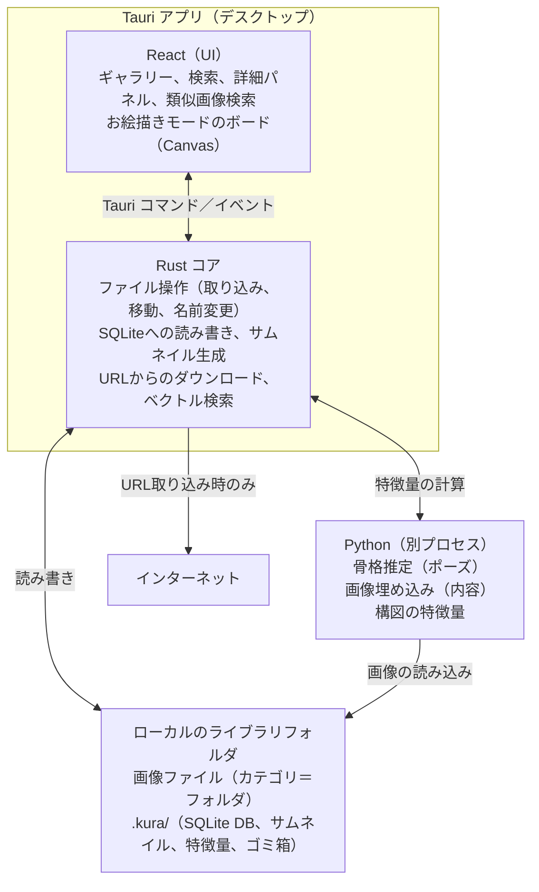

# Kura 要件定義書

最終更新：2026-11-05

本書はリポジトリの `docs/requirements.md` に置き、決まったことはここに書き戻します。

## 1. 背景と目的

Kura（蔵）は、イラスト制作用の参考画像を手元のPCだけで集め、整理し、作画中に参照するための個人用ツールです。

### 背景

- これまでポーズや構図の参考資料はPinterestで集めていた。
- Pinterestでは、ピンした画像が後日アダルトコンテンツとして削除されると、ピンしただけの利用者にもペナルティが課される。
- 削除対象の画像は、見た目では問題がわからないものも多い。Pinterest自身がおすすめしてきた画像でも対象になる。
- この仕組みにより、アカウントが過去に何度も停止された。集めた資料もアカウントと一緒に失われた。
- 現在は、資料をFinderのフォルダで整理している。

### 目的

1. 参考資料を外部サービスの規約や判断に左右されずに保持する。
2. 資料をカテゴリとタグで整理し、必要な画像をすぐに見つけられるようにする。
3. 作画中に複数の参考画像を一画面に並べ、自由に動かして参照できるようにする。

## 2. スコープ

本アプリは、参考資料の取り込み・整理・検索・作画中の参照の4つを扱います。新しい画像と出会うための発見機能は持ちません。

### 対象とする範囲

- ローカル画像の取り込みと、画像URLからの取り込み
- カテゴリ（フォルダに対応）とタグによる分類
- 一覧性の高いギャラリー表示と、条件による絞り込み
- ギャラリー内での類似画像検索
- お絵描きモード（仮称）：複数画像を自由に配置するボード
- 画像以外の資料（CLIP STUDIO PAINT の .clip、フォント、動画）の管理と表示。種類ごとに別のライブラリで管理する（フェーズ5。5.8）

### 対象外

- 他の利用者との共有、公開、SNS機能
- おすすめ画像の提示などの発見機能
- クラウド同期と複数端末での利用
- 画像の編集（トリミングや色調整を除く加工全般）
- ウェブページからの一括収集（スクレイピング）

### 参考にする既存ツール

| ツール | 参考にする点 |
| --- | --- |
| Eagle | ライブラリの整理方法、一覧画面、タグ付け、作業中の参照 |
| PureRef | お絵描きモードの操作（自由配置、拡大縮小、最前面表示） |

## 3. 利用者と利用シーン

利用者は作者本人のみです。趣味で美少女イラストを描き、ポーズや構図の参考に主に写真を集めています。利用環境はmacOSを想定します。

| シーン | 利用者がすること | 使う機能 |
| --- | --- | --- |
| 資料を集める | ブラウザで見つけた画像のURLを貼り付けて取り込む。手元の画像をドラッグ＆ドロップで取り込む | 取り込み、URL取り込み |
| 資料を整理する | 未分類の画像にカテゴリとタグをまとめて付ける | 分類、複数選択 |
| 資料を探す | 「座り」「振り返り」などのタグで絞り込む。気になる画像に似たポーズの画像を探す | 一覧、検索、類似画像検索 |
| 作画中に参照する | 使う画像をボードに並べ、描画ソフトの横に置いて見る | お絵描きモード |
| 元の画像を確認する | 取り込んだ画像の元URLを開く | 画像詳細 |

## 4. システム構成方針

本アプリは、Tauri（Rust）とReactで作るデスクトップアプリとして実装します。画面はウェブ技術で作り、ファイル操作などOSに関わる処理はRustが担当します。機械学習の処理はPythonの別プロセスが担当します。ブラウザで開くローカルウェブアプリにはしません。最前面表示（FR-705）とファイル操作が難しくなるためです。



Rustコアだけがライブラリに書き込みます。Pythonは画像を読んで特徴量を返すだけで、ファイルもDBも変更しません。

| 領域 | 採用する技術 | 選んだ理由 |
| --- | --- | --- |
| アプリ基盤 | Tauri 2 | ローカルファイルを直接操作でき、最前面表示などのウィンドウ制御もできる |
| 画面 | React + TypeScript | 一覧画面とボードをウェブ技術で作れる |
| データ保存 | SQLite | 1ファイルで管理でき、ライブラリごと持ち運べる |
| 機械学習 | Python（uvで環境管理） | 骨格推定や画像埋め込みのライブラリがそろっている |
| ベクトル検索 | sqlite-vec または全件比較 | 2万枚程度なら全件比較でも十分な速さが出る見込み。実測して決める |

### 実装方針（スパイクで確かめたこと）

フェーズ1の前に、技術的に確かでない3点を使い捨てのプロトタイプで確かめました。試した方法と結果は、各スパイクの README にあります。

**Pythonの処理の同梱**（`spikes/tauri-python/`）

- PythonのワーカーはPyInstallerのonedirの形でビルドし、Tauriの `bundle.resources` で `.app` に同梱する。Rustから `tauri-plugin-shell` で起動する
- 単一ファイルの形（onefile、Tauriのサイドカー）は使わない。起動のたびに展開するため、起動に約0.85秒かかった（onedirは約0.04秒）
- ワーカーはアプリの起動中ずっと動かし、標準入力と標準出力で1行1件のJSONをやりとりする
- 利用者がuvやPythonをインストールする必要はない。uvは開発とビルドのときだけ使う。起動時にPythonの実行環境をダウンロードする方式は、外部への通信が増えるので使わない（NFR-08）

**一覧の仮想スクロール**（`spikes/masonry-scroll/`、NFR-01）

- 一覧はライブラリを使わずに自前で作る。DBに保存した幅と高さから全体の配置を先に計算し、列ごとの二分探索で表示範囲を求め、表示範囲と上下1画面分だけを描く
- 2万枚・12列で、WKWebViewで60fpsを保ってスクロールできた
- 本体の一覧（フェーズ1のタスク6）でも、ダミー2万枚を取り込んだライブラリをリリースビルドで開き、スパイクと同じ方法で計測した。一覧の幅は766px。列の幅200px（4列）と120px（6列）のどちらでも、毎秒1500pxと6000pxのスクロールで、フレーム間隔の p99 は18ms、33msを超えたフレームは0だった。遠くへ飛んだ2フレーム後の空白は0%と3.3%で、0.5秒後はどちらも0%だった
- サムネイルは `.kura/` の下のファイルを、Tauriのアセットプロトコルで直接読む。読み込み範囲（scope）は開いたライブラリの中に絞り、パスは正規化してから渡す。本体で読める範囲は5.5の「一覧の細部」にある（スパイクでは `.kura/` の下だけにしたが、拡大表示のために画像も読めるよう広げた）

**移動の途中で止まった場合**（`spikes/crash-safe-move/`、NFR-06）

- ファイルを動かす操作（移動、名前変更、カテゴリのフォルダの移動・名前変更、ゴミ箱への移動と復元）は、次の3段階で行う
  1. 移動の予定を `pending_ops` に記録してコミットする
  2. 上書きしない名前変更（`renamex_np` の `RENAME_EXCL`）でファイルを移す
  3. 画像の情報の更新と予定の削除を、1つのトランザクションでコミットする
- 起動時に、残っている予定を実ファイルの位置に合わせて完了させるか取り消す。どちらとも決められない場合は予定を残して利用者に知らせる
- どの段階で処理を止めても、画像は失われず、不整合を検出して元に戻せた
- exFATでは `RENAME_EXCL` が使えない（`ENOTSUP` になる。フェーズ1のタスク2でディスクイメージを作って確かめた）。exFATでは、移動先がないことを確かめてから通常の rename をする。確かめてから rename するまでの間に Finder で同名のファイルが置かれると上書きされうる。HFS+ と大文字・小文字を区別する APFS では `RENAME_EXCL` が使える
- exFATでは、存在の確認が大文字・小文字を区別しないので、大文字・小文字だけの名前変更は一時的な名前（移動先のフォルダの `.kura-tmp-<予定のid>`）を経由する。後始末では、一時的な名前が残っていれば移動元に戻す（コピーなら消す）
- `pending_ops` の移動元と移動先は、ライブラリのルートからの相対パスで記録する。外付けドライブのマウント先が変わっても後始末できるようにするため

## 5. 機能要件

機能は8つのグループに分けます。優先度は、Must（初回リリースに必須）、Should（できれば初回に入れる）、Could（後のフェーズでよい）の3段階です。

### 5.1 ライブラリ管理

| ID | 要件 | 優先度 |
| --- | --- | --- |
| FR-101 | 利用者はライブラリのルートフォルダを新規作成できる。また、作成済みのライブラリ（`.kura/` があるフォルダ）を開ける | Must |
| FR-102 | アプリはライブラリの管理情報（DB、サムネイル、特徴量）をルートフォルダ内の専用フォルダに保存する | Must |
| FR-103 | 利用者は、ライブラリでない既存フォルダをそのままライブラリのルートにできる。アプリは配下の画像とサブフォルダを走査し、サブフォルダをカテゴリとして登録する | Should |
| FR-104 | アプリは起動時と手動操作時に、DBと実際のファイルの差分（追加・削除・移動）を検出して反映する。ファイルの常時監視はしない | Must |
| FR-105 | 利用者は複数のライブラリを作成し、切り替えて使える | Could |

差分を見つけたとき（FR-104）、アプリは次のように動きます。

- 新しいファイル：取り込みと同じ扱いで登録する。重複していれば登録せず、一覧で知らせる（FR-204）
- 新しいフォルダ：カテゴリとして登録する
- 見つからないファイル：DBの行は消さず「見つからない」状態にする。タグやメモを失わないため。利用者は見つからない画像だけを一覧で表示し、DBから外せる
- 移動・名前変更：見つからない画像と同じハッシュのファイルが別の場所にあれば、同じ画像の移動とみなしてカテゴリとファイル名を更新する
- ファイルサイズと更新日時がDBと同じファイルは、ハッシュを計算し直さない

常時監視をしないのは、アプリ自身の移動や名前変更でも監視のイベントが届き、Finderの操作と見分ける処理とそのテストが難しくなるためです。

差分検出の細部は次のとおりです（フェーズ1のタスク17で決めた。A・B は 2026-11-05 に利用者と決めた）。

- ライブラリを開いた後と、サイドバーの「差分を確認」ボタンを押したときに行う。結果はステータスバーに出し、スキップしたものは取り込みと同じ一覧で知らせる
- ライブラリを開いたら、DB の一覧を先に出してから差分検出を始める。中身を読むファイル（新しいファイルと、サイズか更新日時が変わったファイル）を1枚処理するごとにロックを外し、ステータスバーに「Finder での変更を反映中 N / M枚」と進み具合のバーを出す。その間も一覧を見て操作できる。取り込みは差分検出が終わるまで受け付けない。その間と取り込み中は、ヘッダーの取り込みのボタンの代わりに処理中の表示（`docs/design.md`）を出す（タスク17の確認の後に足した。開発用のビルドで新しい画像が多いと、終わるまで画面が固まって見えたため）
- 名前は NFC にそろえて DB と比べる。exFAT と FAT32 では、フォルダの一覧の名前が NFD で返るため。フォルダは大文字・小文字だけが違えば同じカテゴリとみなし、カテゴリ名を Finder の名前に合わせる
- 隠しファイル（`.` で始まるもの）と `.kura/` は見ない。シンボリックリンクはたどらない
- ライブラリの直下の画像と、`_未分類/` の下のフォルダは登録せず、スキップの一覧で知らせる。カテゴリ名に使えない名前のフォルダ（`_未分類` など）も同じ
- A. カテゴリのフォルダがなくなった（Finder で削除・名前変更・移動した）ときは、カテゴリを子孫ごと消す。中の画像のうち、同じハッシュのファイルが別の場所にあるものは移動として扱う。残りの画像は未分類にして「見つからない」状態にする。ゴミ箱の画像は、カテゴリの削除（FR-404）と同じく元のカテゴリが消えた印を付ける
  - 「フォルダがない」と判断するのは、そのフォルダを調べて NotFound になったときだけにする。権限などで読めないだけのフォルダは、カテゴリを消さず、中の画像も「見つからない」にしない。読めなかったフォルダはエラーとして一覧で知らせる。外付けドライブの一時的な不調で、カテゴリや画像の状態をまとめて変えないため
- B. 同じ場所のファイルの中身が変わった（サイズか更新日時が違い、ハッシュも違う）ときは、同じ画像として行を更新する。ハッシュ、幅、高さ、ファイルサイズ、更新日時、代表色、サムネイルを新しくし、タグとメモは残す。新しい中身が別の画像（ゴミ箱を含む）と同じなら更新せず、古い行を「見つからない」にして、そのファイルは重複として一覧で知らせる
- 更新日時は DB の値と完全に一致するかで比べる。DB の値は同じボリュームで読んだ値なので、exFAT（10ミリ秒刻み）や FAT32（2秒刻み）でも、ファイルが変わらなければ一致する。別のボリュームへライブラリを写して一致しなくなっても、ハッシュを計算し直して同じなら、サイズと更新日時だけを更新する
- 新しいファイルの重複（FR-204）は、ゴミ箱の画像を含めて判定する。「見つからない」画像と同じハッシュなら、重複ではなく移動とみなす。取り込みの例外（未分類の画像を取り込み先へ移す）は使わない。ファイルはすでにライブラリの中にあり、利用者が置いた場所を変えないため
- 対応していない形式のファイルは、取り込みと同じくスキップの一覧で知らせる
- 見つからなかった画像のファイルが元の場所に戻れば、「見つからない」状態を外す
- 「見つからない」画像は通常の一覧とサイドバーの件数に出さない。サイドバーの「ゴミ箱」の下に「見つからない」と枚数を出す（1枚以上のときだけ）。押すと一覧が見つからない画像になり、詳細パネルの場所に「一覧から外す」を出す。外すのは取り消せないので、枚数を見せて確認する。外すと、DB の行（タグの付き方と元URLを含む）とサムネイルを消す
- 差分検出はファイルを動かさず、DB とサムネイルだけを書き換える。そのため `pending_ops` を使わない

ライブラリの作成と開き方（FR-101、NFR-13）は次のとおりです。

- 新規作成では、空のフォルダ（`.DS_Store` だけがあるフォルダを含む）だけを受け付ける。中身のあるフォルダをライブラリにするのは FR-103 にあたるため。作成の途中で失敗したら、アプリが作った `.kura/` と `_未分類/` を消して元の状態に戻す
- 起動時は、最近使ったライブラリの先頭を開く。開けなければ、ライブラリ選択画面にエラーを出す
- 最近使ったライブラリの一覧は10件までにする。見つからないライブラリも一覧から消さない
- iCloud Drive とネットワークドライブの警告は、利用者がダイアログでフォルダを選んだときに出し、続けるかやめるかを選んでもらう。最近使った一覧から開くときは出さない
- DBがアプリより新しい版（`user_version` がアプリの知っている版より大きい）なら、DBを変更せずにエラーにする

### 5.2 画像の取り込み

| ID | 要件 | 優先度 |
| --- | --- | --- |
| FR-201 | 利用者はファイル選択ダイアログ、またはドラッグ＆ドロップでローカル画像を取り込める（複数ファイル、フォルダごとの指定も可）。フォルダごと取り込む場合、アプリはサブフォルダをカテゴリとして再現する | Must |
| FR-202 | 対応形式はJPEG、PNG、WebP、GIF（静止画として扱う。アニメーションの再生はフェーズ5の FR-801 で見直す）とする。HEIC、AVIF、TIFFなどは対象外とし、利用者が取り込む前にJPEGなどへ変換する（今の資料にHEICがないことは確認済み） | Must |
| FR-203 | 取り込み時、アプリは画像をライブラリ内へコピーする。元ファイルはそのまま残す。コピーしたファイルには元ファイルの更新日時を引き継ぐ | Must |
| FR-204 | アプリはファイルの中身のSHA-256で重複を検出する。同じ画像がライブラリ（ゴミ箱を含む）にある場合は取り込まずにスキップし、取り込みの終了後にスキップした画像を一覧で知らせる。一覧から既存の画像へ移動できる。同じ取り込み操作の中に同じ画像が複数ある場合は、最初の1枚だけを取り込む | Must |
| FR-205 | 取り込み時、アプリはサムネイルを生成し、幅・高さ・ファイルサイズ・代表色を記録する | Must |
| FR-206 | 利用者はクリップボードの画像を貼り付けで取り込める | Should |
| FR-207 | 利用者は取り込み時に、カテゴリとタグをあらかじめ指定できる | Should |

フォルダごと取り込む場合（FR-201）、アプリは次のように動きます。

- 取り込んだフォルダ自体を1つのカテゴリにする。フォルダ直下の画像はそのカテゴリに入る。サイドバーのカテゴリにドロップした場合は、そのカテゴリの下に作る
- 取り込み先に同名のカテゴリがすでにある場合は、新しく作らず既存のカテゴリに合流させる
- 空のサブフォルダもカテゴリとして作る
- 隠しファイル（`.` で始まるもの）は無視し、シンボリックリンクはたどらない
- 対応していない形式のファイルは取り込まず、取り込みの終了後に、重複でスキップした画像（FR-204）と同じ一覧で知らせる

取り込みの細部は次のとおりです（フェーズ1のタスク5で決めた）。

- フォルダではなくファイルを選んだりドロップしたりした場合は、未分類に入れる（サイドバーのカテゴリにドロップした場合は、そのカテゴリに入れる）
- 同名かどうかは、名前の衝突と同じく正規化（NFC）と大文字・小文字の違いを無視して判定する
- カテゴリ名に使えない名前のフォルダ（`_未分類` など）、同名のカテゴリがなく Finder で作った同名のフォルダやファイルがある場所のフォルダ、読めないフォルダは、エラーとしてスキップの一覧に出し、中身は取り込まない。残りの取り込みは続ける
- 壊れていて読めない画像も、エラーとしてスキップの一覧に出す

重複のうち未分類にある画像の扱い（FR-204 の例外）は次のとおりです（2026-11-05、タスク16の確認の後に利用者と決めた）。

- カテゴリを削除して画像を未分類へ移した後で、同じ構成のフォルダを取り込み直す使い方を想定する。重複としてスキップするだけだと、カテゴリだけができて画像は未分類に残る
- 取り込み先がカテゴリで、同じ中身の画像が未分類にあれば、スキップせずにその画像を取り込み先のカテゴリへ移す（ファイルも移す。4章「移動の途中で止まった場合」の手順）。タグとメモはそのまま残る
- 同じ画像が別のカテゴリにある場合と、ゴミ箱にある場合は、今までどおり重複としてスキップする。利用者が整理した場所を取り込みで変えないため
- 移した枚数は、取り込んだ枚数とは別にステータスバーに出す
- 取り込みは1枚ずつ順に行う。取り込み中にファイルを選んだりドロップしたりしても、受け付けない

1枚の取り込み（FR-202〜FR-205）の細部は次のとおりです（フェーズ1のタスク4で決めた）。

- 形式は拡張子ではなく、ファイルの中身（先頭のバイト列）で判定する。形式は対応していても壊れていて読めない画像は、取り込まずにエラーとして知らせる
- 幅と高さは、Exif の向きを反映した表示上の値を記録する
- サムネイルは幅320pxの JPEG（幅が320px以下の画像は拡大しない）で、`.kura/thumbs/<SHA-256>.jpg` に置く。透明な部分は白に重ねる
- 代表色は、サムネイルの平均の色（`#rrggbb`）とする
- コピーした後、DB に登録する前に止まった取り込みは、起動時の後始末でファイルを残して予定だけを消す。そのファイルは差分検出（FR-104）が新しいファイルとして登録する

### 5.3 URLからの取り込み

| ID | 要件 | 優先度 |
| --- | --- | --- |
| FR-301 | 利用者が画像URLを入力すると、アプリは画像をダウンロードしてライブラリに取り込む | Must |
| FR-302 | アプリは画像URLを元URLとして画像情報に保存する | Must |
| FR-303 | 利用者は画像URLとは別に、掲載ページのURLを任意で入力して保存できる | Should |
| FR-304 | URLの先が画像でない場合や取得に失敗した場合、アプリは理由を表示し、画像を登録しない | Must |
| FR-305 | 利用者は複数のURLを改行区切りでまとめて入力できる | Could |
| FR-306 | ブラウザの画像をアプリへドラッグ＆ドロップした場合、アプリは取得できた元URLを保存する | Could |

### 5.4 分類（カテゴリとタグ）

カテゴリはフォルダに1対1で対応し、画像1枚は1つのカテゴリに属します。タグはファイルの置き場所とは関係なく、画像1枚に複数付けられます。カテゴリをフォルダに対応させるのは、1つのフォルダに画像が集中してFinderでの表示が重くなるのを避けるためです。

同じ画像を複数のカテゴリに入れることはできません。複数の分類に入れたい場合はタグを使います。ファイルの複製は重複検出（FR-204）と矛盾し、シンボリックリンクやエイリアスはFinderやiCloudで扱いが不安定になるためです。

| ID | 要件 | 優先度 |
| --- | --- | --- |
| FR-401 | 利用者がカテゴリを作成すると、アプリはルートフォルダ配下に対応するフォルダを作る。カテゴリは入れ子にできる | Must |
| FR-402 | 利用者が画像にカテゴリを設定すると、アプリは画像ファイルをそのフォルダへ移動する | Must |
| FR-403 | 利用者がカテゴリ名を変更すると、アプリは対応するフォルダ名も変更する | Must |
| FR-404 | 利用者はカテゴリを削除できる。子カテゴリもまとめて削除し、配下の画像はすべて「未分類」に移動する（画像は削除しない）。削除前に、消えるカテゴリの数と未分類に移る画像の枚数を示して確認する。アプリが管理していないファイルが残ったフォルダは `.kura/trash/` に移す。`.DS_Store` だけが残ったフォルダは削除する | Must |
| FR-405 | カテゴリを設定していない画像は「未分類」（ルート直下の専用フォルダ）に置く | Must |
| FR-406 | 利用者は画像にタグを複数付け、外せる。入力中に既存タグを候補として表示する | Must |
| FR-407 | 利用者は複数の画像を選択し、カテゴリとタグをまとめて設定できる | Must |
| FR-408 | 利用者はタグ名の変更、統合、削除ができる | Should |
| FR-409 | 利用者はタグをグループ（例：ポーズ、アングル、部位）にまとめられる | Could |
| FR-410 | 利用者はアプリ上で画像のファイル名を変更できる。アプリは実ファイル名も変更する。拡張子は変えられず、利用者は拡張子より前の部分だけを編集する | Must |
| FR-411 | 利用者は画像にメモと評価（星5段階）を付けられる | Must |
| FR-412 | 利用者はサイドバーでカテゴリをドラッグし、別のカテゴリの下やルート直下へ移せる。アプリは対応するフォルダも移す。移動先に同名のカテゴリがある場合はエラーにする。カテゴリを自分の子孫の下へは移せない | Must |
| FR-413 | 利用者はカテゴリにアイコンと色を設定できる。サイドバーではカテゴリ名の前に出す | Could |
| FR-414 | 利用者はサイドバーのタグ一覧の表示を、件数付きの一覧と、件数を出さずにタグを折り返して並べる表示から切り替えられる | Could |
| FR-415 | 利用者は直前の分類の操作（カテゴリの作成・名前変更・移動、画像のカテゴリの設定、タグの付け外しなど）を元に戻し、やり直せる | Could |

カテゴリの設定とタグの付け外しの細部（FR-402、FR-406、FR-407）は次のとおりです（フェーズ1のタスク9で決めた）。

- 詳細パネルで変える。1枚のときも複数のときも、同じカテゴリの選択欄とタグの入力欄を出す。複数のときは枚数を見出しにする
- カテゴリは、選択欄で選ぶとすぐに移す。選んだ画像のカテゴリが揃っていなければ「複数のカテゴリ」と出す
- 画像は1枚ずつ移す（4章「移動の途中で止まった場合」の手順）。移せない画像（Finder で消された、フォルダに書き込めないなど）は、ファイルも DB も元のままにして残りを続ける。結果はステータスバーに出し、移せなかった画像は押すと一覧のダイアログで理由を出す
- タグ名は前後の空白を除く。正規化（NFC）と大文字・小文字の違いを無視して既存のタグと同じなら、既存のタグを付ける。名前は最初に作ったときの書き方のまま
- 選んだ画像の一部にだけ付いているタグは、付いている枚数（例：1/4）を出す。外すと、選んだ画像のすべてから外す。どの画像にも付いていないタグも消さずに残す（削除はタグ管理 FR-408）
- 入力中は、入力した文字を名前に含む既存のタグを8件まで候補に出す。選んだ画像のすべてに付いているタグは出さない。上下キーか Tab・Shift+Tab で候補を選び、Enter で付ける（Tab は検索バーの候補と同じく、端を越えると次の部品へ移る。タスク14の確認の後に足した）。かな漢字変換を確定する Enter では付けない
- 文字の入力欄では、macOS の自動修正と先頭の大文字化を切る。cat を Cat にする提案の吹き出しが出て、名前や検索語の入力と候補のキー操作を邪魔するため（タスク14の確認の後に足した）

タグ管理（FR-408）の細部は次のとおりです（フェーズ1のタスク15で決めた）。

- サイドバーのタグの見出しのボタンで、タグ管理ダイアログを開く。タグごとに、付いている枚数（ゴミ箱を除く）と、名前の変更・統合・削除のボタンを出す
- 名前の変更は、ダイアログの中の入力欄で行う。名前の扱いはタグを付けるとき（タスク9）と同じ。大文字・小文字だけの変更はできる。ほかのタグと同じ名前（正規化と大文字・小文字を無視して比べる）にはできず、入力欄の下にエラーを出す。まとめたいときは統合を使う
- 統合は、統合先のタグを選び、枚数を見せて確かめてから行う。元のタグが付いていた画像に統合先のタグを付け、元のタグを削除する。両方が付いていた画像は統合先のタグ1つになる
- 削除は、外れる枚数を見せて確かめてから行う。付いていたすべての画像から外す。画像は削除しない
- ゴミ箱の画像に付いたタグも、統合と削除の対象にする。元に戻したときに、なくなったタグが残らないようにするため
- 統合や削除をしたタグで絞り込んでいたら、絞り込みの条件も統合先に置き換えるか外す
- DB だけを変え、ファイルは動かさない

カテゴリの作成（FR-401）の画面は次のとおりです（フェーズ1のタスク10で足した）。

- サイドバーの「カテゴリ」の見出しの＋でルート直下に、カテゴリの行にマウスを乗せると出る＋でそのカテゴリの下に作る。名前は入力欄で入れ、Enter で作り、Escape か入力欄の外を押すと取り消す。作れないときは入力欄の下にエラーを出し、入力欄を残す

カテゴリ名の変更と移動の細部（FR-403、FR-412）は次のとおりです（フェーズ1のタスク10で決めた）。

- 名前の変更は、サイドバーのカテゴリをダブルクリックして入力欄で行う。Enter で変え、Escape か入力欄の外を押すと取り消す。かな漢字変換を確定する Enter では変えない。変えられないときは入力欄の下にエラーを出し、入力欄を残す
- 移動は、サイドバーのカテゴリを別のカテゴリにドラッグする。ルート直下へは「カテゴリ」の見出しにドラッグする。自分自身と子孫の上には落とせない。移せないとき（移動先に同名がある、フォルダが Finder で消されたなど）は、ステータスバーにエラーを出す
- ドラッグ中は、掴んだカテゴリの背景を変え、カーソルの横に何をどこへ移すかを出す（自分の中へは移せない、今の場所にある、も出す）。落とせる先には枠を付ける。Escape でドラッグをやめる
- 離すと確認のダイアログを出す。元に戻す操作がないため。「今後は確認しない」を選ぶと、次からは確認せずに移す。確認を戻す設定は設定ダイアログに置く（タスク18で作った。アプリ全体の設定に保存する）
- サイドバーのカテゴリは開閉できる。子のあるカテゴリの名前の前に開閉のボタンを置き、見出しに「すべて閉じる」のボタンを置く。閉じた状態はライブラリごとに覚える。子の並びの左に、親の開閉ボタンから縦の線を引き、階層の深さを見分けられるようにする

元に戻す・やり直す（FR-415）について、利用者と決めたことは次のとおりです（2026-11-04、タスク10の確認で。作る時期は決めていない）。

- 「間違えた」と気づいてすぐ直す使い方を想定する。履歴はアプリを閉じたら消してよい
- 戻す先に同名のファイルやフォルダができているなど、元どおりに戻せない場合は、戻せないことを知らせて何もしない
- 変えるのはカテゴリの行の名前と親だけで、配下のカテゴリと画像の行は変えない（7章）。フォルダは4章「移動の途中で止まった場合」の手順で名前を変える・移す
- 同名の判定は、カテゴリの作成（FR-401）と同じく実際のフォルダの中身で行う。大文字・小文字だけの名前変更はできる（一時的な名前を経由する）

### 5.5 一覧と検索

| ID | 要件 | 優先度 |
| --- | --- | --- |
| FR-501 | 一覧画面はサムネイルを、縦横比を保つメイソンリー型で間隔を狭く表示する。画像は並び順のとおりに、一番短い列へ順に置く。利用者はサムネイルの大きさをスライダーで変えられる | Must |
| FR-502 | 利用者は表示形式を、メイソンリー型と、正方形に切り抜くグリッド型から選べる | Should |
| FR-503 | 左サイドバーは、すべての画像、未分類、カテゴリツリー、タグ一覧を表示する | Must |
| FR-504 | 利用者はタグ（AND/OR）、カテゴリ、ファイル名、メモで絞り込める。カテゴリで絞り込むと、子カテゴリの画像も含めて表示する。サイドバーのカテゴリの件数も子カテゴリを含めた数にする | Must |
| FR-505 | 利用者は、縦横比（縦長・横長・正方形）、評価、追加した日、タグの有無で絞り込める | Should |
| FR-506 | 利用者は取り込み日、ファイル名、評価、ランダムで並べ替えられる | Must |
| FR-507 | 利用者が画像を選ぶと、右パネルに詳細（プレビュー、カテゴリ、タグ、元URL、サイズ、メモ）を表示する | Must |
| FR-508 | 利用者が画像をダブルクリックすると、拡大表示になる。左右キーで前後の画像に移れる | Must |
| FR-509 | 利用者は範囲選択（Shift）と個別選択（Command）で複数の画像を選べる | Must |
| FR-510 | 利用者はよく使う検索条件をスマートフォルダとして保存できる | Could |
| FR-511 | 利用者は画像を削除できる。削除した画像はアプリ内のゴミ箱に入り、利用者が空にするまで元に戻せる。アプリはゴミ箱の画像を自動では消さない。元に戻すとき、元のカテゴリが削除されていれば未分類に戻し、そのことを利用者に知らせる | Must |
| FR-512 | 利用者はメイソンリーの空いた所からドラッグして、囲んだ範囲の画像をまとめて選べる | Could |
| FR-513 | 利用者は、人に見られたくない画像に印を付け、印の付いた画像を一覧・詳細・拡大表示に出さないモードに切り替えられる。カフェなど人目のある場所での作業を想定する | Could |
| FR-514 | 利用者は、一覧で選んだ画像をサイドバーのカテゴリかタグへドラッグし、まとめてカテゴリを設定したりタグを付けたりできる（FR-402、FR-406、FR-407 の別の操作） | Could |

追加した日での絞り込み（FR-505）について、利用者と決めたことは次のとおりです（2026-11-05。作るのはフェーズ4のまま）。

- 「X などからまとめて保存した画像を一度に取り込み、後日その日に取り込んだ画像をカテゴリ分けやタグ付けする」使い方を想定する
- 使うのは登録日時（アプリに追加した時刻）とする。取り込み日時は、ローカルから取り込んだ画像では元ファイルの更新日時なので、まとめて取り込んだ日と一致しないことがあるため
- 開始日と終了日で範囲を指定する。どちらか一方だけでもよい。日付は入力欄に打つほか、カレンダーからも選べる

人に見られたくない画像を隠すモード（FR-513）について、利用者と決めたことは次のとおりです（2026-11-05。作る時期は決めていない）。

- 印はタグで代用せず、images に印の列を持つ。タグの名前の変更・統合・削除（FR-408）で印が外れ、画像が見えてしまうことを防ぐため
- 隠すモードでは、サイドバーの件数と「出ている枚数 / 全体の枚数」に、隠した画像を含めない。そのかわり、何枚を隠しているかを別に出す
- 隠すモードのオン・オフは、アプリを閉じても覚えておく。アプリ全体の設定に置き、ライブラリをまたいで効かせる（7章、タスク18で決めた）

一覧の細部（FR-501、FR-503、FR-506）は次のとおりです（フェーズ1のタスク6で決めた）。

- 並べ替えの向きは、取り込み日が新しい順、ファイル名が名前順（数字は Finder と同じく数の大きさで比べる）、評価が高い順とする。同じ値の画像は、取り込み日の新しい順に並べる。ランダムは、ランダムを選ぶたびに並びを作り直す
- 並べ替えは画面側で行う。一覧を開いたときと取り込みの後に、ゴミ箱以外の全画像を1回だけ読む
- スライダーで変えるのは列の幅の目安で、100〜320px（初期値 200px）とする。上限はサムネイルの幅。最後に選んだ値をアプリ全体の設定に覚える（7章。タスク18で決めた）
- サムネイルを読み込むまでは、その画像の代表色で埋める。画像の色そのものなので、UIの色の決まり（`docs/design.md`）の対象外とする
- アセットプロトコルで読めるのは、開いたライブラリの画像と `.kura/thumbs/` の下だけにする。DB（`kura.db` と WAL のファイル）とゴミ箱は読めない（タスク8で、拡大表示のために画像を読めるよう広げた）
- サイドバーで選んで絞り込む操作と、カテゴリ・タグの件数は、絞り込み（FR-504、タスク14）で作った

絞り込みの細部（FR-504、NFR-02）は次のとおりです（フェーズ1のタスク14で決めた）。

- 絞り込みも並べ替えと同じく画面側で行う。一覧を読むときに、画像ごとのタグの id とメモも一緒に読む。2万枚で、押してから一覧が描き直されるまで 16〜51ms だった（Playwright の WebKit、モックの開発サーバーで測った）
- サイドバーの「すべての画像」「未分類」「カテゴリ」は、どれか1つを押して選ぶ。カテゴリを選ぶと、子孫のカテゴリの画像も出す
- タグは一覧の画像と同じ選び方にする（2026-11-06、フェーズ1の確認の後に利用者と決めた。それまでは押すたびに選ぶ・外すが切り替わった）
  - 修飾キーなしで押すとそのタグだけを選ぶ。Command で押すと選択に足し、選択中のタグなら外す。Shift で押すと、最後に修飾キーなしか Command で押したタグから、サイドバーの並び順で範囲を選び直す
  - タグにフォーカスがあるとき（タグを押した後）は、Escape でタグの選択を外し、⌘A でタグをすべて選ぶ。フォーカスがタグにないときの Escape と ⌘A は、今までどおり一覧の画像に効く（NFR-12）
  - サイドバーの余白（項目のない所）を押すと、タグの選択を外す。カテゴリの選択は変えない
- タグの見出しの AND と OR で、選んだタグをすべて含む画像か、どれかを含む画像かを切り替える（初期は AND）
- カテゴリとタグの条件は組み合わせる（両方を満たす画像を出す）
- 検索バーは、ファイル名、メモ、タグ名、カテゴリ名（親からの道筋）のどれかに入力した文字を含む画像に絞る。空白で区切った語は、すべてを含む画像に絞る（語ごとに別の場所に含んでもよい）。正規化（NFC）と大文字・小文字の違いは無視する。タグ名とカテゴリ名も探すのは、候補を選ぶ前に一覧が空にならないようにするため（タスク14の確認の後に利用者と決めた）
- 検索バーに入力すると、名前に入力した文字を含むカテゴリ（親からの道筋で探すので、親の名前で子も出る）とタグを、それぞれ5件まで候補に出す（タスク14の確認の後に利用者の提案で足した。タグやカテゴリが多いとサイドバーで探しにくいため）。いま絞り込みに使っているものは出さない。選ぶとそのカテゴリかタグで絞り込み、入力した文字は消す。操作はタグの入力欄の候補と同じで、上下キーか Tab・Shift+Tab で選び Enter で決める。上下キーは端から反対の端へ巡る。Tab は最後の候補を越えると、Shift+Tab は入力した文字の位置を越えると、次（前）の部品へ移る。かな漢字変換を確定する Enter では選ばない。Escape で入力した文字を消す
- サイドバーの件数は絞り込みに関係なく、ゴミ箱以外の全画像で数える。カテゴリの件数は子孫のカテゴリの画像を含める
- 絞り込みを変えたら、見えなくなった画像の選択を外す。見えない画像までまとめて変えないため。詳細パネルでタグを外して条件に合わなくなった画像は一覧から消えるが、選択は残す
- 絞り込んでいるときは、ステータスバーに「出ている枚数 / 全体の枚数」を出す
- 絞り込みの条件は保存しない。ライブラリを開き直すと、すべての画像に戻る

選択と詳細パネルの細部（FR-507、FR-509）は次のとおりです（フェーズ1のタスク7で決めた）。

- 修飾キーなしで選ぶとその画像だけを選ぶ。Command で選ぶと選択に足し、選択中の画像なら外す。Shift で選ぶと、最後に修飾キーなしか Command で選んだ画像から、今の並び順で範囲を選び直す。画像のない所を押すと選択を外す
- Escape でも選択を外す（利用者の確認の後に足した）。拡大表示中は先に拡大表示を閉じる。入力欄の中とダイアログの中の Escape では外さない。サイドバーのタグにフォーカスがあるときの Escape は、画像ではなくタグの選択を外す（FR-504）。サイドバーや詳細パネルを押しても選択は外さない。詳細パネルの入力中や、まとめての設定（タスク9）の途中で選択が消えないようにするため
- 詳細は1枚だけ選んでいるときに出す。複数のときは枚数だけを出す（まとめての設定は FR-407、タスク9）
- 詳細のカテゴリは親からの道筋（例：ポーズ / 座り）で出す。タグ・元URL・メモがなければ「なし」と出す。元URLは掲載ページURLを優先し、なければ画像URLを出す。文字として出すだけで、ブラウザで開く操作は URL 取り込み（フェーズ2）で足す
- 元URLを読むため、`image_sources` テーブルはこのタスクで作った（掲載ページURLは空にできる）

拡大表示の細部（FR-508）は次のとおりです（フェーズ1のタスク8で決めた）。

- 拡大表示は一覧の場所に重ねて出し、サイドバーと詳細パネルは残す。閉じると一覧のスクロールの位置に戻る
- 元の画像を、縦横比を保ったまま枠いっぱいに広げて出す（小さい画像も広げる）。読み込むまではサムネイルを出す
- 左右キーで今の並び順の前後の画像に移り、移った画像を選ぶ。先頭と末尾では止まる（端から反対の端へは回らない）
- 拡大表示の左右の端（幅の15%）にマウスを乗せると < と > のボタンを出し、押すと前後の画像に移る。先頭では < を、末尾では > を出さない（利用者の確認の後に足した）
- Escape か「閉じる」で閉じる

メモと評価の細部（FR-411）は次のとおりです（フェーズ1のタスク13で決めた）。

- 詳細パネルで、1枚だけ選んでいるときに入力する。複数の画像へのまとめての入力はしない
- 評価は星を押したときに保存する。今の評価と同じ星を押すと評価なし（0）に戻す
- メモは入力欄から離れたとき（別の画像を選んだときを含む）に保存する。保存できなければ入力欄の下にエラーを出す
- ゴミ箱の画像のメモと評価は変えられない

削除とゴミ箱の細部（FR-511）は次のとおりです（フェーズ1のタスク16で決めた）。

- 詳細パネルの「ゴミ箱へ移す」で、選んだ画像（1枚でも複数でも）をゴミ箱へ移す。元に戻せるので確認は出さない。移せない画像はファイルも DB も元のままにして残りを続け、結果はステータスバーに出す（カテゴリの設定と同じ）
- サイドバーの「未分類」の下に「ゴミ箱」と枚数を出す。押すと一覧がゴミ箱の画像になり、詳細パネルの場所に「元に戻す」と「ゴミ箱を空にする」を出す。ほかのサイドバーの項目を押すとゴミ箱を閉じる
- ゴミ箱の一覧は削除した新しい順に出し、並べ替えと絞り込みはしない。拡大表示はしない（アセットプロトコルでゴミ箱を読めないため。5.5）
- 元に戻すと、元のカテゴリのフォルダへ戻す。同名があれば連番を付ける（5章「名前の衝突」）。元のカテゴリが削除されていれば未分類へ戻し、ステータスバーに「お知らせ：」で枚数を出す。タグとメモは消さずに残っているので、そのまま戻る
- ゴミ箱を空にするのは取り消せないので、枚数を見せて確認する。消すのは、ゴミ箱の画像の実ファイル、DB の行（タグの付き方と元URLを含む）、サムネイル
- 空にするときは、1枚ずつ実ファイルを先に消し、次に行を消す。途中で止まっても、もう一度空にすると続きから消せる。消せないファイルの画像は行を残し、元に戻せるままにする
- カテゴリの削除（FR-404）で `.kura/trash/` に残した管理外のファイルのフォルダは、空にしても消さない。画面に出していないものを利用者の知らないうちに消さないため
- ゴミ箱の画面で選んだ画像だけを完全に削除することもできる。取り消せないので、枚数を見せて確認する。消し方はゴミ箱を空にするときと同じ。ゴミ箱を通さずにすぐ削除する操作は作らない。ふだんの削除が取り消せなくなるのを避けるため（2026-11-05、タスク16の確認の後に利用者と決めた）

### 5.6 類似画像検索

類似画像検索は、ギャラリー内の画像だけを対象にします。ポーズ・構図・内容の3つの観点で類似度を計算し、利用者が観点ごとの重みを決めます。

| 観点 | 似ていると判定する例 | 想定する手法 |
| --- | --- | --- |
| ポーズ | 腕を上げて振り返る、片膝を立てて座る | 写真向けの骨格推定で関節座標を取り、正規化して比較する |
| 構図 | 人物が画面の右寄りにいる、あおりのアングル | 画像の大まかな形と配置の特徴量（縮小画像やエッジ分布）を比較する |
| 内容 | 制服、椅子に座る、屋外 | 画像埋め込みモデル（CLIP系など）のベクトルを比較する |

| ID | 要件 | 優先度 |
| --- | --- | --- |
| FR-601 | 利用者が画像を選んで「似た画像を探す」を実行すると、アプリは類似度の高い順に画像を一覧表示する | Must |
| FR-602 | 利用者はポーズ・構図・内容の重みをスライダーで調整できる。結果は調整に合わせて並び替わる | Must |
| FR-603 | 利用者は類似検索の結果を、カテゴリやタグでさらに絞り込める | Should |
| FR-604 | アプリは取り込み後に、特徴量をバックグラウンドで計算する。計算中も利用者は他の操作を続けられる | Must |
| FR-605 | 人物が検出できない画像では、アプリはポーズの類似度を計算せず、構図と内容だけで比較する | Must |
| FR-606 | 利用者が骨格の推定結果を画像に重ねて確認できる | Could |
| FR-607 | 利用者が「座って振り返る女性」のような文章で画像を検索できる | Could |
| FR-608 | 利用者がギャラリー外の画像をドロップして、それに似た画像をギャラリーから探せる | Could |

### 5.7 お絵描きモード（仮称）

お絵描きモードは、複数の画像を無限キャンバス上に自由に配置する画面です。配置した状態は「ボード」として保存します。

| ID | 要件 | 優先度 |
| --- | --- | --- |
| FR-701 | 利用者は一覧で選んだ画像をボードに追加できる。ボードは新規作成できる | Must |
| FR-702 | 利用者はボード上の画像をドラッグで移動し、個別に拡大・縮小できる | Must |
| FR-703 | 利用者はボード全体をホイールやトラックパッドのピンチで拡大・縮小し、ドラッグでスクロールできる | Must |
| FR-704 | アプリはボードの配置（画像、位置、倍率、重なり順）を保存し、次に開いたときに同じ状態で表示する | Must |
| FR-705 | 利用者はウィンドウを常に最前面に表示する設定にできる | Must |
| FR-706 | 利用者は画像の左右反転、回転、グレースケール表示を切り替えられる。元ファイルは変更しない | Should |
| FR-707 | 利用者はウィンドウの不透明度を下げられる | Should |
| FR-708 | 利用者はボード上の画像を表示上だけトリミングできる | Could |
| FR-709 | 利用者はボード上の画像を自動で整列できる | Could |
| FR-710 | 利用者はファイルやクリップボードの画像をボードに直接貼り付けられる。その画像をライブラリに取り込むかどうかは利用者が選ぶ | Could |

### 5.8 その他の形式

フェーズ5では、画像のライブラリに2つの機能（FR-801、FR-802）を足し、画像以外の資料（.clip、フォント、動画）を扱えるようにします。画像以外の資料は、種類ごとに別のライブラリで管理します。1つのライブラリには、1つの種類の資料だけを入れます。

種類ごとにライブラリを分ける理由は次のとおりです（2026-11-04 に決めた）。

- Kura は作画を支援するアプリで、お絵描きモードと類似画像検索は画像でしか使えない。1つの一覧に種類を混ぜると、画像だけを扱う処理のあちこちに、種類での絞り込みが要る
- カテゴリは実際のフォルダに対応する（5.4）。種類を混ぜると、1つのフォルダに画像と .clip が並ぶ。種類ごとの画面には、資料が0件のカテゴリが並ぶ
- 1つのライブラリが1つの種類だけを持てば、今のテーブル、カテゴリとフォルダの対応、差分検出（FR-104）、ファイル操作の共通処理をそのまま使える

| ID | 要件 | 優先度 |
| --- | --- | --- |
| FR-801 | アプリは GIF とアニメーション WebP を、詳細パネルのプレビューと拡大表示で元のファイルのまま再生する。サムネイルは今のとおり静止画の JPEG にする | Could |
| FR-802 | アプリは取り込み時に、画像の主要な8色をサムネイルから計算して記録する。利用者は詳細パネルで8色の見本を見られる | Could |
| FR-803 | 利用者はライブラリを作るときに、種類（画像、.clip、フォント、動画）を選ぶ。アプリは、ライブラリの種類に合う形式のファイルだけを取り込む。また、種類に合わせて画面と使える機能を切り替える。お絵描きモードと類似画像検索は、画像のライブラリだけで使える | Could |
| FR-804 | 利用者は .clip のライブラリに、CLIP STUDIO PAINT のファイル（.clip）を入れられる。アプリはファイルに埋め込まれた SQLite の CanvasPreview からサムネイルを作る。利用者は .clip を既定のアプリ（CLIP STUDIO PAINT）で開ける | Could |
| FR-805 | 利用者はフォントのライブラリに、フォントファイル（.ttf、.otf、.ttc）を取り込める。アプリは見本の文字を描いたサムネイルを作る | Could |
| FR-806 | 利用者はフォントビューアーで、入力した文字を大きさを変えて表示できる。また、フォントに収録されている文字の一覧を表示できる | Could |
| FR-807 | 利用者は動画のライブラリに、動画（mp4、mov）を取り込める。アプリは動画のサムネイルを作る。利用者は詳細パネルと拡大表示で動画を再生できる | Could |

ライブラリの種類（FR-803）について、今の決まりから自然に決まることは次のとおりです。

- フェーズ1〜4で作ったライブラリは、画像のライブラリとして扱う
- ライブラリの種類に合わない形式のファイルは取り込まない。取り込みの終了後に、対応していない形式のファイル（FR-201）と同じ一覧で知らせる

確かめたことと、まだ確かめていないことは次のとおりです（2026-11-04 時点）。

- アニメーション（FR-801）：今の取り込み処理は、GIF とアニメーション WebP を最初のフレームの静止画として読む。本体と同じ image クレート（0.25、`jpeg`・`png`・`webp`・`gif` の機能）で、2フレームのファイルを読んで確かめた。サムネイルの作り方は変えなくてよい。足すのは、アニメーションかどうかの判定と、元ファイルを表示する部分になる。WKWebView が両方を `img` 要素で再生できるかは、まだ確かめていない
- 元ファイルの表示（FR-801、FR-806、FR-807）：画面はアセットプロトコルで元ファイルを読む。読める範囲（5.5）に、画像以外の形式の元ファイルも含める必要がある
- .clip（FR-804）：中身の構造は、公開されている解析情報をもとにしている。先頭が `CSFCHUNK` で、SQLite のデータベースが `CHNKSQLi` のチャンクに入り、その中の CanvasPreview テーブルに PNG の画像がある、という構造である。実際のファイルではまだ確かめていない。フェーズ5の開始時にスパイクで確かめる
- .clip の編集：.clip は作画中に書き換わるファイルなので、FR-203 のとおりコピーすると、元のファイルと中身がずれる。どこに置くかは10章で決める
- フォント（FR-805、FR-806）：サムネイルを描くには、Rust でフォントを描く手段（描画用のクレート、または macOS の Core Text）が要る。フォントビューアーは、画面が元ファイルをフォントとして読み込んで描く。収録されている文字の一覧は、フォントの cmap テーブルから読む
- 動画（FR-807）：image クレートは動画を読めない。サムネイルにするフレームは、macOS の AVFoundation か、同梱した ffmpeg で取り出す。今の取り込み処理はファイル全体をメモリに読んでからハッシュを計算するので、大きな動画では読みながら計算する形に変える必要がある。WKWebView で再生できるコーデック（H.264、HEVC など）は、まだ確かめていない
- 形式の判定：今の取り込み処理（5.2の細部）と同じく、拡張子ではなく先頭のバイト列で判定する。判定した形式がライブラリの種類に合うかを確かめてから取り込む。フォントは `00 01 00 00`・`true`（TrueType）、`OTTO`（OpenType）、`ttcf`（.ttc）で見分ける。mp4 と mov は4バイト目からの `ftyp` で見分け、続くブランド（mov は `qt  `）で区別する。HEIC と AVIF も `ftyp` で始まるので、ブランドで動画と分け、FR-202 のとおり対象外のままにする

### 名前の衝突（各グループ共通）

移動先や変更後の名前と同じ名前のファイル・フォルダがすでにある場合、アプリは操作の種類によって次のように動きます。どの操作でも上書きはしません。

| 操作 | アプリの動き |
| --- | --- |
| 取り込み、カテゴリの設定、カテゴリの削除に伴う移動、ゴミ箱からの復元 | 自動で連番を付ける（`a.jpg` → `a (2).jpg`。Finderと同じ形式） |
| ファイル名の変更（FR-410）、カテゴリの作成・名前変更・移動（FR-401、FR-403、FR-412） | エラーを表示し、利用者に別の名前を入力してもらう |

- 大文字と小文字だけが違う名前は衝突として扱う（APFSの初期設定に合わせる）。大文字・小文字だけの名前変更は、一時的な名前を経由して行う
- 名前はUnicodeの正規化（NFC）をそろえてから比較する
- 衝突の判定は、DBではなく実際のフォルダの中身で行う
- `/` と `:` を含む名前、`.` で始まる名前、`_未分類`、`.kura` はカテゴリ名に使えない
- ファイル名の変更（FR-410）でも、空の名前、`/` と `:` を含む名前、`.` で始まる名前は使えない。`.` で始まるファイルは Finder でも差分検出（FR-104）でも見えなくなるため

## 6. 非機能要件

数値の目標は仮のものです。実際の画像枚数と使い方を見て見直します。

| ID | 分類 | 要件 |
| --- | --- | --- |
| NFR-01 | 性能 | 画像2万枚のライブラリで、一覧画面のスクロールが引っかからずに動く（仮想スクロールを使う） |
| NFR-02 | 性能 | タグやカテゴリでの絞り込み結果が0.5秒以内に表示される |
| NFR-03 | 性能 | 類似画像検索の結果が2秒以内に表示される（特徴量の計算が済んだ画像が対象） |
| NFR-04 | 性能 | お絵描きモードで画像30枚を並べても、移動と拡大が滑らかに動く |
| NFR-05 | データ保全 | 画像ファイルは通常のフォルダに通常のファイルとして置く。アプリがなくてもFinderで画像を開ける |
| NFR-06 | データ保全 | ファイルの移動や名前変更が途中で失敗しても、画像が失われず、DBとファイルの不整合を検出できる |
| NFR-07 | データ保全 | 利用者はライブラリの管理情報（DB）をエクスポートしてバックアップできる |
| NFR-08 | プライバシー | アプリは画像も特徴量も外部サーバーへ送らない。通信するのは、URL取り込みと、初回のモデルダウンロードだけとする |
| NFR-09 | オフライン | URL取り込み以外の機能は、ネットワークにつながっていなくても使える |
| NFR-10 | 動作環境 | macOS（Appleシリコン）で動く。Windows対応は対象外とする |
| NFR-11 | 保守性 | 機械学習の処理は本体と切り離し、モデルを入れ替えても本体のコードを変えなくてよい構成にする |
| NFR-12 | 操作性 | 主な操作（検索、タグ付け、拡大表示、ボードへの追加）にキーボードショートカットを用意する |
| NFR-13 | 動作環境 | ライブラリは内蔵ディスクか外付けドライブ（APFS、HFS+、exFAT）に置く。iCloud Drive とネットワークドライブは保証しない。利用者がそこを指定したら、アプリは警告を出す。起動時にライブラリが見つからない場合（外付けドライブが外れているなど）、アプリはその旨を表示してライブラリ選択画面に戻る |

フェーズ1のキーボードショートカット（NFR-12）は次のとおりです（フェーズ1のタスク19で、2026-11-05 に利用者と決めた）。ボードへの追加はフェーズ2で足す。

| キー | 操作 |
| --- | --- |
| ⌘F | 検索欄へ移る |
| 矢印キー | 一覧で選択を動かす。左右は並び順の前後、上下は同じ列の上下の画像。何も選んでいなければ先頭の画像を選ぶ。端では止まる。移った画像が見えるようにスクロールする。拡大表示中の左右は、前後の画像へ移る（FR-508） |
| Space | 拡大表示を開く・閉じる（Finder のクイックルックと同じ）。1枚だけ選んでいるときに開く。ゴミ箱と見つからない画像では開かない（ダブルクリックと同じ） |
| T | 詳細パネルのタグの入力欄へ移る |
| ⌘A | 今の一覧の画像をすべて選ぶ。サイドバーのタグにフォーカスがあるときは、タグをすべて選ぶ（FR-504） |
| ⌘Delete | 選んだ画像をゴミ箱へ移す（Finder と同じ。詳細パネルの「ゴミ箱へ移す」と同じく確認は出さない） |
| ⌘, | 設定ダイアログを開く |
| Escape | 拡大表示を閉じる。拡大表示でなければ選択を外す（FR-509）。サイドバーのタグにフォーカスがあるときは、タグの選択を外す（FR-504） |

- 入力欄の中では、文字の入力を優先してショートカットを効かせない。例外は ⌘F と ⌘, で、入力欄の中でも効く
- ダイアログを開いている間は、どのショートカットも効かせない
- ⌘A と ⌘Delete は NFR-12 の「主な操作」には入らないが、Finder と同じ操作なので足した

DB のバックアップ（NFR-07）の細部は次のとおりです（フェーズ1のタスク18で、2026-11-05 に利用者と決めた）。

- 設定ダイアログの「管理情報を書き出す…」で、保存先を選んで DB を1つのファイルに書き出す。保存先の初期の名前は `<ライブラリのフォルダ名>-<日付>.db`。画像ファイルとサムネイルは含まない
- SQLite のバックアップ機能で書き出す。ライブラリを開いたまま（WAL に残った変更も含めて）、整った写しになるため。別名に書いてから置き換え、途中で失敗しても保存先にあった前のファイルを壊さない
- フェーズ1では書き出しだけを作り、戻す操作は作らない。戻すときは、利用者が次の手順で行う
  1. アプリを終了する
  2. ライブラリの `.kura/` の `kura.db` を書き出したファイルに置き換え、`kura.db-wal` と `kura.db-shm` があれば消す（残すと、古い変更が新しい DB に重なって壊れるおそれがあるため）
  3. アプリでライブラリを開く。書き出した後に移した・足した・消した画像は、開いた後の差分検出（FR-104）が反映するか「見つからない」画像として知らせる

## 7. データモデル概要

管理情報はライブラリ内のSQLiteに保存します。画像の実体はカテゴリのフォルダに置きます。

DBには相対パスを保存しません。画像のパスは、カテゴリの親子関係とファイル名から組み立てます。カテゴリ名を変えたときに、更新するDBの行を1行で済ませるためです。相対パスを保存すると、配下のカテゴリと画像すべてを書き換える必要があり、途中で失敗するとパスとカテゴリが食い違います。

- DBは `.kura/kura.db` に置き、SQLiteのWALモードと `synchronous=FULL` で使う。WALは取り込み中も一覧を表示できるようにするため。FULLは電源断でも直前のコミットを失わないため
- DBにスキーマのバージョン番号（SQLiteの `user_version`）を持たせ、最初の版からマイグレーションの仕組みで作る。後のフェーズでテーブルを足すときに、既存のライブラリを壊さずに更新するため
- 各テーブルのidは整数の連番にする
- 日時は UNIX 時間のミリ秒で保存する
- 「最近使ったライブラリ」の一覧はライブラリの中に置かず、アプリのデータフォルダ（`~/Library/Application Support/` の下）に置く。外付けドライブが外れていても一覧を出せるようにするため
- 設定は2か所に分けて置く（フェーズ1のタスク18で、2026-11-05 に利用者と決めた）
  - アプリ全体の設定は、アプリのデータフォルダの `settings.json` に置く。どのライブラリを開いても同じ値を使う。今あるのは、カテゴリの移動の確認（5.4）とサムネイルの大きさ（5.5）。人に見られたくない画像を隠すモード（FR-513）のオン・オフもここに置き、ライブラリをまたいで効かせる。書くのは Rust で、別名に書いてから置き換える。ファイルがないか壊れていれば初期値を使う
  - ライブラリの中身に結び付く状態は、ライブラリの DB に置く。今あるのは、サイドバーで閉じたカテゴリ（`categories` の `collapsed`）。ライブラリを移しても、DB のバックアップ（NFR-07）から戻しても残る
  - 画面側の `localStorage` には置かない。以前 `localStorage` に置いていた値は引き継がない（フェーズ1の完了の確認より前で、本物の資料ではまだ使っていないため）
- 未分類の画像は `category_id` を空にし、実ファイルは `_未分類/` に置く
- ゴミ箱の画像は `category_id` とファイル名を削除前の値のまま残し、実ファイルは `.kura/trash/<画像のid>.<拡張子>` に置く。ゴミ箱の中で名前が衝突しないようにするため
- カテゴリを削除する（FR-404）と、そのカテゴリにあったゴミ箱の画像の `category_id` を空にし、`category_deleted` に印を付ける。`category_id` は外部キーなので、消したカテゴリを指したままにできないため。復元（FR-511）では、印のある画像を未分類に戻して利用者に知らせる
- カテゴリを削除するとき、フォルダは空のものも含めて `.kura/trash/` へまとめて移し、カテゴリの行の削除と同じ1つの操作（`pending_ops` の `trash_category`）にする。移した後で、`.DS_Store` だけか空のフォルダを消す。ライブラリの中でフォルダを先に消していくと、途中で失敗したときにフォルダのないカテゴリが残るため。ゴミ箱の中で同名のフォルダがあれば連番を付ける

### ライブラリのフォルダ構成（例）

```
ReferenceLibrary/          ← ルートフォルダ
├── .kura/            ← アプリ専用（DB、サムネイル、特徴量、ゴミ箱）
├── _未分類/
├── ポーズ/
│   ├── 座り/
│   └── 立ち/
└── 服飾/
```

### 主なテーブル

フェーズ1で作ったのは pending_ops、categories、images、tags、image_tags、image_sources です。embeddings、boards、board_items と、tags のグループの列は、使うフェーズで足します。列の名前と型は `src-tauri/src/library.rs` の `MIGRATIONS` にあります。

| テーブル | 主な項目 | 備考 |
| --- | --- | --- |
| images | id、ファイル名、ハッシュ、幅、高さ、ファイルサイズ、ファイルの更新日時、代表色、category_id、評価、メモ、取り込み日時、登録日時、削除日時、見つからなくなった日時、元のカテゴリが消えた印 | 削除日時が入っている画像はゴミ箱にある。元のカテゴリが消えた印は、ゴミ箱の画像の元のカテゴリを削除したときに付ける（上の箇条書き）。見つからなくなった日時が入っている画像は、差分検出（FR-104）で実ファイルが見つからなかった。ファイルサイズとファイルの更新日時は、差分検出でハッシュの再計算を省くために使う。取り込み日時は、ローカルから取り込んだ画像では元ファイルの更新日時、URLやクリップボードから取り込んだ画像では取り込んだ時刻とする。並べ替え（FR-506）はこれを使う。登録日時は実際にライブラリへ入れた時刻で、追加した日での絞り込み（FR-505）はこれを使う |
| image_sources | image_id、画像URL、掲載ページURL、取得日時 | URL取り込みした画像だけが持つ |
| categories | id、名前、parent_id、表示順、閉じているか | parent_idで入れ子を表す。名前がフォルダ名になる。閉じているかは、サイドバーでカテゴリを閉じた状態（5.4） |
| tags | id、名前、グループ | グループはCouldの機能（FR-409）で、列はまだない。名前はUnicodeの正規化（NFC）と大文字・小文字をそろえたうえで重複を許さない |
| image_tags | image_id、tag_id | 画像とタグの多対多 |
| embeddings | image_id、観点（pose / composition / content）、モデル名、ベクトル、計算日時 | モデルを変えたときに再計算が必要な画像を判別できる |
| boards | id、名前、表示位置、倍率、更新日時 | お絵描きモードのボード |
| board_items | board_id、image_id、x、y、倍率、回転、反転、グレースケール、重なり順 | 画像の表示状態だけを持ち、元ファイルは変更しない |
| pending_ops | id、操作の種類、対象のid、コピーかどうか、移動元、移動先 | ファイルを動かす操作の予定。操作が終わると消える。起動時に残っていれば、途中で止まった操作として後始末する（4章「移動の途中で止まった場合」） |

## 8. 画面一覧

アプリは、メインウィンドウとお絵描きモードのウィンドウの2つを持ちます。お絵描きモードを別ウィンドウにするのは、描画ソフトの横に小さく置いて最前面表示するためです。

| 画面 | 種類 | 主な要素 |
| --- | --- | --- |
| ライブラリ選択 | メインウィンドウ | ルートフォルダの新規作成、作成済みライブラリを開く、最近使ったライブラリ |
| ギャラリー | メインウィンドウ | 左：カテゴリツリーとタグ一覧。中央：サムネイル一覧と検索バー。右：選んだ画像の詳細 |
| 拡大表示 | メインウィンドウ内 | 1枚を大きく表示。前後の画像への移動 |
| 類似画像検索 | メインウィンドウ内 | 基準画像、観点ごとの重みスライダー、結果の一覧 |
| URL取り込み | ダイアログ | 画像URL、掲載ページURL、カテゴリ、タグの入力と、取得結果の表示 |
| タグ管理 | ダイアログ | タグ一覧、名前変更、統合、削除 |
| ゴミ箱 | メインウィンドウ内 | 削除した画像の一覧、元に戻す、空にする |
| 設定 | ダイアログ | カテゴリの移動の確認、特徴量の計算状況と再計算、バックアップ（サムネイルの大きさは一覧のスライダーの値を覚えるので、ここには置かない） |
| お絵描きモード | 別ウィンドウ | ボードの切り替え、無限キャンバス、最前面表示と不透明度の切り替え |

### デザイン方針

画面は白を基調にし、白・黒・グレーの3色だけで作ります。差し色は使いません。参考画像の色を正しく見るためと、UIが画像より目立たないようにするためです。例外として、エラー・警告・完了・お知らせの状態を示すときだけ、わかりやすさを優先して色を使います。その色は文字・アイコン・入力欄の枠だけに使い、背景の塗りつぶしや画像を並べる部分には使いません。色や文字サイズなどの具体的な値は `docs/design.md` にまとめます。

| 色 | 使う場所 |
| --- | --- |
| 白 | サイドバー、詳細パネル、ヘッダーなど、操作する部分の地 |
| 薄いグレー | 画像を並べる部分の地、境界線、選択中のカテゴリやオンになっているボタンの背景 |
| 濃いグレー | 件数やラベルなどの補足の文字 |
| 黒 | 本文の文字、選択中の画像の枠、主要なボタン |

画面の元になるプロトタイプは [Kura UIプロトタイプ](https://claude.ai/artifact/TQHrYLpADNMWU6VaNTgKXL) のv2です。黒を基調にしたダークモードは、初回リリースの対象外です。

## 9. 開発フェーズと優先度

開発は5つのフェーズで進めます。フェーズ1が終わると、Finderでの整理をこのアプリに置き換えられます。

1. **フェーズ1：整理と閲覧**
   - ライブラリ管理、ローカル取り込み、カテゴリとタグ、一覧と絞り込み、拡大表示、ゴミ箱
   - 5.1、5.2、5.4、5.5のMustに加え、Shouldのうち FR-408 を入れる。その他のShouldはフェーズ4に回す
   - 非機能要件のうち、NFR-07（バックアップ）と、フェーズ1の操作に対するNFR-12（キーボードショートカット）を入れる
   - 完了条件：現在Finderで整理している資料をすべて取り込み、タグで探せる
   - 資料の移し方：新しいライブラリを作り、今のフォルダをフォルダごと取り込む（FR-201）。元のフォルダには手を入れない。既存フォルダをそのままライブラリにする方法（FR-103）は使わない
2. **フェーズ2：URL取り込みとお絵描きモード**
   - URL取り込み（元URLの保存）、ボードの作成と保存、最前面表示
   - 完了条件：作画中にこのアプリだけで参考画像を並べられる
3. **フェーズ3：類似画像検索**
   - 内容と構図の類似検索を先に作り、次に骨格推定によるポーズの類似検索を足す
   - 完了条件：重みを変えると、結果の並びが期待どおりに変わる
4. **フェーズ4：改善**
   - ShouldとCouldの残り（スマートフォルダ、文章での検索、ボードの自動整列など）
5. **フェーズ5：その他の形式**
   - 5.8 の FR-801〜FR-807（アニメーションの再生、主要な8色、ライブラリの種類、.clip、フォントとフォントビューアー、動画）
   - 5.8 の Could は、フェーズ4の「Couldの残り」に含めず、このフェーズで扱う
   - ライブラリの種類（FR-803）を使うと、利用者は複数のライブラリを行き来する。複数のライブラリの切り替え（FR-105）がフェーズ4で済んでいなければ、このフェーズで一緒に作る
   - 中での順番は、フェーズ5の開始時に決める（10章）
   - 完了条件：.clip、フォント、動画をそれぞれの種類のライブラリに取り込み、詳細パネルで中身を確かめられる

## 10. 未決事項

どの項目もフェーズ1のデータモデルと作業には影響しません。括弧内の時期に、実際に試しながら決めます。

- [ ] 骨格推定モデルの選定（MediaPipe Pose、RTMPose、YOLO-Poseなどを比較する）（フェーズ3の後半）
- [ ] 内容の類似度に使う画像埋め込みモデルの選定と、日本語での文章検索（FR-607）に対応するか（フェーズ3の開始時）
- [ ] 画像に複数人が写っている場合、ポーズの比較をどう扱うか（フェーズ3の後半）
- [ ] お絵描きモードの正式名称（アプリ名はKuraに決定済み）（フェーズ2の開始時。ギャラリー画面の主要なボタンもこのときに置く。フェーズ1のギャラリー画面には主要なボタンを置かない）
- [ ] .clip をどこに置くか（FR-804）（フェーズ5の開始時）
  - A. ライブラリの中に置き、そこで編集する。FR-203 のとおりコピーし、以後は利用者がライブラリの中の .clip を CLIP STUDIO PAINT で開いて編集する
    - パスをカテゴリとファイル名から組み立てる設計（7章）、差分検出（FR-104）、ファイル操作の共通処理（4章「移動の途中で止まった場合」）をそのまま使える
    - 「ライブラリに書き込むのは Rust だけ」（4章）と「元ファイルの中身は変更しない」（CLAUDE.md の設計上の決まり）の例外になる
    - 編集で中身が変わると、ハッシュ、サムネイル、ファイルサイズが古くなる。今の FR-104 には、同じ場所で中身が変わったファイルの扱いがない。「同じ資料として情報を更新する」という決まりを足す必要がある（画像については、タスク17で FR-104 に「同じ画像として行を更新する」決まりを作った（5.1 の差分検出の細部の B）。.clip に同じ決まりを使えるかは、ここで決める）
    - CLIP STUDIO PAINT で開いている間にアプリがファイルを移すと、保存先が食い違うおそれがある（未確認）
    - 利用者は、今の作業フォルダではなくライブラリの中で編集する運用に変える
  - B. コピーせず、場所だけを登録する
    - 7章：DB にパスを持たない設計の例外になる。この資料だけ、絶対パス（または macOS のブックマーク）を持つ列が要る。外付けドライブのマウント先が変わると絶対パスはたどれない。`pending_ops` を相対パスにしたのと同じ問題が起きる
    - カテゴリ：カテゴリとフォルダが1対1という決まり（5.4）が、この資料には成り立たない。カテゴリの設定（FR-402）、名前変更（FR-410）、削除（FR-511）で実ファイルを動かすかを決め直す。利用者の作業ファイルを動かさないなら、DB だけを変える操作になる
    - 差分検出（FR-104）：ライブラリのフォルダを走査しても見つからない。登録した場所を1件ずつ確かめる処理が別に要る。編集で中身が変わるので、同じハッシュで移動を見つける方法も使えない
    - ファイル操作の共通処理：`pending_ops` とゴミ箱は、ライブラリの中のファイルを相対パスで扱う前提で作っている。登録しただけの資料には、ファイルを動かさない分岐が各操作に要る
    - 重複の検出（FR-204）とバックアップ（NFR-07）：中身が変わるので、ハッシュで重複を判定できない。バックアップには資料の実体が入らない
  - C. 今の CLIP STUDIO PAINT の作業フォルダを、そのまま .clip のライブラリにする（FR-103 と同じ形）
    - コピーしないので、元のファイルと中身がずれない。パスを持つ列も要らない。B が避けたかった「作業フォルダから動かさない」も満たせる
    - 作業フォルダのサブフォルダがカテゴリになる。作業フォルダの中に `.kura/` と `_未分類/` ができる
    - A と同じく、CLIP STUDIO PAINT がライブラリに書き込むので、「ライブラリに書き込むのは Rust だけ」と「元ファイルの中身は変更しない」の例外になる。FR-104 にも、同じ場所で中身が変わったファイルの決まりが要る
    - FR-103 は Should で、フェーズ1〜4では使わない予定になっている（9章）。C を選ぶなら、FR-103 を .clip のライブラリで使えるように作る
  - どれを選んでも、編集でサムネイルが古くなる。作り直す契機（差分検出、手動の操作、詳細パネルで開いたとき）もあわせて決める
- [ ] ライブラリの種類（FR-803）と、種類ごとの情報をデータモデルにどう持つか（フェーズ5の開始時）
  - ライブラリの種類を DB のどこに持つか。作成した後に種類を変えられるようにするか
  - 1つのライブラリには1つの種類しかないので、images テーブルに種類の列は要らない。画像以外のライブラリでも images テーブルをそのまま使うか、中身に合う名前に変えるかを決める
  - 種類ごとの情報（フォントの書体名、動画の長さなど）を置くテーブルを決める
  - 一覧（メイソンリー型）は幅と高さで配置を計算する。フォントには元の大きさがないので、サムネイルの大きさを使うかを決める
  - .ttc は1つのファイルに複数の書体が入る。1ファイルを1件にするか、書体ごとに1件にするかを決める
- [ ] 主要な8色（FR-802）と代表色の関係（フェーズ5の開始時）
  - 今の代表色はサムネイルの平均の色で、一覧でサムネイルを読み込むまでの塗りつぶしに使う（5.5）。平均なので、色の多い画像では濁った色になる
  - 代表色を残して8色を別に持つか、代表色を8色のうち一番多い色に置き換えるかを決める
  - 8色の保存の形を決める。images の1つの列にまとめて持つか、色と割合を1行ずつ持つテーブルにするか。色での絞り込みを作るなら後者が向く
  - 計算の手法（減色、k-means など）と、手法を変えたときに計算し直す画像を見分ける方法を決める（embeddings にモデル名を持たせたのと同じ考え方）
  - 色の数が8に満たない画像（白黒の線画など）で、何色を出すかを決める
- [ ] 取り込み済みの画像の8色をどう計算するか（フェーズ5の開始時）
  - サムネイル（`.kura/thumbs/<SHA-256>.jpg`）はすべての画像にあるので、元ファイルを読まずに計算できる。新しく取り込む画像も保存した JPEG から計算すれば、取り込み済みの画像と結果がそろう
  - マイグレーションは SQL だけを1つのトランザクションで流す作りなので、その中で2万枚を計算できない。マイグレーションでは列か表を足すだけにし、未計算の画像を後から計算する。契機の候補は、ライブラリを開いた後にバックグラウンドで流す方法（FR-604 と同じ形）と、設定ダイアログで再計算する方法
- [ ] 種類の違う2つのライブラリを同時に開けるようにするか。たとえば、作画中に画像のボードと .clip のライブラリを並べて見る使い方。今のアプリは一度に1つのライブラリだけを開く（フェーズ5の開始時）
- [ ] フォント（FR-805、FR-806）をフェーズ5の範囲に入れるか。作画の支援（文字入れなど）としての位置づけを確かめる（フェーズ5の開始時）
- [ ] フォントのサムネイルに描く見本の文字（FR-805）（フェーズ5の開始時）
- [ ] 動画のサムネイルを取り出す手段（AVFoundation か、ffmpeg を同梱するか）と、どのフレームを使うか（FR-807）（フェーズ5の開始時。ffmpeg は配布物の大きさとライセンスも確かめる）
- [ ] フェーズ5の中で作る順番（フェーズ5の開始時）
- [ ] カテゴリのアイコンと色（FR-413）と、タグ一覧の表示の切り替え（FR-414）をどのフェーズで作るか。FR-413 の色は、`docs/design.md` の色の例外（状態の4色、画像の中身の色）に加える予定。使える色の数と値、アイコンの種類（線のアイコンから選ぶか、など）も、作るときに決める（2026-11-04、タスク10の確認で利用者から要望）
- [ ] 画像のドラッグでの範囲選択（FR-512）、人に見られたくない画像を隠すモード（FR-513）、画像のドラッグでのカテゴリとタグの設定（FR-514）をどのフェーズで作るか（FR-512・FR-513 は 2026-11-05、タスク14・15の確認のあと、FR-514 は 2026-11-06、フェーズ1の確認で利用者から要望）
  - FR-512：今は Shift と Command のクリックでしか複数選択できない（FR-509）。後で画像をドラッグしてカテゴリへ移す操作を作るなら、ドラッグを始めた場所（画像の上か、画像の間か）で2つを分ける
