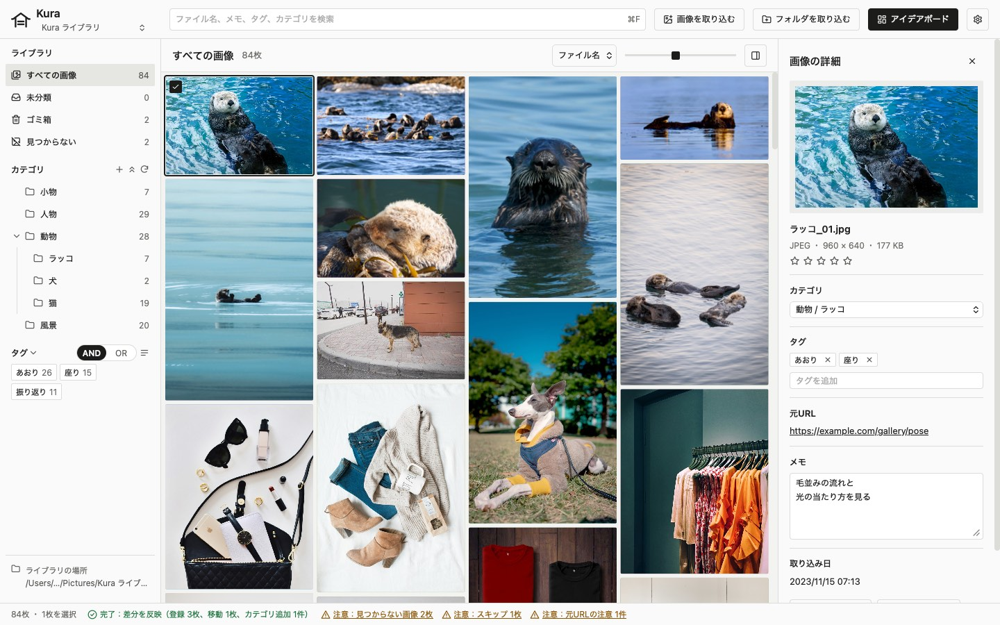
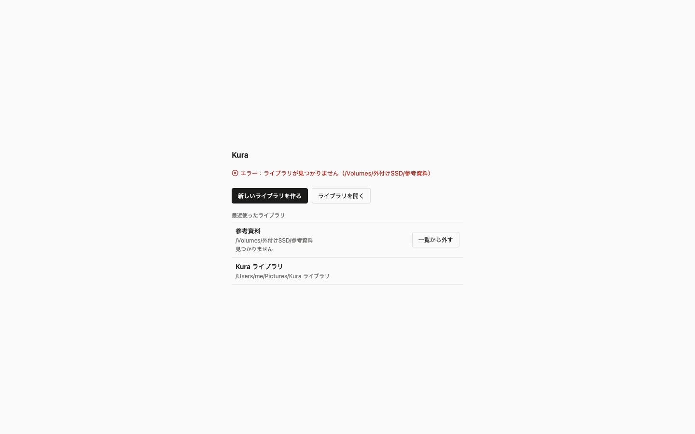
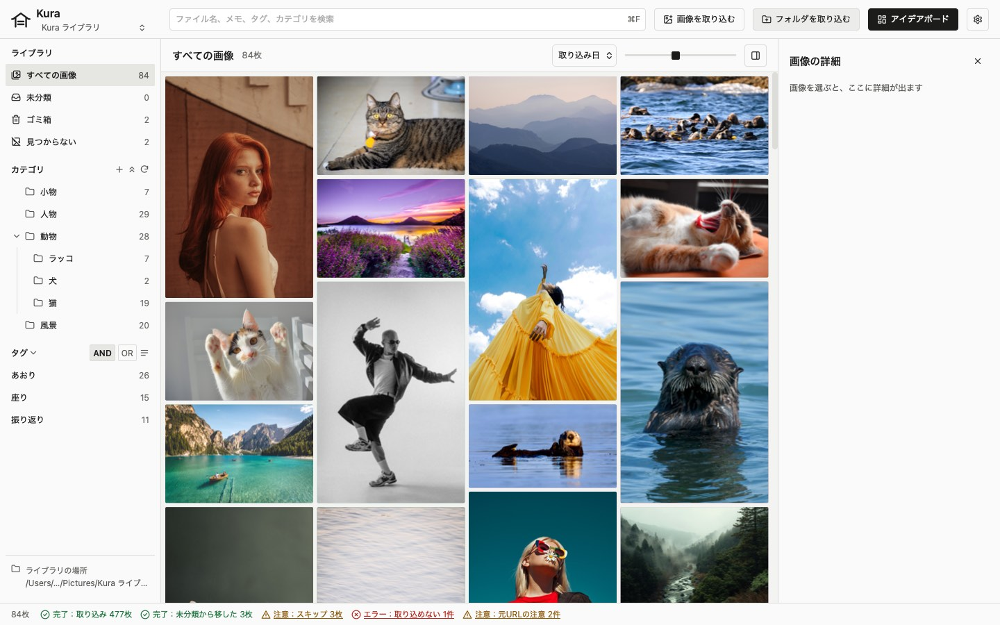
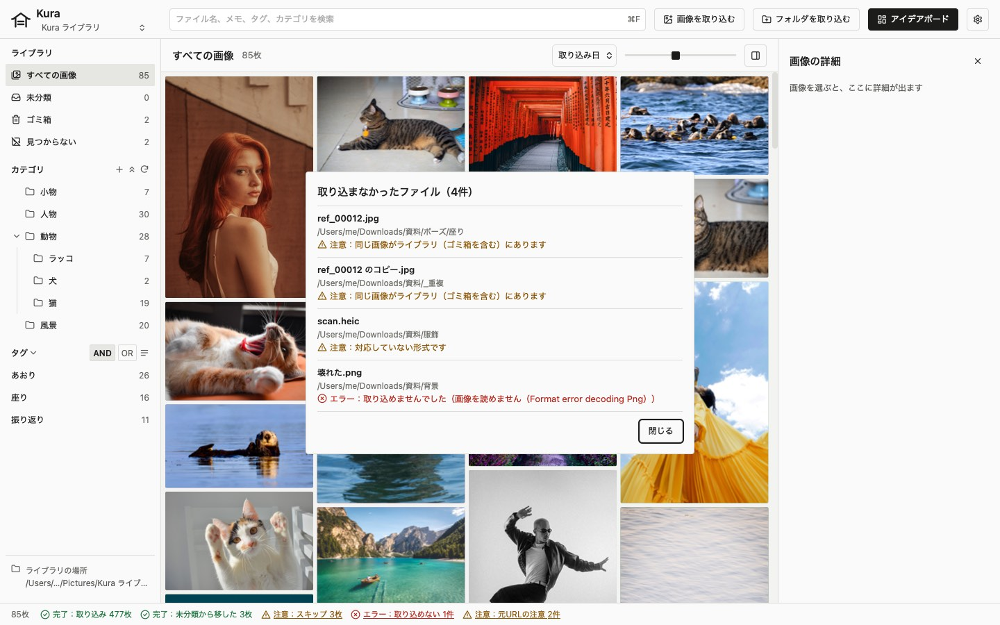
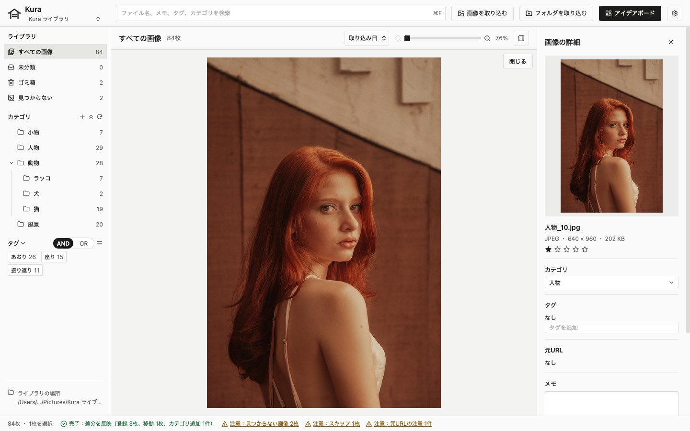
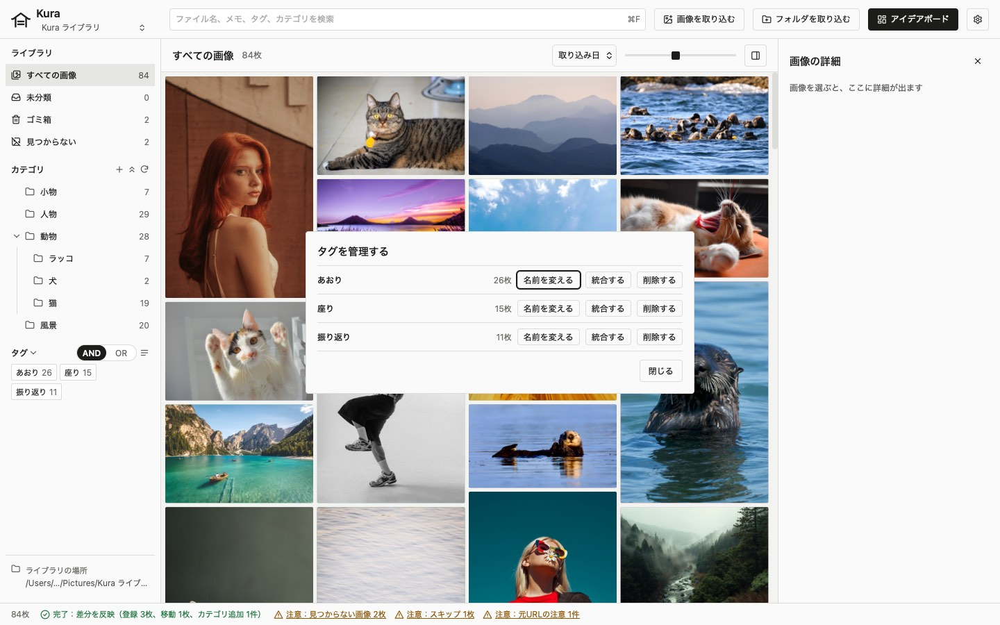
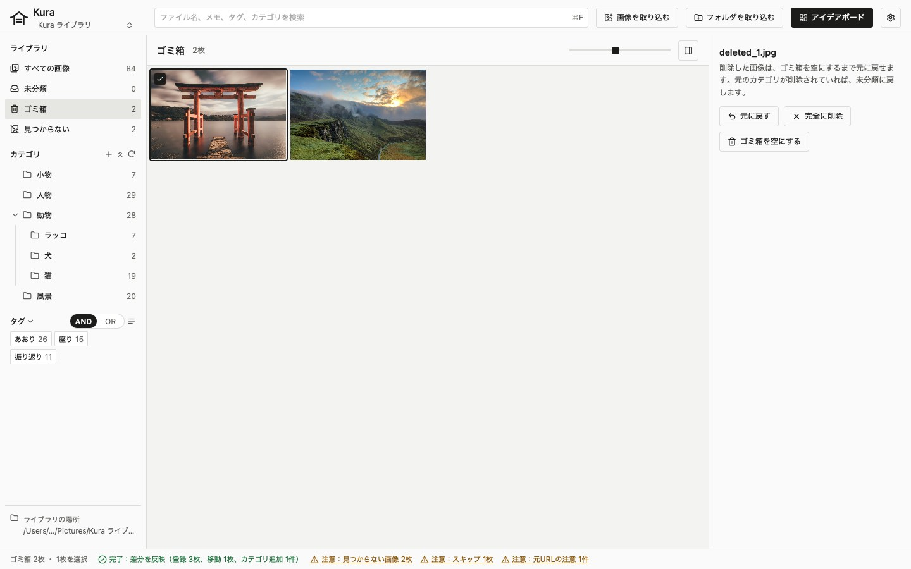
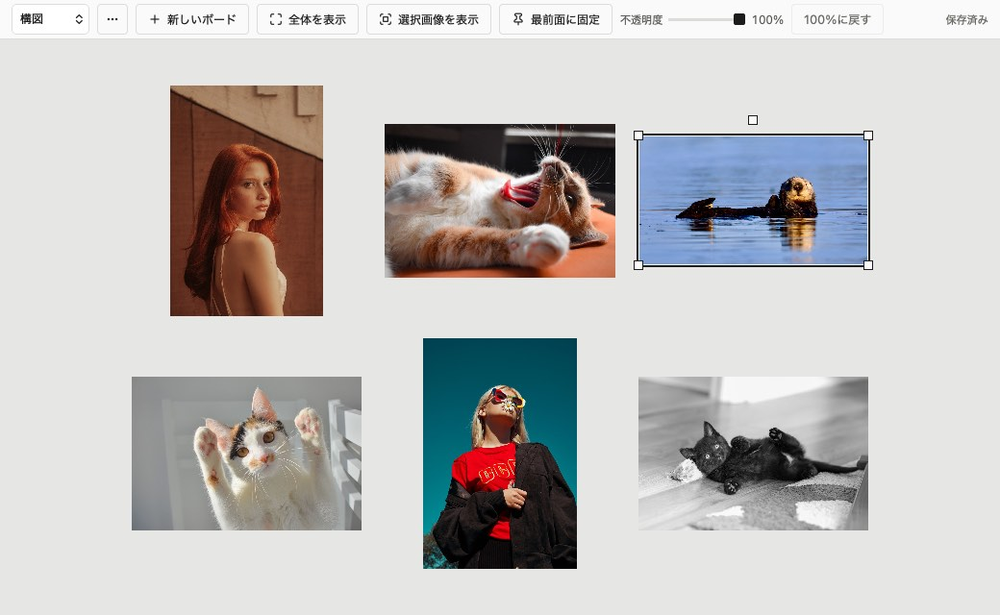
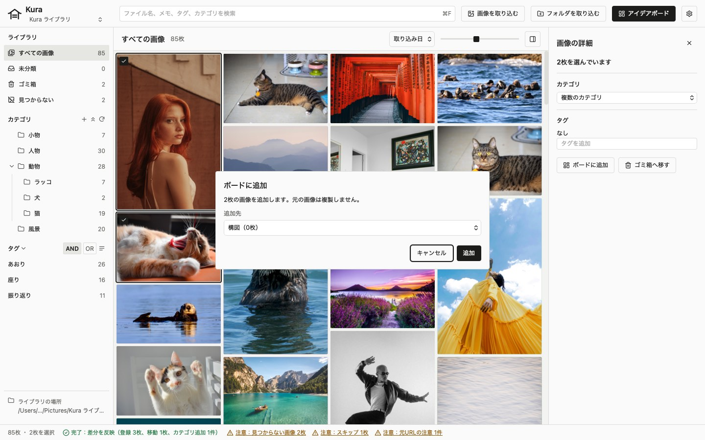
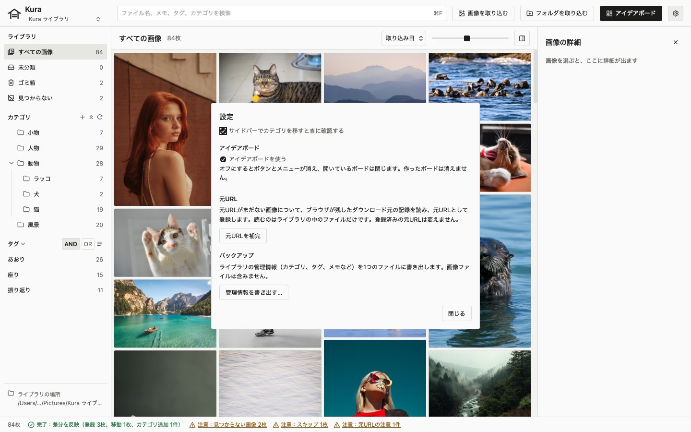

# Kura ユーザーガイド

Kura はイラスト制作に使う参考画像をパソコンの中だけで集め、整理・検索するためのアプリです。画像は普通のフォルダにファイルとして保存するので、Kura がなくても Finder で開けます。

このガイドは現在のバージョンでできることを説明します。URL からの取り込みと似た画像の検索はまだありません。

スクリーンショットには説明用のダミーデータと見本の写真（[Unsplash](https://unsplash.com/ja)）を使用しています。

## 目次

- [ライブラリを作る・開く](#ライブラリを作る開く)
- [画像を取り込む](#画像を取り込む)
- [一覧を見る](#一覧を見る)
- [画像を選ぶ・詳細を見る・拡大する](#画像を選ぶ詳細を見る拡大する)
- [カテゴリ](#カテゴリ)
- [タグ](#タグ)
- [ファイル名、メモ、評価](#ファイル名メモ評価)
- [絞り込みと検索](#絞り込みと検索)
- [ゴミ箱](#ゴミ箱)
- [Finder で変えたとき（差分の確認）](#finder-で変えたとき差分の確認)
- [アイデアボード](#アイデアボード)
- [設定とバックアップ](#設定とバックアップ)
- [キーボードショートカット](#キーボードショートカット)
- [困ったとき](#困ったとき)

## 画面の見方

- 上のヘッダー：開いているライブラリの名前、検索欄、「画像を取り込む」「フォルダを取り込む」、「アイデアボード」、設定（歯車のアイコン）
- 左のサイドバー：すべての画像、未分類、ゴミ箱、カテゴリ、タグ。下端にライブラリの場所
- 真ん中の上の帯：表示中の内容（すべての画像、カテゴリ名など）と画像の枚数、並べ替え、サムネイルの大きさを変えるスライダー、詳細パネルを開閉するボタン
- 真ん中：画像の一覧
- 右の詳細パネル：選んだ画像の情報
- 下のステータスバー：画像の枚数、選んだ画像の枚数、操作の結果

ステータスバーの結果には、種類を示す言葉が先頭に付きます。

| 先頭の言葉 | 意味 |
| --- | --- |
| 完了： | 操作が終わった |
| お知らせ： | 終わったが、知っておいてほしいことがある |
| 注意： | 一部をスキップした、見つからない画像がある |
| エラー： | 操作の一部またはすべてに失敗した |

下線の付いた結果（「注意：スキップ 3枚」など）は、押すと詳細を一覧で確認できます。

## ライブラリを作る・開く

ライブラリは Kura が画像を保存するフォルダです。最初にライブラリを1つ作ります。

### 新しく作る

1. 「新しいライブラリを作る」を押す
2. 空のフォルダを選ぶ（ダイアログの中で新しいフォルダも作れる）

ファイルやフォルダが入っているフォルダは選べません。「空のフォルダを選んでください」と出ます。既存のフォルダにある画像を使うときは、空のライブラリを作ってから、そのフォルダを[取り込み](#画像を取り込む)ます。元のフォルダはそのまま残ります。

作成したライブラリには、次のフォルダができます。

| 名前 | 中身 |
| --- | --- |
| `_未分類/` | カテゴリを決めていない画像 |
| カテゴリと同じ名前のフォルダ | そのカテゴリの画像 |
| `.kura/` | 管理情報（データベース、サムネイル、ゴミ箱）。Finder では非表示。中のファイルを直接変更しないでください |

### 開く

- 「ライブラリを開く」を押し、ライブラリのフォルダ（`.kura/` があるフォルダ）を選ぶ
- 「最近使ったライブラリ」から選ぶ（10件まで出る）

フォルダが見つからないライブラリには「見つかりません」と出て、右に「一覧から外す」が出ます。押すと、確認なしで「最近使ったライブラリ」から消えます。

- 消えるのは一覧の項目だけです。ライブラリのフォルダ、管理情報、ボードは変わりません
- 外したライブラリも、「ライブラリを開く」で選び直せば一覧に戻ります
- 外付けドライブが一時的に外れているだけのこともあるので、Kura が自動で外すことはありません

Kura を起動すると、最後に使ったライブラリを開きます。一度に開けるライブラリは1つです。

### 別のライブラリに切り替える

ヘッダーのライブラリ名を押すと、最近使ったライブラリが表示されます。選ぶとそのライブラリに切り替わります。今開いているライブラリには印が付いています。一覧にないライブラリを開くときや、新しく作るときは、「ほかのライブラリを開く…」を選びます。

メニューバーの「ファイル」→「ライブラリを切り替える…」（⇧⌘O）を選ぶと、ライブラリ選択画面に戻ります。そこで新しいライブラリを作るか、別のライブラリを開きます。

- 直前まで開いていたライブラリは「最近使ったライブラリ」の先頭にあります。押すと開き直します
- 入力中のメモと、開いているボードを保存してから切り替えます。ボードのウィンドウは閉じます。選んでいた画像と絞り込みは元に戻ります
- メモかボードを保存できなかったときは切り替えず、ステータスバーに「エラー：…」と出ます。ヘッダーのライブラリ名から選んだときも同じです
- 取り込みや Finder での変更の反映の途中では切り替えられません。終わってから選び直してください

### 置き場所

ライブラリは内蔵ディスクか外付けドライブ（APFS、HFS+、exFAT）に置いてください。iCloud Drive 内やネットワークドライブ上では動作を保証しません。これらの場所を選ぶと「注意：iCloud Drive の中のフォルダです。…」のように確認が出ます。「続ける」で使えますが、おすすめしません。

## 画像を取り込む

取り込み時に、Kura は画像をライブラリ内へコピーします。元のファイルはそのまま残ります。

### 取り込み方

- ヘッダーの「画像を取り込む」を押し、画像を選ぶ（複数選べる）
- ヘッダーの「フォルダを取り込む」を押し、フォルダを選ぶ
- Finder から画像やフォルダを Kura のウィンドウにドロップする

取り込める形式は JPEG、PNG、WebP、GIF です。GIF は静止画として扱います。HEIC、AVIF、TIFF などは取り込めないので、先に JPEG などに変換してください。

### 入る場所

- 画像を選んだとき：未分類に入る
- フォルダを選んだとき：フォルダと同じ名前のカテゴリを一番上の階層に作り、中の画像を入れる。サブフォルダは子カテゴリになる。空のサブフォルダもカテゴリになる
- 同じ名前のカテゴリがすでにあれば、新しく作らずにそこへ入れる。大文字・小文字の違いは同じ名前とみなす
- ドロップしたときも同じです。サイドバーのカテゴリの上にドロップしても、入る場所は変わりません

### 取り込みの間

取り込みは1枚ずつ進みます。ステータスバーに「取り込み中 240 / 481枚」と進み具合が出ます。取り込み中はヘッダーのボタンの代わりに「取り込み中…」が出て、次の取り込みは受け付けません。一覧は見られます。

### 結果とスキップの一覧

終わると、ステータスバーに結果が出ます。

| 結果 | 意味 |
| --- | --- |
| 完了：取り込み N枚 | 取り込んだ枚数 |
| 完了：未分類から移した N枚 | 同じ画像が未分類にあったので、取り込まずにその画像を取り込み先のカテゴリへ移した枚数。タグとメモは残る |
| 注意：スキップ N枚 | 重複か、対応していない形式で取り込まなかった枚数 |
| エラー：取り込めない N件 | 壊れている画像、読めないフォルダなど |
| 注意：元URLの注意 N件 | 取り込んだが、元URLを全部は保存できなかった枚数（下の「元URL」） |

「スキップ」か「取り込めない」を押すと、「取り込まなかったファイル」の一覧が出ます。ファイル名、場所、理由を確かめられます。

| 理由 | 意味 |
| --- | --- |
| 同じ画像がライブラリ（ゴミ箱を含む）にあります | 中身が同じ画像がすでにある。ファイル名が違っても、中身が同じなら重複とみなす |
| 対応していない形式です | JPEG、PNG、WebP、GIF ではない |
| 取り込めませんでした | 画像が壊れている、フォルダが読めない、`_未分類` のようにカテゴリに使えない名前のフォルダ、など。括弧の中に詳しい理由が出る |

重複は、同じ画像が別のカテゴリかゴミ箱にあるときもスキップします。1回の取り込みの中に同じ画像が何枚かあれば、最初の1枚だけを取り込みます。隠しファイル（名前が `.` で始まるもの）は枚数に含めず、取り込みをスキップします。

### 元URL

ブラウザでダウンロードした画像には、macOS がダウンロード元の記録を付けます。Kura は取り込むときにこの記録を読み、1番目を画像URL、2番目を掲載ページURLとして保存します。保存した元URLは詳細パネルに出ます（「詳細パネル」）。

- 記録がない画像は、元URLなしで取り込みます
- 保存するのは `http://` か `https://` で始まる正しい URL だけです。一方だけが正しければ、その一方を保存します
- 記録を読めなかった画像と、不正な項目があった画像も取り込みます。ステータスバーの「元URLの注意」を押すと、「元URLの注意」の一覧で対象のファイルと理由を確かめられます
- 重複としてスキップした画像では、すでにある画像の元URLを変えません
- 記録はファイルから読むだけで、URL が今も開けるかを確かめる通信はしません
- Finder でライブラリに置いた画像も、差分の確認で登録するときに同じように読みます

#### 取り込み済みの画像の元URLを補完する

元URLの保存ができる前の版で取り込んだ画像は、元URLがありません。設定（ヘッダーの歯車）の「元URLを補完」を押すと、ライブラリの中のファイルから記録を読み直し、元URLを登録します。

- 調べるのは、元URLがまだない画像だけです。画像URLか掲載ページURLの一方でも登録済みの画像は対象外で、値を変えません
- ゴミ箱と「見つからない」画像も対象外です
- 読むのはライブラリの中のファイルだけです。取り込む前の元のフォルダは探しません。通信もしません
- 設定に進み具合が出ます。設定を閉じても補完は続き、ステータスバーに「元URLを補完中 N / M枚」と出ます。その間も一覧を見る、検索する、ボードを編集することはできます
- 「中断」を押すと、調べている画像を終えたところで止まります。それまでに登録した元URLは残ります。もう一度「元URLを補完」を押すと、残りの画像を調べます
- 終わると「補完 N枚、記録なし N枚、読み取り失敗 N枚、対象外 N枚」と出ます。中断したときは先頭に「中断しました。」と付きます。設定を開き直しても、最後の結果を確かめられます
- 補完の間は、取り込み、Finder での変更の反映、画像の名前変更・カテゴリの変更・ゴミ箱への移動など（カテゴリの操作を含む）、ライブラリの切り替えが、補完が終わるか中断するまで待ちます。待っている操作は、補完が終わると続けて行われます。急ぐときは設定から中断してください
- 取り込みと Finder での変更の反映の途中は、補完を始められません
- Kura を起動しただけでは補完しません

## 一覧を見る

### 並べ替え

一覧の上部にある並べ替えメニューで選びます。

| 項目 | 並び |
| --- | --- |
| 取り込み日 | 新しい順 |
| ファイル名 | 名前順。数字は数の大きさで比べる（Finder と同じ） |
| 評価 | 星の多い順 |
| ランダム | 選ぶたびに並びが変わる |

並べ替えの値が同じ画像は取り込み日の新しい順に並びます。

### サムネイルの大きさ

一覧の上部にあるスライダーで変えます。右へ動かすと大きくなります。スライダーの左右のアイコン（縦長の四角が並んだ絵）を押すと、1段ずつ小さく・大きくなります。拡大表示の間は、このスライダーの代わりに画像の倍率のスライダーが出ます。設定した大きさは次に起動したときも保持されます。

## 画像を選ぶ・詳細を見る・拡大する

### 選ぶ

| 操作 | 結果 |
| --- | --- |
| 押す | その画像だけを選ぶ |
| ⌘ を押しながら押す | 選択に足す。選んでいる画像なら外す |
| Shift を押しながら押す | 最後に選んだ画像からその画像まで、並びのとおりにまとめて選ぶ |
| 画像のない所を押す、Escape | 選択を外す |
| ⌘A | 今の一覧の画像をすべて選ぶ |
| 矢印キー | 選択を動かす。左右は並びの前後、上下は同じ列の上下 |

選んだ画像には黒い枠と左上のチェックの印が付きます。

### 詳細パネル

1枚を選ぶと、右の詳細パネルにプレビュー、ファイル名、形式とサイズ（幅 × 高さ、ファイル容量）、評価、カテゴリ、タグ、元URL、メモ、取り込み日が出ます。

元URLは、ダウンロード元の記録があった画像で下線付きのリンクになります。掲載ページURLがあればそれを、なければ画像URLを出します。押すと、確認なしで既定のブラウザが開きます。開けなかったときは、リンクの下に「エラー：ブラウザで開けません」と出ます。`http://` と `https://` 以外の値はリンクにならず、文字として出るだけです。記録がなかった画像では「なし」です。

「Finderで表示」を押すと、Finder が開き、その画像のファイルが選択された状態になります。サイドバーの下端のライブラリの場所を押すと、ライブラリのフォルダを Finder で開きます。

詳細パネルは右上の × か ⌘I で閉じます。一覧の上の帯の右端のボタンか ⌘I で、また開きます。閉じている間に画像を選び直しても、パネルは開きません。

2枚以上を選ぶと、「N枚を選んでいます」と、カテゴリとタグの欄だけが出ます。カテゴリとタグは、選んだ画像にまとめて設定できます。

アイデアボードを使うときは、1枚でも2枚以上でも「ボードに追加」が出ます（[画像を追加する](#画像を追加する)）。

### 拡大表示

画像をダブルクリックするか、1枚を選んで Space を押すと、一覧の位置に画像が拡大表示されます。詳細パネルのサムネイルをダブルクリックしても開きます。

- 左右キーで前後の画像に移る。左右の端にマウスを乗せると出る < と > を押しても移れる
- 先頭と末尾では止まる
- Escape、Space、「閉じる」で閉じる。一覧は元のスクロールの位置に戻る

拡大表示の中では、画像を拡大・縮小できます。

- トラックパッドでピンチすると、指の位置を中心に拡大・縮小する
- 一覧の上部の倍率のスライダーと、その左右の虫眼鏡の「−」「＋」でも変えられる。右に、原寸（画像の1ピクセルを画面の1ポイント）を 100% とした倍率が出る
- ⌘＋と⌘−で拡大・縮小、⌘0 で原寸、⌘9 で枠に合わせた大きさになる
- 枠からはみ出した画像は、ドラッグするか、2本指でスクロールすると動かせる
- 前後の画像へ移ると、枠に合わせた大きさに戻る

## カテゴリ

カテゴリはライブラリの中のフォルダと1対1で対応します。1枚の画像が属するカテゴリは1つだけです。いくつかの分類を付けたいときは[タグ](#タグ)を使います。

サイドバーの「カテゴリ」の見出しの右にボタンがあります。

| ボタン | 操作 |
| --- | --- |
| ＋ | 一番上の階層にカテゴリを作る |
| 上向きの二重の矢印 | すべてのカテゴリを閉じる |
| ↻ | 差分を確認する（[Finder で変えたとき](#finder-で変えたとき差分の確認)） |

### 作る

- 一番上の階層に作る：見出しの ＋ を押す
- あるカテゴリの下に作る：そのカテゴリの行にマウスを乗せ、右に出る ＋ を押す

入力欄に名前を入れて Enter で作ります。Escape か入力欄の外を押すと取り消します。作れないとき（同じ名前がある、など）は、入力欄の下に理由が出ます。

### 画像のカテゴリを変える

詳細パネルの「カテゴリ」の入力欄を押すと、「未分類」とすべてのカテゴリが一覧で出ます。文字を入れると、名前（親のカテゴリの名前も含む）で絞り込めます。押すか、上下キーで選んで Enter を押すと、すぐに画像のファイルがそのフォルダへ移ります。Escape で取り消します。選んだ画像のカテゴリがそろっていなければ、「複数のカテゴリ」と出ます。

移せない画像があると、ステータスバーに「エラー：移せない N枚」と出ます。押すと理由の一覧が出ます。移せなかった画像は元の場所に残ります。

### 名前を変える

サイドバーのカテゴリをダブルクリックし、入力欄で名前を変えて Enter を押します。フォルダの名前も変わります。

### 移す

サイドバーのカテゴリを、別のカテゴリの上へドラッグします。一番上の階層へ移すときは、「カテゴリ」の見出しの上へドラッグします。カーソルの横に、何をどこへ移すかが出ます。離すと確認が出るので、「移す」を押します。フォルダも中の画像ごと移ります。

- そのカテゴリの下の階層にあるカテゴリへは移せない
- 移す先に同じ名前のカテゴリがあると移せない
- ドラッグの途中で Escape を押すとやめる
- 確認で「今後は確認しない」を選ぶと、次からは確認せずに移す。確認を戻すときは[設定](#設定とバックアップ)で戻す

### 開く・閉じる

子のあるカテゴリは名前の左の矢印で開閉できます。閉じた状態はライブラリごとに残ります。

### 削除する

カテゴリの行にマウスを乗せ、右に出るゴミ箱の形のボタンを押します。確認で、消えるカテゴリの数と未分類へ移る画像の枚数が出ます。「削除する」を押すと、子カテゴリもまとめて消えます。

画像は消えません。中の画像はすべて未分類へ移ります。Kura が管理していないファイルがフォルダに残っていたときは、そのフォルダを `.kura/trash/` に移します。

## タグ

タグはファイルの置き場所に関係なく、1枚の画像にいくつでも付けられます。

### 付ける

1. 画像を選ぶ（何枚でもよい）
2. 詳細パネルの「タグを追加」に名前を入れる（T キーでここへ移れる）
3. Enter を押す

何も入れずに入力欄を押すと、すべてのタグが名前の順に一覧で出ます。入力すると、その文字を含む既存のタグが8件まで候補に出ます。上下キーか Tab・Shift+Tab で選び、Enter で付けます。かな漢字変換を確定する Enter では付きません。Escape で入力を消します。

入力欄の下には、この起動の間に付けたタグが、新しい順に5個まで出ます。押すと、選んでいる画像に付きます。選んでいる画像のすべてに付いているタグは出ません。アプリを閉じるか、ライブラリを開き直すと消えます。

前後の空白は除かれます。大文字・小文字だけが違う名前は、既存のタグと同じとみなして既存のタグを付けます。

### 外す

詳細パネルのタグの × を押します。複数を選んでいるとき、一部の画像にだけ付いているタグには、付いている枚数（例：1/4）が出ます。× を押すと、選んだ画像のすべてから外します。

外してもタグ自体は消えません。どの画像にも付いていないタグも、サイドバーに残ります。

### タグ管理

サイドバーの「タグ」の見出しの右の ≡ を押すと、「タグを管理する」が開きます。タグごとに、付いている枚数（ゴミ箱を除く）と3つのボタンが出ます。

| ボタン | 操作 |
| --- | --- |
| 名前を変える | 入力欄で名前を変える。ほかのタグと同じ名前にはできない。まとめたいときは統合を使う |
| 統合する | 「統合先」を選び、確かめてから「統合する」を押す。元のタグが付いていた画像に統合先のタグが付き、元のタグは消える |
| 削除する | 確かめてから「削除する」を押す。付いていたすべての画像からタグが外れる。画像は消えない |

統合と削除は元に戻せません。ゴミ箱の画像に付いたタグも対象になります。

## ファイル名、メモ、評価

1枚だけを選んでいるときに、詳細パネルで変えます。

- ファイル名：名前をダブルクリックし、拡張子より前の部分を変えて Enter を押す。実際のファイルの名前も変わる。Escape で取り消す
- 評価：星を押す。今と同じ星を押すと評価なしに戻る
- メモ：入力欄に書く。入力欄から離れたとき（別の画像を選んだときを含む）に保存する。保存できなければ入力欄の下に「メモを保存できません」と出る

ゴミ箱の画像のメモと評価は変えられません。

## 絞り込みと検索

### サイドバー

- 「すべての画像」「未分類」、カテゴリのどれか1つを押すと、そこにある画像だけが出る。カテゴリを押すと、子カテゴリの画像も出る
- タグは一覧の画像と同じ選び方をする。押すとそのタグだけを選ぶ。選んでいるタグを押すと、そのタグだけが外れる（ほかのタグの選択は残る）。⌘ を押しながら押すと足す（選んでいるタグなら外す）。Shift を押しながら押すと、最後に選んだタグからそこまでをまとめて選ぶ（範囲は、選んだタグを先頭へ寄せる前の並びで決まる）
- タグは四角い部品を折り返して並べ、名前の右に付いている枚数を出す。選んでいるタグは黒く塗り、一覧の先頭へ寄せる。下の方のタグが選ばれたままになっていても気づけるようにするため
- タグを押した後は、Escape でタグの選択を外し、⌘A でタグをすべて選ぶ。サイドバーの何もない所を押しても、タグの選択が外れる
- タグの見出しの AND と OR のスイッチで組み合わせを切り替える。AND を選ぶと、選んだタグをすべて含む画像が出る。OR を選ぶと、どれかを含む画像が出る（初めは AND）
- カテゴリとタグは組み合わせて絞り込める
- タグの見出しの「タグ」を押すと、タグ一覧を閉じる・開く。閉じている間も、選んでいるタグは出る。閉じた状態は次に起動したときも残る

サイドバーの件数は絞り込みに関係なく、ゴミ箱以外のすべての画像を対象に数えます。カテゴリの件数には子カテゴリの画像も入ります。

### 検索欄

ヘッダーの検索欄（⌘F で移れる）に文字を入れると、ファイル名、メモ、タグ名、カテゴリ名のどれかにその文字を含む画像が出ます。

- 空白で区切ると、すべての語を含む画像が出る
- 大文字・小文字の違いは無視する
- 入力すると、名前にその文字を含むカテゴリとタグが5件ずつ候補に出る。選ぶとそのカテゴリかタグで絞り込み、入力した文字は消える。操作はタグの候補と同じ
- Escape で入力した文字を消す

### 絞り込んでいるとき

- ステータスバーに「出ている枚数 / 全体の枚数」が出る
- 見えなくなった画像の選択は外れる
- 条件に合う画像がなければ「条件に合う画像がありません」と出る
- 絞り込みの条件は残らない。ライブラリを開き直すと、すべての画像に戻る

## ゴミ箱

削除した画像は Kura 内のゴミ箱に入ります。ゴミ箱を空にするまでは元に戻せます。Kura がゴミ箱の画像を自動で消すことはありません。

### ゴミ箱へ移す

画像を選び、詳細パネルの「ゴミ箱へ移す」を押すか、⌘Delete を押します。元に戻せるので、確認は出ません。

### ゴミ箱を開く

サイドバーの「ゴミ箱」を押すと、一覧がゴミ箱の画像になります。削除した日時が新しい順に並びます。ゴミ箱では並べ替え、絞り込み、拡大表示はできません。サイドバーのほかの項目を押すと、ゴミ箱を閉じます。

| ボタン | 操作 |
| --- | --- |
| 元に戻す | 選んだ画像を元のカテゴリへ戻す。タグとメモもそのまま戻る |
| 完全に削除 | 選んだ画像を完全に消す。確認が出る |
| ゴミ箱を空にする | ゴミ箱のすべての画像を完全に消す。確認が出る |

- 元のカテゴリが削除されていれば、未分類へ戻します。ステータスバーに「お知らせ：元のカテゴリがないため未分類に戻した N枚」と出ます
- 戻す先に同じ名前のファイルがあれば、名前に連番を付けます
- 完全に削除すると、ファイル、タグ、メモ、評価、元URL、サムネイルが消えます。元に戻せません
- カテゴリの削除で `.kura/trash/` に移したフォルダは、ゴミ箱を空にしても消えません

## Finder で変えたとき（差分の確認）

Finder でライブラリの中の画像やフォルダを足したり、移したり、消したりしても大丈夫です。Kura は次のときに差分を確かめて、一覧に反映します。

- ライブラリを開いた後
- サイドバーの「カテゴリ」の見出しの ↻（差分を確認）を押したとき

Kura はフォルダの変更を常時監視していません。Kura を開いたまま Finder で変更したときは、↻ を押してください。

### 確かめている間

先に一覧を表示してから、Finder での変更を確認します。ステータスバーに「Finder での変更を反映中 N / M枚」と出ます。その間も一覧を見て操作できます。取り込みは終わるまで受け付けません。

### 反映のしかた

| Finder でしたこと | Kura の動き |
| --- | --- |
| 画像を足した | 取り込みと同じく登録する。重複はスキップの一覧に出る。ダウンロード元の記録があれば元URLとして保存する |
| フォルダを足した | カテゴリとして登録する |
| 画像を別のフォルダへ移した、名前を変えた | 同じ画像として、カテゴリとファイル名を変える。タグとメモは残る |
| 画像を編集した（同じ場所で中身が変わった） | 同じ画像として、サイズとサムネイルを新しくする。タグとメモは残る |
| 画像を消した、ライブラリの外へ出した | 「見つからない」画像にする |
| カテゴリのフォルダを消した・移した | カテゴリを子カテゴリごと消す。中の画像は、移した先で見つかれば移動として扱い、見つからなければ未分類の「見つからない」画像にする |

結果は「完了：差分を反映（登録 3枚、移動 1枚、…）」のようにステータスバーに出ます。変更がなければ「完了：Finder での変更はありません」と出ます。

次のものは登録せず、「登録しなかったファイル」の一覧で知らせます。

- ライブラリの直下に置いた画像（カテゴリのフォルダか `_未分類/` に置いてください）
- `_未分類/` の中に作ったフォルダ
- 対応していない形式のファイル

### 「見つからない」画像

見つからない画像は通常の一覧には表示されず、サイドバーの件数にも含まれません。1枚以上あると、サイドバーの「ゴミ箱」の下に「見つからない」と枚数が出ます。ステータスバーの「注意：見つからない画像 N枚」を押しても開けます。

見つからない画像には、タグとメモが残っています。戻すときは、ファイルを元の場所に戻すか、ライブラリの中に置いてから ↻ を押します。

不要なときは、「見つからない」を開いて画像を選び、「一覧から外す」を押します。確認が出ます。外すと、その画像のタグ、メモ、評価が消えます。元に戻せません。

## アイデアボード

アイデアボードは、参考画像を並べて見るための専用のウィンドウです。ボードは開いているライブラリの中に保存します。

### 開く

ヘッダーの「アイデアボード」を押すか、「ウインドウ」→「アイデアボードを開く」（⌘B）を選びます。画像を選んでいても、開くだけでは画像はボードに入りません。

- 開けるウィンドウは1つだけです。もう一度開く操作をすると、開いているウィンドウが手前に出ます
- 開くと、そのライブラリで最後に使ったボードが出ます
- ボードがまだなければ「ボードを作成」が出ます。開いただけではボードは作られません
- 最後に使ったボードを削除していたら、残っているボードの一覧が出ます。開くボードを選んでください
- ボードのウィンドウを閉じても（赤い閉じるボタン、⌘W）、ギャラリーはそのまま残ります。ギャラリーを閉じるか ⌘Q で、ボードも閉じて Kura が終わります
- 別のライブラリに切り替えると、前のライブラリのボードは閉じます
- どの場合も、ボードと入力中のメモを保存し終えてから閉じます（[保存](#保存)）

### 作る・切り替える

ウィンドウの上にボードの選択欄、「…」（ボードの操作）、「新しいボード」が並びます。

- 「新しいボード」（ボードがないときは「ボードを作成」）を押すと名前を聞かれます。初めの名前は「新しいボード」で、使用済みなら「新しいボード 2」のように番号が付きます。そのまま「作成」を押しても作れます。「キャンセル」では作りません
- 選択欄でボードを選ぶと切り替わります。今のボードを保存できなかったときは切り替わりません

ボード名は前後の空白を除いて1〜100文字です。`/` などの記号も使えます。同じライブラリの中では、大文字と小文字の違い、濁点の書き方の違いだけの名前は同じ名前とみなします。別のライブラリなら同じ名前を使えます。名前に問題があると、入力欄の下に「エラー：…」と出ます。

### 画像を追加する

ギャラリーで画像を選び、次のどれかで「ボードに追加」のダイアログを開きます。どれも同じダイアログです。

- 詳細パネルの「ボードに追加」（1枚でも、2枚以上を選んでいても出ます）
- 画像を右クリックして「ボードに追加…」。選んでいない画像を右クリックすると、その画像だけを選びます
- 「ファイル」→「ボードに追加…」（⇧⌘B）。ギャラリーのウィンドウが手前で、追加できる画像を選んでいるときだけ押せます。ボードのウィンドウが手前のときや、ダイアログを開いている間は押せません

- 「追加先」で、追加するボードを選びます。初めは、開いているボード（閉じていれば最後に使ったボード）が選ばれています。最後に使ったボードを削除していたら、最近更新したボードが選ばれます
- 「新しいボード…」を選ぶと名前の欄が出ます。名前を付けて新しいボードに追加できます。名前の決まりは「作る・切り替える」と同じで、問題があると名前の欄の下に「エラー：…」と出ます
- 「追加」を押すと、ボードのウィンドウが手前に出て、追加した画像が選ばれ、全部が見える大きさで表示されます。「キャンセル」では、画像も追加せず、新しいボードも作りません
- 追加した画像は縦横比を保ち、同じ大きさの枠に収まるように格子状に並びます。空のボードでは中央に、画像があるボードではその右側に並びます。前から置いてある画像は動きません
- 同じ画像を何度でも追加できます。追加するたびに別々に動かせる画像として置かれます。元の画像ファイルは複製しません
- 画像を選んでいないとき、ゴミ箱と「見つからない」の一覧では追加できません

### 画像を選ぶ・動かす・大きさを変える

- 画像を押すと、その画像だけが選ばれます。何もない所を押すと選択が外れます
- ⌘ か Shift を押しながら画像を押すと、選択に足します。選んである画像を押すと外れます。どちらのキーでも同じです
- 何もない所からドラッグすると枠が出て、枠に少しでも入った画像が選ばれます。⌘ か Shift を押しながら引くと、今の選択に足します
- ⌘A で、ボードの画像をすべて選びます
- 選んだ画像をドラッグすると動きます。複数を選んでいれば、互いの位置を保ったまま一緒に動きます
- 選んだ画像を囲む枠の四隅に、小さな四角（ハンドル）が出ます。ハンドルをドラッグすると、縦横比を保って大きさが変わります。複数を選んでいれば、互いの位置を保ったまま一緒に変わります。引いた角の向かいの角は動きません
- delete キーで、選んだ画像をボードから外します。元の画像はライブラリに残り、同じ画像をボードの別の所に置いていれば、そちらも残ります。間違えて外したときは ⌘Z で戻せます

動かす、大きさを変える、外す操作は、指を離したときや押したときに自動で保存されます。

名前の入力欄やダイアログ、メニューを開いている間は、delete、⌘A、⌘Z、⇧⌘Z、Space はボードの画像に効きません。入力欄での ⌘Z と ⌘A は、入力した文字を取り消す・すべて選ぶ操作になります。

メニューバーの「編集」→「取り消す」「やり直す」「すべてを選択」も、キーと同じく手前のウィンドウに効きます。ボードのウィンドウが手前ならボードの画像に、ギャラリーが手前ならギャラリーの一覧に、入力欄で文字を入れている間はその文字に効きます。

画像を右クリックして出るメニューは、ウィンドウが低くて全部が入らないときは、メニューの中をスクロールして下の項目を出せます。

### 重なり順を変える

画像が重なっているときの前後は、画像を右クリックして出るメニューで変えます。

- 「最前面へ」：ほかのすべての画像の手前に出す
- 「1つ前へ」：1枚分だけ手前に出す
- 「1つ後ろへ」：1枚分だけ奥に送る
- 「最背面へ」：ほかのすべての画像の奥に送る

選んでいない画像を右クリックすると、その画像だけを選びます。複数を選んで右クリックすると、選んだ画像同士の前後を保ったまま、まとめて動きます。もう動かせない向きの項目は押せません（一番手前の画像の「最前面へ」など）。

画像を選んだり動かしたりするだけでは、前後は変わりません。新しく追加した画像は、一番手前に置かれます。

### 反転・回転・グレースケール・トリミング

画像を1枚だけ選ぶと、その画像の見え方を変えられます。変わるのはボードに置いたその1枚だけです。元の画像ファイル、ギャラリー、同じ画像をボードの別の所に置いたものは変わりません。2枚以上を選んでいる間は使えません。

画像を右クリックして出るメニューから選びます。

- 「左右反転」：左右を入れ替えます。もう一度選ぶと戻ります
- 「グレースケール」：白黒で表示します。もう一度選ぶと戻ります。反転とは別々に切り替えられます。ON の項目にはチェックが付きます
- 「右へ90度回転」：右回りに90度回します
- 「回転をリセット」：回転を元（0度）に戻します
- 「トリミング」：画像の一部だけを表示します（下の手順）
- 「トリミングを解除」：元の画像の全体を表示に戻します

自由な角度に回すには、選んだ画像を囲む枠の上に出る小さな四角（回転のハンドル）をドラッグします。Shift を押している間は15度刻みになります。回した画像を選ぶと、回した後の画像を囲む枠が出ます。大きさを変えるハンドルは、その枠の四隅にあります。

トリミングの手順：

1. 画像を右クリックして「トリミング」を選びます。左上に「切り抜く範囲をドラッグしてください。Esc でやめます」と出て、トリミング済みの画像は元の全体が出ます
2. 残したい範囲を、四角くドラッグします。画像の外まで引いた分は無視されます
3. 指を離すと、その範囲だけの表示になります。残した部分は同じ場所に残ります

- 範囲を選び直すときは、もう一度「トリミング」を選びます。反転や回転をした画像でも、見えている向きのまま範囲を選べます
- やめるときは Esc を押すか、ドラッグせずにクリックします
- 選べる範囲は四角形だけです

反転、回転、グレースケール、トリミングも自動で保存され、⌘Z で取り消せます。

元の画像を表示できない枠（[元の画像を削除・移動したとき](#元の画像を削除移動したとき)）では、これらの項目は押せず、回転のハンドルも出ません。

### 元の画像を削除・移動したとき

ボードは元の画像を複製せず、ライブラリの画像を参照します。ギャラリーや Finder で元の画像を変えると、ボードは次のようになります。ボードを開いたままでも、ギャラリーでの操作と差分の確認が終わるとすぐに変わります。

- 名前を変えた、カテゴリを移した：同じ画像がそのまま表示されます
- ゴミ箱へ移した：画像の代わりに「ゴミ箱にあります」とファイル名の枠が出ます。ゴミ箱から元に戻すと、同じ位置・大きさ・加工で画像が戻ります
- Finder で消した・ライブラリの外へ移した：差分を確認すると「見つからない」の枠になります。ファイルを戻して差分を確認すると、画像が戻ります
- ゴミ箱から完全に削除した、「見つからない」画像を一覧から外した：「削除された画像」と、削除する前のファイル名の枠が残ります。同じ画像を取り込み直しても、この枠には戻りません。もう一度ギャラリーから追加してください

枠も、選ぶ・動かす・大きさを変える・重なり順を変える・ボードから外す（delete キー）ことができます。反転・回転・グレースケール・トリミングは、画像が表示されている間だけ使えます。枠になる前の加工は残ります。

### ギャラリーで表示

ボードの画像を1枚だけ選び、右クリックして「ギャラリーで表示」を選ぶと、ギャラリーのウィンドウが手前に出て、その画像が選ばれた状態で見える所に出ます。ボードのウィンドウは開いたままです。

- 検索やカテゴリ・タグでの絞り込みは解除されます
- ゴミ箱にある画像は「ゴミ箱」の一覧で、見つからない画像は「見つからない」の一覧で選ばれます
- 「削除された画像」の枠と、2枚以上を選んでいる間は押せません
- ギャラリーで確認のダイアログなどを開いている間は、ウィンドウが手前に出るだけで、選択は変わりません
- ボードを「最前面に固定」していると、ギャラリーはボードの後ろに出ます。ギャラリーで設定や確認のダイアログを開いている間だけは固定が外れ、ダイアログがボードの後ろに隠れません

### 取り消す・やり直す

- ⌘Z で、直前の操作を取り消します。続けて押すと、さらに前の操作へ1つずつ戻ります
- ⇧⌘Z で、取り消した操作をやり直します。取り消した後に別の操作をすると、やり直せなくなります
- 取り消せるのは、ギャラリーからの画像の追加、ボードから外す、動かす、大きさを変える、重なり順を変える、反転、回転、グレースケール、トリミングとその解除です。ドラッグ1回が1つの操作です
- 取り消した結果・やり直した結果も、自動で保存されます
- 選択、表示の位置と倍率、ボードの作成・名前の変更・削除は取り消せません
- 取り消せるのは、今のボードを開いてからの操作だけです。別のボードに切り替えるか、ボードのウィンドウを閉じると、それより前の操作は取り消せなくなります。ボードの中身は、そのまま残ります
- 外した画像を ⌘Z で戻したとき、その間に元の画像がゴミ箱に移されたり削除されたりしていたら、画像の代わりにその状態を示す枠が出ます

### 表示を動かす・拡大する

- Space を押しながらドラッグするか、マウスの中ボタンでドラッグすると、ボードの見えている範囲が動きます。画像の上から引いても、画像は動きません
- マウスのホイールを回すか、トラックパッドでピンチすると、ポインターのある所を中心に拡大・縮小します。トラックパッドの2本指のスクロールも、ホイールと同じく拡大・縮小になります
- 「全体を表示」を押すと、ボードの画像がすべて見える位置と大きさになります。画像を見失ったときも、これで戻れます
- 「選択画像を表示」を押すと、選んでいる画像がすべて見える位置と大きさになります

見えている位置と倍率もボードごとに自動で保存され、次に開いたときに同じ表示で出ます。

### ほかのアプリの手前に固定する・透かす

描画ソフトの手前や横にボードを置いたまま描くための設定です。ウィンドウの上の帯で変えます。ウィンドウが狭いときは、上の帯が折り返して2段以上になります。

- 「最前面に固定」：押すと、ほかのアプリを使っている間もボードのウィンドウが手前に残ります。もう一度押すと元に戻ります。固定されるのはボードのウィンドウだけで、ギャラリーのウィンドウは固定されません。初めは固定していません。ギャラリーで設定や確認のダイアログを開いている間は、ダイアログを操作できるよう固定が一時的に外れ、ダイアログを閉じると戻ります
- 「不透明度」のスライダー：左へ動かすと、タイトルバーを含むウィンドウ全体が透けて、後ろが見えます。30%から100%の間で変えられます。初めは100%（透けない）です
- 「100%に戻す」：透けない状態に戻します

透かしていても、ボードの上のクリックは後ろのアプリには届きません。後ろのアプリを操作するときは、ボードのない所を押すか、ボードをどかしてください。

固定するかどうか、不透明度、ウィンドウの位置と大きさは、Kura 全体で1つだけ覚えます。ボードやライブラリを切り替えても、ウィンドウを閉じて開き直しても、Kura を起動し直しても同じです。設定の「アイデアボードを使う」を外しても消えません。

- 初めて開くときは、ギャラリーのウィンドウと同じディスプレイの中央に出ます
- 外したディスプレイに置いていたときや、画面からはみ出していたときは、次に開くときに今の画面の中へ寄せます。画面より大きければ、画面の大きさに縮めます
- 位置と大きさは、ボードのウィンドウを閉じたときと Kura を終了したときに覚えます
- 設定を保存できなかったときは、前の状態に戻して「エラー：…」と出ます

名前の似た右クリックメニューの「最前面へ」は、ボードの中で画像をほかの画像の手前に出す操作です（[重なり順を変える](#重なり順を変える)）。

### 保存

ボードは自動で保存されます。ウィンドウの上の右端に、保存の状態が出ます。

- 「保存中…」：保存しています
- 「保存済み」：画面のとおりに保存できています
- 「エラー：保存できませんでした（…）」：保存できませんでした。動かした位置は画面に残ります。ドライブをつなぎ直すなどしてから「再試行」を押してください。次に画像を動かしたときも、もう一度保存します

保存できないままボードを閉じる、ボードを切り替える、Kura を終了する、ライブラリを切り替える、アイデアボードを使わない設定にする、のどれかをすると、その操作は止まります。ボードは開いたままで、エラーが出ます。保存できてから、もう一度操作してください。入力中のメモも同じで、保存できなければ Kura は終了しません。

- 保存を待っている間と、ギャラリーから画像を追加している間は、画像を動かしても元の位置に戻ります。終わってから動かしてください
- Dock の右クリックの「終了」も、⌘Q と同じく保存を待ちます。保存できなければ終了しません
- ログアウトや再起動でも保存を待ち、保存できなければ Kura がログアウトを止めます。macOS が強制的に終わらせた場合は待てないので、終わる前にボードの状態が「保存済み」になっているか確かめてください

### 名前を変える・削除する

「…」を押して「名前を変更…」か「削除…」を選びます。

削除の前に、ボード名と置いた画像の枚数を示して確認します。削除するのはボードと画像の配置だけで、元の画像はライブラリに残ります。削除したボードは戻せません。削除の後は残っているボードの一覧が出て、ボードが残っていなければ「ボードを作成」が出ます。削除できなかったときは、ボードを開いたまま「エラー：…」と出ます。

### 使わないとき

設定の「アイデアボードを使う」を外すと、ヘッダーの「アイデアボード」、詳細パネルと右クリックの「ボードに追加」、メニューの「アイデアボードを開く」「ボードに追加…」、⌘B と ⇧⌘B が消え、開いているボードは保存してから閉じます。ボードを保存できなかったときは設定を変えず、ボードを開いたままにします。作ったボードは消えません。もう一度チェックを入れると入口が戻ります。そのときボードは自動では開きません。初めは「使う」になっています。

## 設定とバックアップ

ヘッダーの右端の歯車のアイコン（設定）か ⌘, で開きます。

- 「サイドバーでカテゴリを移すときに確認する」：カテゴリを移す前の確認を出すかどうか
- 「アイデアボードを使う」：アイデアボードの入口を出すかどうか（[使わないとき](#使わないとき)）
- 「元URLを補完」：取り込み済みの画像の元URLを、ダウンロード元の記録から補う（[取り込み済みの画像の元URLを補完する](#取り込み済みの画像の元urlを補完する)）
- 「管理情報を書き出す…」：バックアップを作る

設定はすべてのライブラリで共通です。

### バックアップを作る

1. 設定の「管理情報を書き出す…」を押す
2. 保存先を選ぶ。初めの名前は `<ライブラリのフォルダ名>-<日付>.db`
3. 「完了：… に書き出しました」と出れば終わり

書き出したファイルには、カテゴリ、タグ、メモ、評価などの管理情報が入ります。画像ファイルとサムネイルは入りません。画像はライブラリのフォルダごと Time Machine などでバックアップしてください。

ライブラリを開いたまま書き出せます。保存先に同じ名前のファイルがあれば置き換えます。書き出しが途中で失敗しても、以前のバックアップファイルは使えなくなりません。

### 更新の前の自動の写し

Kura を新しい版に上げると、ライブラリを開いたときに管理情報の形式を新しくすることがあります。形式を新しくした後は、古い版の Kura でそのライブラリを開けません。そのため Kura は、形式を新しくする直前に、管理情報の写しを `.kura/backups/kura-v<前の形式の番号>-<日時>.db` に自動で残します。写しを残せないときは、形式を新しくせず、ライブラリも開きません。

写しは自動では消えません。古い版の Kura に戻したいときは、この写しを使って下の「バックアップから戻す」の手順で戻します。要らなくなった写しは Finder で消してかまいません。

### バックアップから戻す

Kura にはバックアップを復元する機能がありません。次の手順で手動で復元します。

1. Kura を終了する
2. Finder でライブラリのフォルダを開き、⌘⇧. で隠しファイルを表示する
3. `.kura/` の中の `kura.db` を、書き出したファイルに置き換える。名前は `kura.db` にする
4. 同じ場所に `kura.db-wal` と `kura.db-shm` があれば消す。残すと、古い変更が復元した DB に適用され、DB が使えなくなるおそれがある
5. Kura でライブラリを開く

書き出した後に追加・移動・削除した画像については、ライブラリを開いた後に Kura が差分を確認して変更を反映するか、「見つからない」画像として知らせます。

## キーボードショートカット

| キー | 操作 |
| --- | --- |
| ⌘F | 検索欄へ移る |
| 矢印キー | 一覧で選択を動かす。何も選んでいなければ先頭を選ぶ。拡大表示中の左右は前後の画像へ移る |
| Space | 拡大表示を開く・閉じる（1枚を選んでいるとき） |
| ⌘＋ / ⌘− | 拡大表示の中で拡大・縮小する |
| ⌘0 / ⌘9 | 拡大表示の中で、原寸 / 枠に合わせた大きさにする |
| T | 詳細パネルの「タグを追加」へ移る |
| ⌘A | 今の一覧の画像をすべて選ぶ。サイドバーのタグを押した後は、タグをすべて選ぶ |
| ⌘Delete | 選んだ画像をゴミ箱へ移す |
| ⌘, | 設定を開く |
| ⌘I | 詳細パネルを閉じる・開く |
| ⇧⌘O | ライブラリを切り替える（ライブラリ選択画面に戻る） |
| ⌘W | 手前のウィンドウを閉じる。ボードはボードだけを、ギャラリーは Kura を、保存を終えてから閉じる |
| ⌘Q | ボードと入力中のメモを保存してから Kura を終了する。保存できなければ終了しない |
| ⌘B | アイデアボードを開く。設定でアイデアボードを使わないときは効かない |
| ⇧⌘B | 選んだ画像を「ボードに追加」する。ギャラリーが手前で、追加できる画像を選んでいるときだけ。設定でアイデアボードを使わないときは効かない |
| ボードで ⌘A | ボードの画像をすべて選ぶ |
| ボードで ⌘Z | 画像の追加・外す・移動・大きさ・重なり順・反転・回転・グレースケール・トリミングの操作を取り消す |
| ボードで ⇧⌘Z | 取り消した操作をやり直す |
| ボードで delete | 選んだ画像をボードから外す。元の画像は残る |
| ボードで Space＋ドラッグ | ボードの見えている範囲を動かす。中ボタンのドラッグでも同じ |
| Escape | 拡大表示を閉じる。拡大表示でなければ選択を外す。サイドバーのタグを押した後は、タグの選択を外す |

- 入力欄の中では、文字の入力が優先されます。⌘F と ⌘, だけは入力欄の中でも効きます。入力欄の中の ⌘Z、⇧⌘Z、⌘A は文字の取り消し・やり直し・全選択になります
- メニューバーの「編集」の「取り消す」「やり直す」「すべてを選択」は、⌘Z、⇧⌘Z、⌘A と同じく手前のウィンドウに効きます
- ダイアログを開いている間は、どのショートカットも効きません
- ゴミ箱と見つからない画像では、Space で拡大表示を開けません

## 困ったとき

### 起動すると「エラー：ライブラリが見つかりません」と出る

ライブラリを保存した外付けドライブが接続されていないか、ライブラリのフォルダが移動または削除されています。Kura はライブラリ選択画面に戻ります。

- 外付けドライブのとき：ドライブをつないでから、「最近使ったライブラリ」で選び直す
- フォルダを移したとき：「ライブラリを開く」で新しい場所を選ぶ

見つからないライブラリも、「最近使ったライブラリ」から自動では消えません。ドライブを外しているだけのことがあるためです。もう使わないときは、[一覧から外します](#開く)。

### 使っている途中で外付けドライブが外れた

画像の移動、取り込み、ゴミ箱の操作が「エラー：…」になります。移動の途中で失敗しても、画像は失われません。Kura を終了し、ドライブをつなぎ直してから起動してください。

アイデアボードを開いていると、ボードに「エラー：保存できませんでした」と「再試行」が出ます。外れている間も配置は動かせ、画面に残ります。ドライブをつなぎ直してから「再試行」を押すと、Kura がライブラリを開き直し、外れていた間の配置も保存します。保存できるまでは、ライブラリの切り替えと終了は止まります。ギャラリーのタグやメモも、外れている間は「ライブラリのドライブを読めません。ドライブをつなぎ直してから、もう一度試してください」のエラーになり、つなぎ直した後にもう一度行うと保存されます。管理情報が壊れたわけではありません。

ドライブが一時的に読めなかっただけのフォルダは、カテゴリを消さず、中の画像も「見つからない」にしません。読み取れなかったフォルダはエラーの一覧に表示されます。

### 「このライブラリは、ほかの Kura が開いています」と出る

同じライブラリを、別に起動した Kura がすでに開いています。Kura は、開いている間ライブラリの管理情報をほかのアプリから開けないようにしています。もう一方の Kura を終了してから、開き直してください。

### 「このフォルダはライブラリではありません」と出る

選んだフォルダに `.kura/` がありません。ライブラリのフォルダ（`_未分類/` があるフォルダ）を選んでください。新しく作るときは「新しいライブラリを作る」を使います。

### 「このライブラリはアプリより新しい版で作られています」と出る

新しいバージョンの Kura で使ったライブラリを、古いバージョンで開こうとしています。Kura を新しいバージョンに更新してください。このライブラリは変更されていません。

### 取り込みのボタンがない

取り込みか差分の確認の途中です。ヘッダーに「取り込み中…」か「Finder での変更を反映中…」が出ています。終わるとボタンに戻ります。

### 画像を移せない・ゴミ箱へ移せない

ステータスバーの「エラー：移せない N枚」を押すと、画像ごとの理由が出ます。Finder でファイルを消した、フォルダに書き込めない、などが理由です。移動できなかった画像のファイルと管理情報は元のままです。Finder で消したときは、↻（差分を確認）を押すと「見つからない」画像になります。

### 取り込んだはずの画像が一覧にない

- 絞り込んでいないか確かめる。ステータスバーが「出ている枚数 / 全体の枚数」になっていれば絞り込み中。サイドバーの「すべての画像」を押し、選んだタグを外し、検索欄を空にする
- 重複でスキップしていないか確かめる。同じ画像が別のカテゴリかゴミ箱にあれば取り込まない
